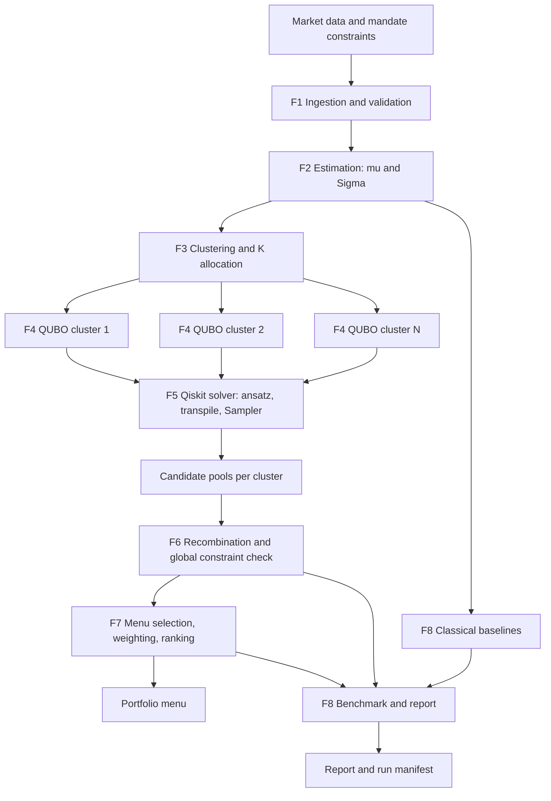
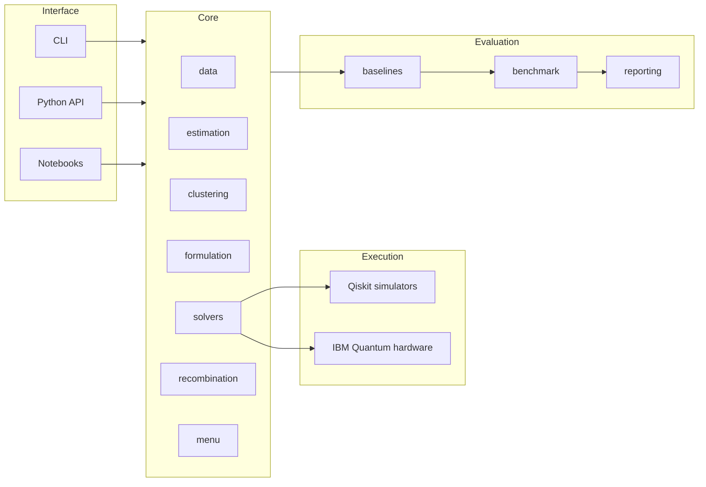

# Quantum-Sampled, Cluster-Decomposed Portfolio Engine — Feature Specification

| Field | Value |
|---|---|
| **Working name** | QPortfolio Engine (placeholder, rename freely) |
| **Document type** | Feature specification — cornerstone for repository build |
| **Status** | Draft v1.0 |
| **Target quantum stack** | IBM Qiskit (Qiskit SDK, Qiskit Runtime, Qiskit Optimization / Finance / Algorithms) |
| **Audience** | Engineers, quants, product owners, reviewers, and non-experts who need to understand the idea end to end |

> **Verification note.** Qiskit package names, class names and APIs in this document are written from general knowledge, **not** verified against current official IBM documentation (the documentation libraries available while drafting did not include Qiskit). Section 22 lists every item that must be confirmed against the current Qiskit docs before implementation. Where this document says "verify", treat the statement as a working assumption.

---

## Table of Contents

1. [Executive Summary](#1-executive-summary)
2. [Background and Plain-English Primer](#2-background-and-plain-english-primer)
3. [Glossary](#3-glossary)
4. [Problem Statement](#4-problem-statement)
5. [Vision, Goals and Non-Goals](#5-vision-goals-and-non-goals)
6. [Users and Use Cases](#6-users-and-use-cases)
7. [Solution Overview](#7-solution-overview)
8. [System Architecture](#8-system-architecture)
9. [Feature Specifications](#9-feature-specifications)
10. [Mathematical Formulation](#10-mathematical-formulation)
11. [Data Model and Interfaces](#11-data-model-and-interfaces)
12. [Qiskit Technology Stack](#12-qiskit-technology-stack)
13. [Benchmarking Framework](#13-benchmarking-framework)
14. [Configuration](#14-configuration)
15. [Non-Functional Requirements](#15-non-functional-requirements)
16. [Risks and Mitigations](#16-risks-and-mitigations)
17. [Phased Delivery Plan](#17-phased-delivery-plan)
18. [Acceptance Criteria](#18-acceptance-criteria)
19. [Proposed Repository Structure](#19-proposed-repository-structure)
20. [Testing Strategy](#20-testing-strategy)
21. [Out-of-Scope and Future Work](#21-out-of-scope-and-future-work)
22. [Verification Checklist and Open Questions](#22-verification-checklist-and-open-questions)
23. [Worked Mini-Example](#23-worked-mini-example)

---

## 1. Executive Summary

**What we are building.** A software platform that helps an investment manager choose *which assets to hold* from a large universe (for example 50 stocks out of 1,000), subject to real-world rules. It does this by:

1. **Splitting** the large universe into smaller groups of related assets (**decomposition**).
2. **Solving** each small group on a quantum computer or simulator using IBM Qiskit, which naturally produces **many good answers** rather than one (**sampling**).
3. **Combining** the group answers into whole portfolios while enforcing global rules (**recombination**).
4. **Offering a menu** of several near-optimal, meaningfully different portfolios, ranked by secondary criteria such as liquidity or ESG (**diverse portfolio menu**).
5. **Proving or disproving value** by comparing every result against strong classical solvers in a built-in **benchmarking suite**.

**Why this combination.**

| Element | Reason it is included |
|---|---|
| Decomposition | Today's IBM quantum devices have on the order of 100+ noisy qubits. A 1,000-asset problem cannot be run directly, but a 20–60-asset cluster can. |
| Sampling | Quantum circuits natively output a *distribution* of answers. Investors want a menu of good options, not a single answer. |
| Benchmarking | There is no proven quantum advantage for this problem today. Honest measurement against classical methods is the only credible way to find out if and when quantum helps. |

**Honest expectation.** Classical solvers may match or beat the quantum component on pure solution quality today. The value of this platform is (a) the diversity of near-optimal choices, (b) rigorous evidence about where quantum does or does not help, and (c) readiness to scale when hardware improves.

---

## 2. Background and Plain-English Primer

This section explains the core ideas without assuming finance or quantum knowledge.

### 2.1 What is a portfolio?
A portfolio is a collection of investments (stocks, bonds, etc.). Building one means deciding **what to hold** and **how much of each**.

### 2.2 What are return, risk and covariance?
- **Expected return (μ):** the average gain we expect from an asset.
- **Risk:** how much the asset's value tends to swing. We measure it with **variance** (the spread of outcomes).
- **Covariance (Σ):** how two assets move *together*. If two stocks tend to rise and fall at the same time, they have high positive covariance. Holding both gives less protection than holding two that move independently. The **covariance matrix** Σ holds this number for every pair of assets.

### 2.3 What is portfolio optimization?
Choosing holdings to get the best trade-off between return and risk. The classic method is **Markowitz mean-variance optimization**: maximize return while penalizing risk. A parameter **λ (risk-aversion)** controls how much we care about risk versus return.

### 2.4 Why is it hard in real life?
The textbook version (any fractional weights, no extra rules) is easy. Real portfolios add rules such as:
- "Hold **exactly 30** stocks" (**cardinality constraint**).
- "No more than 25% in one **sector**" (**sector cap**).
- "Buy in blocks of 100 shares" (**lot size**).
- "Don't trade more than 10% of the portfolio" (**turnover limit**).

Rules of this kind turn the problem from smooth into **discrete**: you are choosing from a huge number of yes/no combinations. With *n* assets there are 2ⁿ possible selections. For 1,000 assets that is more combinations than atoms in the observable universe. Problems of this type are **NP-hard**: no known method solves every large instance exactly in a reasonable time.

### 2.5 What does a quantum computer have to do with it?
Some quantum algorithms are designed to search for low-"energy" configurations of a system. If we describe our portfolio problem as an energy landscape where *lower energy = better portfolio*, a quantum device can be used to explore it. The device returns **bitstrings** (e.g., `0110100…`), where each bit says whether an asset is included (1) or excluded (0). Running it many times gives a **distribution** of bitstrings, with better portfolios appearing more often.

### 2.6 Why not just use the quantum computer on everything?
Current devices are **NISQ** (Noisy Intermediate-Scale Quantum): limited qubits, errors in every operation, and short usable circuits. So we use a **hybrid** approach: classical code does the heavy preparation and assembly, and the quantum device handles small, hard core pieces.

---

## 3. Glossary

Terms are grouped by area. Each is defined in plain language.

### 3.1 Finance terms

| Term | Definition |
|---|---|
| **Asset** | A single investable item (stock, bond, ETF). |
| **Universe** | The full set of assets we are allowed to choose from. |
| **Portfolio** | A chosen set of assets, with or without weights. |
| **Weight (wᵢ)** | The fraction of total money placed in asset *i*. Weights sum to 1 (100%). |
| **Expected return (μ)** | Vector of average expected gains per asset. |
| **Covariance matrix (Σ)** | Square table of how every pair of assets moves together. Diagonal entries are each asset's own variance. |
| **Variance / Volatility** | Measure of spread of returns. Volatility is the square root of variance. |
| **Risk aversion (λ)** | Dial that sets how strongly to penalize risk relative to return. |
| **Markowitz / Mean-variance optimization** | Choosing weights to trade off expected return against variance. |
| **Cardinality (K)** | The exact number of assets to hold. |
| **Sector cap** | Limit on total allocation to one industry sector. |
| **Turnover** | How much of the portfolio changes compared with the current holdings. |
| **Lot size** | Minimum trade increment (e.g., 100 shares). |
| **Transaction cost** | Fees and market impact incurred when trading. |
| **ESG** | Environmental, Social and Governance score — a sustainability rating. |
| **Liquidity** | How easily an asset can be bought or sold without moving its price. |
| **Rebalancing** | Periodically adjusting holdings back toward targets. |
| **Efficient frontier** | The set of portfolios giving the best return for each level of risk. |
| **Sharpe ratio** | Return per unit of risk. Higher is better. |
| **VaR / CVaR** | Value at Risk / Conditional VaR — loss measures at a given confidence level. (Future work, see §21.) |

### 3.2 Optimization terms

| Term | Definition |
|---|---|
| **Objective function** | The score we are trying to minimize or maximize. |
| **Constraint** | A rule the answer must obey. |
| **Feasible solution** | A solution that satisfies all constraints. |
| **Combinatorial optimization** | Choosing the best combination from a huge discrete set. |
| **NP-hard** | A class of problems with no known efficient exact algorithm for all cases. |
| **Local optimum** | A solution that looks best among its neighbors but is not globally best. Heuristics can get stuck here. |
| **Heuristic** | A practical method that finds good (not guaranteed best) answers. |
| **Optimality gap** | How far a solution's objective is from the best known (or proven) value, usually in %. |
| **Penalty term** | Extra cost added to the objective when a constraint is violated. Used to fold constraints into the objective. |
| **Slack variable** | An extra variable used to convert an inequality constraint (≤) into an equality. Costs additional qubits. |
| **QUBO** | **Q**uadratic **U**nconstrained **B**inary **O**ptimization. Minimize xᵀQx where each xᵢ ∈ {0,1}. A standard form that quantum optimizers accept. |
| **Ising model / Hamiltonian** | Equivalent physics form of QUBO using spins ±1. A **Hamiltonian** is the function whose lowest value ("ground state") encodes the best answer. |
| **Ground state** | The lowest-energy configuration = the best solution. |
| **Simulated annealing (SA)** | A classical randomized search that mimics cooling a metal. Used as a baseline. |
| **MIP / MIQP** | Mixed-Integer (Quadratic) Programming. Classical exact/near-exact solvers (e.g., Gurobi, CPLEX, SCIP) handle these. |
| **Beam search** | A search that keeps only the top-N partial solutions at each step. |

### 3.3 Quantum computing terms

| Term | Definition |
|---|---|
| **Qubit** | Quantum bit. Unlike a classical bit (0 or 1) it can be in a combination of both until measured. |
| **Superposition** | A qubit being in a combination of 0 and 1 states simultaneously. |
| **Entanglement** | A link between qubits so their outcomes are correlated. |
| **Measurement** | Reading qubits, which collapses them to 0/1. Produces one bitstring per run. |
| **Shot** | One run-and-measure of a circuit. We use many shots (e.g., 4,096) to build a distribution. |
| **Gate** | A basic operation on qubits. |
| **Quantum circuit** | A sequence of gates ending in measurement. |
| **Circuit depth** | Number of sequential gate layers. Deeper = more error on noisy hardware. |
| **Ansatz** | The circuit template with adjustable parameters used by variational algorithms. |
| **Variational algorithm** | Hybrid loop: classical optimizer tunes circuit parameters; quantum device evaluates them. |
| **QAOA** | Quantum Approximate Optimization Algorithm. Alternates a *cost* layer (encodes the problem) with a *mixer* layer (explores alternatives), repeated *p* times. |
| **VQE** | Variational Quantum Eigensolver. Finds the lowest-energy state of a Hamiltonian using a variational loop. |
| **Mixer** | The part of QAOA that moves probability between candidate solutions. |
| **Layers (p)** | Number of cost+mixer repetitions in QAOA. More layers = potentially better, but deeper circuits. |
| **NISQ** | Noisy Intermediate-Scale Quantum — today's era of hardware. |
| **Noise** | Errors in qubits and gates that corrupt results. |
| **Error mitigation / suppression** | Techniques that reduce the effect of noise without full error correction. |
| **Transpilation** | Rewriting a circuit to fit a specific device's gates and qubit connections. |
| **Qubit connectivity / heavy-hex** | Which qubits can interact directly. IBM devices use a heavy-hexagon layout. |
| **Backend** | A target for running circuits: real hardware (QPU) or a simulator. |
| **QPU** | Quantum Processing Unit — the actual quantum chip. |
| **Primitive** | Qiskit's high-level execution interface. **Sampler** returns bitstring distributions; **Estimator** returns expectation values. |
| **Session / Batch** | Runtime modes for grouping multiple jobs on hardware (verify current modes). |
| **Quantum advantage** | A quantum method outperforming the best classical method on a meaningful task. Not established for this problem today. |
| **Quantum-inspired** | Classical algorithms borrowing ideas from quantum methods; used here as baselines. |

### 3.4 Platform-specific terms (used in this spec)

| Term | Definition |
|---|---|
| **Cluster** | A group of assets that tend to move together, produced by clustering the correlation matrix. |
| **Sub-problem** | The QUBO for one cluster. |
| **Candidate pool** | The set of good bitstrings (partial portfolios) sampled for one cluster. |
| **Master step / Recombination** | Classical stage that picks one candidate per cluster and checks global rules. |
| **Portfolio menu** | The final shortlist of distinct, near-optimal portfolios presented to the user. |
| **Diversity** | How different menu portfolios are from each other (measured by Jaccard or Hamming distance). |
| **ε-band (epsilon band)** | Tolerance: only portfolios within ε of the best objective value qualify for the menu. |
| **Two-stage weighting** | Stage 1 picks *which* assets (binary). Stage 2 sets *how much* of each (continuous). |
| **Baseline** | A classical method run on the same input for comparison. |
| **Run manifest** | A record of every input, parameter, version, seed and backend used for a run, for reproducibility. |

---

## 4. Problem Statement

**Given**
- A universe of *N* assets (target scale: 100 to 5,000).
- Expected returns μ and covariance matrix Σ (estimated from historical data or supplied).
- Constraints: cardinality K, sector caps, optional turnover limit versus current holdings, optional exclusions and inclusions, optional ESG/liquidity thresholds.

**Produce**
- A **menu of M distinct portfolios** (default M = 10) that are each feasible, are within ε of the best objective found, and differ meaningfully from one another.
- A **benchmark report** stating how those portfolios compare with those from classical solvers on quality, diversity, runtime and cost.

**Why existing tools fall short**
- Classical heuristics typically return one answer, and can get stuck in local optima as constraints multiply.
- Quantum demos typically map the whole problem onto a device, which only works at toy scale (< ~100 assets), and rarely compare fairly against strong classical baselines.

---

## 5. Vision, Goals and Non-Goals

### 5.1 Vision
Be the reference open implementation of a *hybrid, decomposed, sampling-first* quantum portfolio workflow, with measurement built in so claims are evidence-based.

### 5.2 Goals

| ID | Goal |
|---|---|
| G1 | Solve realistic-size universes (up to ~5,000 assets in the decomposed path) by fitting sub-problems onto available qubits. |
| G2 | Produce a menu of diverse near-optimal portfolios, not a single answer. |
| G3 | Run end to end on Qiskit simulators and on IBM Quantum hardware with the same code path. |
| G4 | Include strong classical baselines and a fair, reproducible benchmark. |
| G5 | Make every run reproducible and auditable (run manifest). |
| G6 | Be modular so any component (clusterer, solver, recombiner, ranker) can be swapped. |

### 5.3 Non-Goals (v1)
- Not a trading system; no order execution or live market connectivity.
- Not investment advice; outputs are decision support only.
- Not a claim of quantum advantage.
- No fault-tolerant / error-corrected algorithms (e.g., amplitude estimation for VaR) in v1.
- No proprietary market data bundled; data is user-supplied or from open sources.

---

## 6. Users and Use Cases

### 6.1 Personas

| Persona | Needs |
|---|---|
| **Portfolio manager** | A shortlist of good portfolios that satisfy mandate rules, with explanations. |
| **Quant researcher** | Control over formulation, solver settings and reproducible experiments. |
| **Quantum developer** | Clear interfaces to swap ansatz, backend, mitigation settings. |
| **Risk / compliance reviewer** | Auditable runs and constraint-satisfaction proof. |
| **Innovation / strategy lead** | Evidence on whether quantum is adding value. |

### 6.2 Primary use cases

| ID | Use case | Outcome |
|---|---|---|
| UC1 | **Generate a menu** of portfolios for a universe and mandate | Ranked list of M feasible, diverse portfolios |
| UC2 | **Benchmark** quantum vs. classical on a defined problem set | Report with quality, diversity, time, cost |
| UC3 | **Scale test** by growing N and observing cluster/qubit demand | Scaling curves |
| UC4 | **Reproduce** a past run from its manifest | Identical (or statistically equivalent) results |
| UC5 | **Swap a component** (e.g., change clusterer or solver) and compare | A/B comparison |

---

## 7. Solution Overview

The pipeline has **eight stages**.

| # | Stage | Type | One-line description |
|---|---|---|---|
| 1 | Data ingestion and validation | Classical | Load and clean prices/returns/constraints |
| 2 | Estimation | Classical | Compute μ and Σ, with shrinkage for stability |
| 3 | Clustering and decomposition | Classical | Split universe into qubit-sized clusters; allocate K across clusters |
| 4 | QUBO construction | Classical | Build one QUBO per cluster (constraints as penalties) |
| 5 | Quantum sampling | **Quantum** | Run QAOA (or alternative) via Sampler; collect candidate pools |
| 6 | Recombination (master step) | Classical | Combine cluster candidates into full portfolios; enforce global rules |
| 7 | Menu selection, weighting and ranking | Classical | Pick diverse near-optimal set; set weights; rank by secondary criteria |
| 8 | Benchmarking and reporting | Classical | Compare against baselines; produce report and manifest |

Quantum computing is used **only in stage 5**. Everything else is classical, and this is intentional: it keeps the quantum part small enough to run on today's hardware.

---

## 8. System Architecture

### 8.1 Pipeline diagram



### 8.2 Component layers



### 8.3 Design principles
1. **Quantum is a pluggable solver, not the architecture.** The solver interface also accepts classical solvers, which makes fair comparison easy.
2. **Same code path for simulator and hardware.** Only the backend object changes.
3. **Deterministic where possible.** Seeds recorded; non-determinism (hardware noise) is acknowledged in the manifest.
4. **Fail loudly on infeasibility.** Never silently return a portfolio that violates a hard constraint.
5. **Everything is measured.** Each stage logs time, size and quality metrics.

---

## 9. Feature Specifications

Each feature has: purpose, inputs, outputs, behavior, and requirements. Requirement IDs (e.g., F3-R2) are for traceability into issues and tests. Priority: **M** = must, **S** = should, **C** = could.

### F1 — Data Ingestion and Validation

**Purpose.** Bring asset and constraint data into a clean, validated internal format.

**Inputs**
- Price or return time series (CSV/Parquet) for N assets.
- Asset metadata: sector, liquidity measure, ESG score (optional), current holdings (optional).
- Mandate configuration (see §14).

**Outputs**
- Validated `Universe` object (see §11).

**Requirements**

| ID | Requirement | Pri |
|---|---|---|
| F1-R1 | Load CSV and Parquet; schema-validate columns and types. | M |
| F1-R2 | Handle missing values via configurable policy (drop, forward-fill, or reject above a threshold). | M |
| F1-R3 | Detect and report assets with insufficient history. | M |
| F1-R4 | Provide a synthetic data generator (seeded) for tests and demos. | M |
| F1-R5 | Provide an adapter for open data sources (e.g., public price datasets). Qiskit Finance data providers may be used (verify). | S |
| F1-R6 | Reject inconsistent constraints at load time (e.g., K larger than N, sector caps that cannot sum to 100%). | M |

### F2 — Estimation of Returns and Covariance

**Purpose.** Produce μ and Σ that are stable enough to optimize on.

**Why it matters.** Raw sample covariance matrices from limited data are noisy, and optimizers tend to exploit that noise ("error maximization"). Stable estimates are essential for any solver.

**Requirements**

| ID | Requirement | Pri |
|---|---|---|
| F2-R1 | Compute sample mean returns and sample covariance. | M |
| F2-R2 | Offer **shrinkage** covariance estimators (e.g., Ledoit-Wolf). | M |
| F2-R3 | Ensure Σ is symmetric positive semi-definite; repair if not. | M |
| F2-R4 | Allow user-supplied μ and Σ to bypass estimation. | M |
| F2-R5 | Annualization options (daily → annual). | S |
| F2-R6 | Optional robust μ (e.g., shrink toward a common mean). | C |

### F3 — Clustering and Decomposition

**Purpose.** Split the universe into clusters small enough for the quantum device and decide how many assets to pick from each.

**Key idea.** Assets that move together are grouped. Within a cluster, interactions are strong, so solving it jointly matters. Between clusters, interactions are weaker, so handling them in a later classical step loses less.

**Inputs.** Σ (or correlation matrix), universe metadata, `max_cluster_size` (qubit budget), K.

**Outputs.** List of `Cluster` objects and a K-allocation (see below).

**Behavior**
1. Convert covariance to correlation, then to a distance (e.g., `d = sqrt((1 − ρ)/2)`).
2. Cluster with a pluggable method: hierarchical (default), spectral, or k-means on embeddings.
3. Enforce `max_cluster_size`; split oversized clusters recursively.
4. Optionally keep sector-homogeneous clusters to make sector caps easier to enforce.
5. **K allocation.** Decide a target number of picks K_c for each cluster so that ΣK_c = K. Default: proportional to cluster size, adjusted by cluster risk-adjusted attractiveness. Also generate neighbor allocations (K_c ± δ) so the recombiner can explore (see F6).

**Requirements**

| ID | Requirement | Pri |
|---|---|---|
| F3-R1 | Hierarchical clustering as default. | M |
| F3-R2 | Spectral clustering as an alternative. | S |
| F3-R3 | Hard cap on cluster size = qubit budget (including slack qubits, see F4). | M |
| F3-R4 | Report cluster quality: intra-cluster vs. inter-cluster correlation, and the share of total covariance "cut" by the split. | M |
| F3-R5 | Support K allocation strategies: proportional, risk-aware, and user-specified. | M |
| F3-R6 | Pluggable `Clusterer` interface. | M |
| F3-R7 | Deterministic given a seed. | M |

### F4 — QUBO Construction

**Purpose.** Convert each cluster sub-problem into a QUBO (and its Ising form) that Qiskit can consume.

**Behavior**
- One binary variable per asset in the cluster (1 = pick).
- Quadratic term from Σ (risk), linear term from μ (return).
- **Cardinality** for the cluster, `Σxᵢ = K_c`, as a penalty.
- **Local constraints** (exclusions, inclusions) by fixing variables.
- **Inequality constraints** (e.g., sector caps) are handled by one of: penalty with slack variables, enforcement during recombination (default), or both. See §10.4.
- Automatic **penalty weight selection** and validation.

**Requirements**

| ID | Requirement | Pri |
|---|---|---|
| F4-R1 | Build QUBO as a Qiskit Optimization `QuadraticProgram`, convertible to Ising (verify). | M |
| F4-R2 | Cardinality constraint as an equality penalty. | M |
| F4-R3 | Penalty weight calibration routine, with documented heuristic and override. | M |
| F4-R4 | Support fixed variables (forced in / forced out). | M |
| F4-R5 | Slack-variable encoding for inequalities as an option, with qubit-count reporting. | S |
| F4-R6 | Verify encoded QUBO against brute force on small instances (unit test). | M |
| F4-R7 | Export QUBO in a solver-neutral format (matrix + offset) so classical baselines use the *identical* problem. | M |
| F4-R8 | Report qubit count and coefficient range before any hardware submission. | M |

### F5 — Quantum Sampling (Qiskit Solver Layer)

**Purpose.** Obtain a pool of good candidate bitstrings per cluster.

**Core design: sampling-first.** Rather than keeping only the single best bitstring, we collect **all** sampled bitstrings above a quality threshold, along with their counts/probabilities.

**Behavior**
1. Choose an algorithm via a `Solver` interface:
   - **QAOA** (default): *p* layers (default p = 1–3).
   - **VQE** with a problem-aware ansatz (alternative).
   - Optional **warm-start** QAOA initialised from a classical relaxation (verify support).
   - Classical solvers implementing the same interface (for baselines).
2. Optimize circuit parameters with a classical optimizer (e.g., COBYLA or SPSA), with a bounded iteration budget.
3. **Transpile** for the target backend (layout and routing).
4. Execute with the **Sampler primitive** at a configured number of shots.
5. Apply configured **error suppression/mitigation** options (verify what the Runtime offers).
6. **Post-process**: decode bitstrings, discard those violating local cardinality (or repair them), compute exact objective for each candidate classically, deduplicate, keep top-M_c.

> **Important.** The objective of every candidate is **re-evaluated classically and exactly**. The device is used for *proposing* candidates, never for *scoring* the final result. This guards against noise corrupting reported quality.

**Requirements**

| ID | Requirement | Pri |
|---|---|---|
| F5-R1 | `Solver` abstract interface: input = QUBO, output = `CandidatePool`. | M |
| F5-R2 | QAOA implementation using Qiskit primitives. | M |
| F5-R3 | Backend abstraction: local simulator, noisy simulator (from a hardware noise model), IBM hardware. | M |
| F5-R4 | Configurable shots, p, optimizer, max iterations, seed. | M |
| F5-R5 | Transpile with configurable optimization level; log depth and two-qubit gate counts. | M |
| F5-R6 | Error mitigation/suppression options exposed via config. | S |
| F5-R7 | Classical re-scoring of all candidates; flag any candidate whose device-implied rank disagrees strongly with exact rank. | M |
| F5-R8 | Candidate repair: optional greedy fix-up to meet cardinality. | S |
| F5-R9 | Job management: submit, poll, retry on transient failure, record job IDs. | M |
| F5-R10 | Cost controls: configurable max QPU time and max jobs per run; abort cleanly when exceeded. | M |
| F5-R11 | Alternative solver: VQE. | C |
| F5-R12 | Warm-start variant. | C |
| F5-R13 | Parallel submission of independent cluster jobs (batch). | S |

### F6 — Recombination (Master Step)

**Purpose.** Turn independent cluster answers into complete, globally feasible portfolios and compensate for the cross-cluster covariance that clustering ignored.

**The problem.** Each cluster `c` has a pool of candidates. We must choose **one candidate per cluster** so that the combined portfolio:
- satisfies global constraints (total cardinality K, sector caps, turnover, ESG minimum);
- has the best **full** objective, including cross-cluster covariance terms.

This is a *multiple-choice selection* problem and is much smaller than the original.

**Method (default pipeline)**
1. **Exact scoring:** compute the full-universe objective for any combination (using full Σ).
2. **Search:** *beam search* over clusters (keep top-B partial combinations), or a small MIP solve when the pool size is small enough.
3. **Local polish:** optional single-asset swap local search on the best combinations to fix cut-induced errors.
4. **Constraint gate:** reject any combination violating a hard constraint.
5. Return the top-R combinations (R ≥ M) as the **recombined pool**.

**Requirements**

| ID | Requirement | Pri |
|---|---|---|
| F6-R1 | Compute exact full objective using full Σ for any combination. | M |
| F6-R2 | Beam search recombiner with configurable beam width. | M |
| F6-R3 | Enforce all hard global constraints; never emit infeasible output. | M |
| F6-R4 | Support multiple K-allocations from F3 (explore K_c ± δ). | M |
| F6-R5 | Optional swap-based local search polish. | S |
| F6-R6 | Optional exact MIP recombiner for small pools (via an open-source solver). | S |
| F6-R7 | Report **decomposition loss**: difference between recombined best and a full-problem classical best, when the latter is computable. | M |
| F6-R8 | Pluggable `Recombiner` interface. | M |

### F7 — Menu Selection, Weighting and Ranking

**Purpose.** Convert the recombined pool into the final product: a short list of distinct, good, ranked portfolios with actual weights.

**Step 1 — ε-band filter.** Keep only portfolios whose objective is within ε of the best found.

**Step 2 — Diversity selection.** Greedily choose M portfolios maximizing minimum pairwise distance (Jaccard distance on the selected-asset sets), subject to the ε-band. Default M = 10.

**Step 3 — Two-stage weighting.** The quantum/QUBO stage chose *which* assets. For each selected set, solve a small classical convex problem to assign *how much* of each (long-only, sum to 1, optional per-asset caps and sector caps). This is fast and exact for continuous weights.

**Step 4 — Secondary-criteria ranking.** Score each menu portfolio on user-defined criteria (liquidity, ESG, turnover vs. current, sector balance, client-specific preferences). Combine with configurable weights (or lexicographic order) into a final rank.

**Step 5 — Explanations.** For each portfolio: key stats (expected return, volatility, Sharpe), constraint slack, how it differs from the top-ranked one (assets added/removed).

**Requirements**

| ID | Requirement | Pri |
|---|---|---|
| F7-R1 | ε defined both as absolute and as percentage of the best objective. | M |
| F7-R2 | Greedy max-min-distance diversity selection; choose distance metric by config. | M |
| F7-R3 | Continuous weight optimization for each chosen asset set. | M |
| F7-R4 | Pluggable ranking criteria interface; built-in: liquidity, ESG, turnover, sector concentration. | M |
| F7-R5 | If fewer than M qualifying portfolios exist, return what exists and state why. | M |
| F7-R6 | Per-portfolio explanation payload. | S |
| F7-R7 | Report menu diversity statistics (mean/min pairwise distance, overlap heatmap data). | M |

### F8 — Classical Baselines and Benchmarking

Described fully in [§13](#13-benchmarking-framework). Summary of requirements:

| ID | Requirement | Pri |
|---|---|---|
| F8-R1 | Baseline set (see §13.2) run on the *same* inputs and constraints. | M |
| F8-R2 | Metrics suite (see §13.3). | M |
| F8-R3 | Benchmark problem set generator and fixed reference instances. | M |
| F8-R4 | Statistical rigor: multiple seeds, confidence intervals. | M |
| F8-R5 | Report generation (Markdown/HTML) with tables and charts. | M |
| F8-R6 | Run manifest for every run (see §11.4). | M |

### F9 — Interfaces (CLI, Python API, Notebooks)

| ID | Requirement | Pri |
|---|---|---|
| F9-R1 | Python API exposing each stage and a one-call `run_pipeline(config)`. | M |
| F9-R2 | CLI: `qportfolio run`, `qportfolio benchmark`, `qportfolio inspect`. | M |
| F9-R3 | Example notebooks: tiny end-to-end demo; clustering explorer; benchmark walkthrough. | S |
| F9-R4 | Config files in YAML with schema validation. | M |
| F9-R5 | Structured logging and progress reporting. | M |

---

## 10. Mathematical Formulation

### 10.1 The base problem (selection form)

Let *x* ∈ {0,1}ᴺ where xᵢ = 1 means asset *i* is selected. Let K be the number of assets to hold.

Minimize

```
f(x) =  λ · xᵀ Σ x  −  μᵀ x
subject to  Σᵢ xᵢ = K
```

Here a selected asset is treated with a nominal equal weight. The exact weights come later in the two-stage weighting (F7). To keep scale consistent, many implementations use the scaled version `λ · (1/K²) xᵀΣx − (1/K) μᵀx`, which corresponds to equal weights of 1/K. The spec fixes this as the **default** so that the selection stage approximates the final equal-weight portfolio objective. This choice must be documented in code.

### 10.2 Folding the cardinality constraint into a QUBO

Add a penalty `P · (Σᵢ xᵢ − K)²`.

Because xᵢ² = xᵢ for binary variables, expanding gives:

```
P · (Σᵢ xᵢ − K)²  =  P · [ Σᵢ xᵢ  +  2 Σ_{i<j} xᵢ xⱼ  −  2K Σᵢ xᵢ  +  K² ]
```

- Diagonal contribution: `P · (1 − 2K)` per asset.
- Off-diagonal contribution: `2P` per asset pair.
- Constant offset: `P · K²` (does not affect which bitstring is best).

### 10.3 Choosing the penalty weight P

- **Too small:** the solver happily returns infeasible portfolios (wrong asset count).
- **Too large:** it dominates the landscape, squashing the real signal and hurting quantum circuit performance (large coefficient ranges are harder for noisy devices).

Default heuristic: set P slightly above the largest possible objective improvement that violating the constraint by one unit could give (an upper bound derived from Σ and μ magnitudes). Calibration routine (F4-R3) then confirms on small instances via brute force that the optimum of the QUBO is feasible. Document the exact heuristic in code.

### 10.4 Handling inequality constraints

Sector cap example: `Σ_{i ∈ sector s} xᵢ ≤ C_s`.

| Option | How | Trade-off |
|---|---|---|
| **A. Enforce in recombination (default)** | Ignore in QUBO; reject or fix in F6 | No extra qubits; candidates may be wasted |
| **B. Slack variables + penalty** | Add binary slack bits so inequality becomes equality, then penalize | Extra qubits per constraint; stronger guidance |
| **C. Cluster by sector** | Make clusters sector-homogeneous so caps become a K_c allocation matter | Reduces cross-sector diversification in each sub-problem |

The spec's default is **A combined with C where possible**, and **B as an option** once qubit budget allows.

### 10.5 QUBO ↔ Ising

QUBO variable `x ∈ {0,1}` maps to a spin `s ∈ {−1,+1}` via `x = (1 − s)/2`. This turns the QUBO matrix into Ising coefficients (linear fields *h* and couplings *J*) plus a constant. The Ising form is the Hamiltonian that the QAOA cost layer encodes. Qiskit Optimization provides conversion utilities (verify).

### 10.6 QAOA in one paragraph

Start with all qubits in an equal superposition (every bitstring equally likely). Repeat *p* times: (1) apply a **cost layer** that gives each bitstring a phase proportional to its cost, using the Ising couplings; (2) apply a **mixer layer** that shuffles amplitude between neighboring bitstrings. Each layer has an adjustable angle (γₖ for cost, βₖ for mixer). A classical optimizer tunes the 2p angles so that low-cost bitstrings become likelier when measured. Finally, measure many shots to obtain the distribution.

### 10.7 Diversity metric

For two selections A and B (sets of selected assets), the **Jaccard distance** is:

```
d_J(A, B) = 1 − |A ∩ B| / |A ∪ B|
```

0 means identical, 1 means no overlap. Alternative: Hamming distance on bitstrings.

### 10.8 Objective gap

```
gap(%) = 100 · (f_found − f_best_known) / |f_best_known|
```

`f_best_known` is the best objective across all methods in a benchmark instance (or the proven optimum when an exact solver completes).

### 10.9 Two-stage weighting problem

For a selected set S:

```
minimize   λ · wᵀ Σ_S w − μ_Sᵀ w
subject to Σ w = 1,  0 ≤ wᵢ ≤ w_max,  sector and other linear constraints
```

This is a convex quadratic program solvable quickly by standard solvers.

---

## 11. Data Model and Interfaces

All types are described in language-neutral form; implement as Python dataclasses or Pydantic models.

### 11.1 Core entities

```
Asset
  id: str
  sector: str
  liquidity: float | null
  esg_score: float | null
  current_weight: float | null

Universe
  assets: list[Asset]
  mu: vector[N]
  sigma: matrix[N x N]
  metadata: dict

Mandate
  K: int
  lambda_risk: float
  sector_caps: dict[str, float]
  w_max: float
  turnover_limit: float | null
  forced_in: list[str]
  forced_out: list[str]
  min_esg: float | null

Cluster
  id: str
  asset_ids: list[str]
  K_c_options: list[int]
  quality: ClusterQuality

QUBO
  Q: matrix
  offset: float
  var_names: list[str]
  penalty_weight: float
  num_qubits: int

Candidate
  bitstring: str
  cluster_id: str
  exact_objective: float
  device_count: int | null
  feasible_local: bool

CandidatePool
  cluster_id: str
  candidates: list[Candidate]
  solver_info: dict   # algorithm, p, shots, backend, job ids, depth, 2q gates

Portfolio
  selected_ids: list[str]
  weights: dict[str, float] | null
  objective: float
  stats: {exp_return, volatility, sharpe}
  constraint_slack: dict
  rank_scores: dict
  explanation: dict

PortfolioMenu
  portfolios: list[Portfolio]
  diversity_stats: dict
  epsilon: float
```

### 11.2 Core interfaces

```
Clusterer.cluster(universe, mandate, max_cluster_size) -> (list[Cluster], KAllocation)
QuboBuilder.build(universe, cluster, K_c, mandate) -> QUBO
Solver.solve(qubo, backend, config) -> CandidatePool
Recombiner.combine(pools, universe, mandate, config) -> list[Portfolio]
MenuSelector.select(portfolios, universe, mandate, config) -> PortfolioMenu
RankingCriterion.score(portfolio, universe, mandate) -> float
Baseline.run(universe, mandate, config) -> list[Portfolio]
```

### 11.3 Output artifacts

| Artifact | Format | Content |
|---|---|---|
| Portfolio menu | JSON + CSV | Selected assets, weights, stats, rank, explanation |
| Benchmark report | Markdown + HTML | Tables, charts, conclusions |
| Run manifest | JSON | See below |
| Raw sampling data | Parquet/JSON | Bitstring counts per cluster per run |

### 11.4 Run manifest (reproducibility)

Must include: git commit, package versions (including Qiskit components), config (full), random seeds, input data hash, backend name and calibration snapshot identifier (for hardware), job IDs, transpile statistics, timings, and QPU time used.

---

## 12. Qiskit Technology Stack

> All items below are **to be verified** against current official Qiskit/IBM Quantum documentation before implementation (see §22).

| Layer | Component (working assumption) | Role |
|---|---|---|
| Core SDK | `qiskit` | Circuits, transpiler, quantum info |
| Optimization | `qiskit-optimization` | `QuadraticProgram`, QUBO conversion, penalty handling |
| Finance | `qiskit-finance` | Portfolio problem helpers and data providers. Check maintenance status; fallback is our own formulation (we need it anyway for cluster sub-problems) |
| Algorithms | `qiskit-algorithms` | QAOA, VQE, classical optimizers. Check compatibility with current primitives |
| Runtime | `qiskit-ibm-runtime` | Sampler (V2) and Estimator for hardware; session/batch execution; mitigation options |
| Simulation | `qiskit-aer` | Fast local and noisy simulation |
| Optional | Qiskit Functions | IBM/partner optimization services; evaluate if available, as they could replace parts of F5 |

**Classical stack**

| Need | Suggested tool |
|---|---|
| Numerics | NumPy, SciPy |
| Data | pandas, pyarrow |
| Covariance shrinkage | scikit-learn |
| Clustering | SciPy hierarchy, scikit-learn |
| Convex weighting | cvxpy or SciPy |
| Exact baselines | OR-Tools / SCIP / HiGHS (open-source); Gurobi/CPLEX optional if licensed |
| Config | Pydantic + YAML |
| Testing | pytest, hypothesis |
| Packaging | pyproject.toml; Python version per Qiskit's supported range (verify) |

---

## 13. Benchmarking Framework

### 13.1 Why built in
Without a fair comparison, "quantum portfolio optimization" is only a claim. The benchmark suite makes the platform's central question testable: **does the quantum sampler add value over classical alternatives, and where?**

### 13.2 Baselines

| Baseline | Purpose |
|---|---|
| **Equal-weight / naive** | Sanity floor |
| **Greedy selection** | Simple heuristic reference |
| **Exact MIQP (small N)** | True optimum for ground truth; may time out at large N |
| **MIQP with time limit (large N)** | Practical strong classical competitor |
| **Simulated annealing on the identical QUBO** | Classical analogue of the same formulation |
| **Decomposed + classical sub-solver** | Same pipeline with the quantum step replaced by SA/exact on each cluster. **This isolates the quantum contribution** |
| **Multi-restart classical sampler** | Fair comparison for the sampling/diversity claim: classical methods can also produce many solutions |
| **Quantum-inspired solver (optional)** | Reference for hardware-free "quantum-style" methods |

The **"decomposed + classical sub-solver"** and **"multi-restart classical sampler"** baselines are the most important. Without them, any benefit from decomposition or diversity could be wrongly credited to quantum.

### 13.3 Metrics

| Category | Metric |
|---|---|
| **Quality** | Objective value; optimality gap (§10.8); feasibility rate |
| **Diversity** | Mean/min pairwise Jaccard distance across the menu; number of distinct portfolios inside ε-band |
| **Efficiency** | Wall-clock time per stage; QPU seconds; number of jobs; shots |
| **Scale** | Qubits per cluster; circuit depth; two-qubit gate count; number of clusters |
| **Decomposition** | Decomposition loss (F6-R7); cut covariance share (F3-R4) |
| **Robustness** | Variance across seeds; sensitivity to λ, K, penalty weight |
| **Noise impact** | Quality on ideal simulator vs. noisy simulator vs. hardware |
| **Cost** | Estimated monetary or credit cost per run |

### 13.4 Benchmark instance families

| Family | Description | Sizes (N) |
|---|---|---|
| **S — Synthetic factor model** | Seeded generator with controllable correlation structure | 20, 50, 100, 500, 1000, 5000 |
| **R — Real/public** | Public equity data (user-supplied or open data) | 50, 100, 500 |
| **C — Constrained** | Same as above with sector caps, turnover, ESG | as above |
| **H — Hard** | Dense, highly correlated universes designed to defeat greedy methods | 50, 100 |

Fixed reference instances (with seeds and expected best-known values) are checked into the repository so results are comparable over time.

### 13.5 Experimental protocol
1. For each instance and each method, run at least 10 seeds (fewer on hardware; document the count).
2. Report mean, median, and 95% confidence interval for each metric.
3. Always include ideal simulator, noisy simulator and (when available) hardware runs for the same instance.
4. Record all in the run manifest.
5. Never report a single best run; always report distributions.

### 13.6 Report contents
- Summary table: method × metric.
- Plots: gap vs. N; diversity vs. method; runtime vs. N; qubits needed vs. N.
- A plain-language **verdict section** stating where quantum did, did not, or could not be evaluated as helpful. This must be written to be honest even when the answer is unfavorable.

---

## 14. Configuration

Example YAML (illustrative; the schema will be finalized in code):

```yaml
run:
  name: demo-equity-1000
  seed: 42
  output_dir: outputs/demo-equity-1000

data:
  source: parquet
  path: data/equities_1000.parquet
  min_history_days: 500
  missing_policy: forward_fill

estimation:
  covariance: ledoit_wolf
  annualize: true

mandate:
  K: 50
  lambda_risk: 3.0
  w_max: 0.06
  sector_caps:
    Technology: 0.25
    Energy: 0.10
  turnover_limit: 0.20
  min_esg: null
  forced_in: []
  forced_out: []

decomposition:
  clusterer: hierarchical
  max_cluster_size: 30
  k_allocation: risk_aware
  k_neighbor_delta: 1

qubo:
  inequality_handling: recombination   # recombination | slack
  penalty_weight: auto

solver:
  algorithm: qaoa
  p_layers: 2
  optimizer: cobyla
  max_iterations: 100
  shots: 4096
  top_candidates_per_cluster: 50
  backend:
    type: simulator          # simulator | noisy_simulator | ibm_hardware
    name: aer
  mitigation:
    enabled: false
  limits:
    max_qpu_seconds: 600
    max_jobs: 200

recombination:
  method: beam
  beam_width: 200
  local_polish: true

menu:
  size: 10
  epsilon_pct: 2.0
  distance: jaccard
  ranking:
    method: weighted
    weights:
      liquidity: 0.4
      esg: 0.3
      turnover: 0.3

benchmark:
  enabled: true
  baselines: [equal_weight, greedy, miqp_timelimit, sa_qubo, decomposed_classical, multistart_classical]
  seeds: 10
```

**Secrets.** IBM Quantum credentials (API key / instance) must **never** live in config files or the repository. Use environment variables or a secrets manager. This is a hard requirement.

---

## 15. Non-Functional Requirements

| ID | Category | Requirement |
|---|---|---|
| NFR1 | **Reproducibility** | Same config + seed + simulator = identical results. Hardware runs record everything needed for audit. |
| NFR2 | **Modularity** | Each stage replaceable via its interface without touching others. |
| NFR3 | **Performance** | Classical stages (F1–F4, F6–F7) for N = 1,000 complete in minutes on a laptop. Quantum stage time is dominated by queue and shot time and is reported separately. |
| NFR4 | **Scalability** | Architecture supports N up to 5,000 via decomposition; clusters are processed independently and can run in parallel. |
| NFR5 | **Cost control** | Hard limits on QPU time and job count; dry-run mode that prints expected qubits, depth, shots and estimated cost without submitting. |
| NFR6 | **Security** | No credentials in code, config or logs; dependency vulnerability scanning in CI. |
| NFR7 | **Auditability** | Run manifest is mandatory. Final portfolios carry constraint-satisfaction proofs (computed slack values). |
| NFR8 | **Correctness** | No infeasible portfolio is ever emitted as "feasible". Exact classical re-scoring of all outputs. |
| NFR9 | **Observability** | Structured logs; per-stage timings; failure reasons. |
| NFR10 | **Portability** | Linux/macOS; containerized via Docker for reproducible environment. |
| NFR11 | **Documentation** | Every public interface documented; this spec kept in sync with code. |
| NFR12 | **Code quality** | Type hints, linting, formatting, ≥ 85% line coverage on core modules. |
| NFR13 | **Licensing** | All dependencies' licenses reviewed; compatible with the intended repository license. |
| NFR14 | **Financial disclaimer** | README and report footer state outputs are not investment advice. |

---

## 16. Risks and Mitigations

| # | Risk | Likelihood | Impact | Mitigation |
|---|---|---|---|---|
| R1 | **Penalty tuning** is hard; wrong P gives infeasible or flattened results | High | High | Calibration routine (F4-R3), brute-force validation tests, report coefficient range |
| R2 | **Hardware noise** destroys QAOA signal at depth | High | High | Shallow p, small clusters, error mitigation, noisy-simulator tests first, exact classical re-scoring |
| R3 | **Decomposition loses cross-cluster structure** | Medium | Medium | Cut-covariance reporting, K-neighbor exploration, swap polish, decomposition loss metric |
| R4 | **Classical baselines win** on quality | High | Medium | Expected possibility. Value then lies in diversity, benchmark evidence and readiness. Verdict section reports honestly |
| R5 | **Classical samplers match the diversity claim** | Medium | Medium | Include multi-restart classical sampler baseline; do not claim diversity as a quantum win unless measured |
| R6 | **Qiskit API churn** breaks code | Medium | Medium | Pin versions, adapter layer, CI against pinned and latest versions |
| R7 | **QPU queue time and cost** | High | Medium | Batching, dry-run mode, QPU budget limits, simulator-first workflow |
| R8 | **Barren plateaus / optimizer stalls** in variational training | Medium | Medium | Small p, good initialization, bounded iterations, multiple restarts |
| R9 | **Sampling not concentrating** on good bitstrings | Medium | Medium | More shots, larger candidate keep-count, post-sample classical local search on candidates |
| R10 | **Covariance estimation noise** dominates everything | High | High | Shrinkage (F2), sensitivity analysis in benchmarks |
| R11 | **Data licensing** for real market data | Medium | Low | Synthetic generator and open data as defaults |
| R12 | **Misinterpretation** as investment advice or proven quantum advantage | Medium | High | Disclaimers, verdict section, documentation tone |
| R13 | **Qubit budget exceeded** when slack variables used | Medium | Medium | Report qubit count pre-flight; fall back to recombination-time enforcement |

---

## 17. Phased Delivery Plan

Indicative durations assume a small team (2–4 engineers); adjust to capacity.

### Phase 0 — Foundations (week 0–1)
- Repository scaffolding, CI, packaging, pinned environment.
- Verify Qiskit stack (§22) and record the actual versions.
- **Exit:** CI green; versions verified and recorded.

### Phase 1 — Classical baseline and formulation (weeks 1–3)
- F1, F2, F4 (QUBO build + brute-force validation), classical baselines (F8 subset), synthetic generator.
- Qiskit simulators on 10–20 assets to validate the formulation.
- **Exit:** QUBO optimum verified equal to brute-force optimum on small instances; baselines produce portfolios.

### Phase 2 — Decomposition and recombination (weeks 4–6)
- F3 clustering and K allocation, F5 on simulators (≤ ~30 qubits per cluster), F6 recombination, F7 menu and weighting.
- **Exit:** End-to-end pipeline runs for N = 500 on simulators; decomposition loss reported.

### Phase 3 — Hardware (weeks 7–10)
- Backend abstraction for IBM hardware, transpilation, error mitigation, job management, cost limits.
- Noisy simulator studies, then hardware runs on a reduced set of instances.
- **Exit:** Documented hardware runs with manifests; noise-impact analysis.

### Phase 4 — Benchmarking and report (weeks 11–12)
- Full benchmark protocol (§13.5), report generator, verdict section.
- **Exit:** Published internal benchmark report across instance families.

### Phase 5 — Hardening (week 13+)
- Docs, notebooks, Docker image, coverage targets, example datasets, release v0.1.

```mermaid
gantt
    title Indicative delivery timeline
    dateFormat  X
    axisFormat  W%s
    section Foundations
    Phase 0 Scaffolding and verification :0, 1
    section Core
    Phase 1 Baseline and QUBO :1, 3
    Phase 2 Decomposition and recombination :4, 3
    section Hardware
    Phase 3 Hardware integration :7, 4
    section Evidence
    Phase 4 Benchmarking and report :11, 2
    section Release
    Phase 5 Hardening :13, 2
```



---

## 18. Acceptance Criteria

The v1 release is accepted when **all** of the following hold.

| ID | Criterion |
|---|---|
| AC1 | For N ≤ 20, the QUBO optimum (brute force) equals the best feasible portfolio found by the exact classical baseline. |
| AC2 | On a simulator, the full pipeline runs end to end on at least one N ≥ 500 instance and produces a menu of M portfolios, all feasible. |
| AC3 | No emitted portfolio violates any hard constraint (automated check on all benchmark runs). |
| AC4 | The menu satisfies the ε-band and has min pairwise Jaccard distance ≥ a configured threshold (default 0.1), or the report explains why not. |
| AC5 | The pipeline runs on at least one real IBM Quantum backend for at least one reduced instance, with a complete run manifest. |
| AC6 | The benchmark report includes all mandatory baselines (§13.2) with distributions over seeds. |
| AC7 | The report contains the verdict section described in §13.6. |
| AC8 | Dry-run mode prints qubits, depth, shots and cost estimates without submitting any job. |
| AC9 | A run can be reproduced from its manifest on a simulator. |
| AC10 | No credentials in repository history (secret scan passes). |
| AC11 | Documentation lets a new engineer run the demo in under 30 minutes. |

---

## 19. Proposed Repository Structure

```
qportfolio/
├── README.md
├── LICENSE
├── pyproject.toml
├── Dockerfile
├── docs/
│   ├── FEATURE_SPEC.md              # this document
│   ├── architecture.md
│   ├── glossary.md
│   ├── formulation.md
│   ├── benchmarking.md
│   └── runbooks/
│       ├── running_on_ibm_quantum.md
│       └── adding_a_new_solver.md
├── configs/
│   ├── demo_small.yaml
│   ├── demo_1000.yaml
│   └── benchmark_full.yaml
├── data/
│   ├── README.md                    # data sourcing and licensing notes
│   └── reference_instances/         # fixed seeded benchmark instances
├── src/qportfolio/
│   ├── __init__.py
│   ├── config/                      # schemas, loading, validation
│   ├── data/                        # F1: ingestion, synthetic generator
│   ├── estimation/                  # F2: mu, Sigma, shrinkage
│   ├── clustering/                  # F3: clusterers, K allocation, quality
│   ├── formulation/                 # F4: QUBO builder, penalty calibration
│   ├── solvers/                     # F5
│   │   ├── base.py                  # Solver interface
│   │   ├── qaoa.py
│   │   ├── vqe.py
│   │   ├── classical_sa.py
│   │   ├── classical_exact.py
│   │   └── backends.py              # simulator / noisy / IBM hardware
│   ├── recombination/               # F6: beam search, MIP, polish
│   ├── menu/                        # F7: epsilon band, diversity, weighting, ranking
│   ├── baselines/                   # F8: baseline runners
│   ├── benchmark/                   # F8: instances, metrics, protocol
│   ├── reporting/                   # F8: tables, plots, verdict
│   ├── manifest/                    # run manifest and reproducibility
│   ├── cli/                         # F9
│   └── utils/
├── notebooks/
│   ├── 01_tiny_end_to_end.ipynb
│   ├── 02_clustering_explorer.ipynb
│   └── 03_benchmark_walkthrough.ipynb
├── tests/
│   ├── unit/
│   ├── integration/
│   ├── property/                    # hypothesis-based tests
│   └── hardware/                    # opt-in, excluded from default CI
├── scripts/
└── .github/workflows/               # CI: lint, type check, tests, secret scan
```

---

## 20. Testing Strategy

| Level | Focus | Examples |
|---|---|---|
| **Unit** | Each function in isolation | QUBO coefficients match hand calculations; Jaccard distance; PSD repair |
| **Property-based** | Invariants over random inputs | Any emitted portfolio has exactly K assets; menu diversity ≥ threshold; Σ remains PSD |
| **Correctness vs. brute force** | Small N ground truth | QUBO optimum equals exhaustive-search optimum for N ≤ 20 |
| **Integration** | Stage-to-stage contracts | Cluster → QUBO → Solver → Recombiner → Menu on synthetic data |
| **Regression** | Fixed reference instances | Best-known objective not degraded beyond tolerance across commits |
| **Statistical** | Stochastic components | QAOA on simulator reaches target gap in ≥ X% of seeds |
| **Hardware (opt-in)** | Real devices | Smoke tests on tiny instances; tagged and excluded from default CI |
| **Security** | Secrets and dependencies | Secret scanning; dependency audit |

---

## 21. Out-of-Scope and Future Work

| Item | Notes |
|---|---|
| Quantum risk analysis (VaR / CVaR via amplitude estimation) | Needs fault-tolerant-scale hardware for real benefit; separate module later |
| Quantum scenario generation (generative models for return distributions) | Research-stage; candidate for a later module |
| Multi-period / dynamic rebalancing | Extend formulation with time index |
| Privacy-preserving / blind quantum computation | Research dependency |
| Transaction cost and market impact modeling | Add to objective in v2 |
| ESG/climate multi-objective optimization | Extend ranking to true multi-objective |
| Warm-start and advanced ansätze | After v1 benchmarks identify gains |
| Web UI / dashboard | Not in v1 |
| Live data integrations | Not in v1 |
| Larger-scale quantum solver strategies (e.g., circuit cutting, other decomposition) | Evaluate once hardware improves |

---

## 22. Verification Checklist and Open Questions

### 22.1 Items to verify against current official Qiskit / IBM Quantum documentation

| # | Item |
|---|---|
| V1 | Exact current package names, supported Python versions, and mutually compatible versions of `qiskit`, `qiskit-optimization`, `qiskit-finance`, `qiskit-algorithms`, `qiskit-aer`, `qiskit-ibm-runtime`. |
| V2 | Whether `qiskit-finance` and `qiskit-algorithms` are actively maintained and compatible with the current primitives (SamplerV2). If not, which parts must be implemented in-house. |
| V3 | Current QAOA implementation path with V2 primitives (library class vs. custom circuit), and how to extract full bitstring distributions rather than only the best. |
| V4 | Runtime execution modes available (job / batch / session), their availability on the chosen IBM plan, and queue/cost characteristics. |
| V5 | Available error suppression and mitigation options on the Sampler and their effect on sampling workloads. |
| V6 | Hardware: available backends, qubit counts, connectivity, and calibration data access; how to build a noisy simulator from a hardware noise model. |
| V7 | QUBO → Ising conversion utilities and their sign/offset conventions. |
| V8 | Whether Qiskit Functions (optimization services) are available to the project and what they offer. |
| V9 | Credential handling best practice and account/instance configuration. |
| V10 | Warm-start QAOA support and any known limitations. |

### 22.2 Open product questions

| # | Question | Impact |
|---|---|---|
| Q1 | Which data and universe will the first demo use (open data vs. internal)? | F1, benchmark family R |
| Q2 | Do selected assets need non-equal weights in the QUBO stage, or is the two-stage approach sufficient? | F4, F7 |
| Q3 | What is the target IBM plan and QPU time budget? | F5 limits, Phase 3 scope |
| Q4 | Which exact classical solvers are permitted (open-source only vs. commercial licenses)? | F8 baselines |
| Q5 | Who is the primary audience for the first report (technical vs. executive)? | F8 reporting style |
| Q6 | Is long-only the only supported mode in v1, or are shorts needed? | Formulation (shorts need ternary encoding) |
| Q7 | Preferred repository name, license and hosting? | Phase 0 |
| Q8 | Target cluster size / qubit budget given the chosen backend? | F3, F4 |

---

## 23. Worked Mini-Example

A tiny, fully traceable example of how the pieces fit. Numbers are illustrative.

**Universe.** Six assets A–F, K = 3, two natural clusters from correlation: {A, B, C} and {D, E, F}.

**Step 1–2 (data, estimation).** Compute μ and Σ. Suppose A, B, C are highly correlated tech stocks and D, E, F are weakly correlated with each other and with the first group.

**Step 3 (clustering).** Cluster 1 = {A, B, C}, Cluster 2 = {D, E, F}. K allocation: K₁ = 1, K₂ = 2 (cluster 1 is internally redundant, so we want fewer picks there). Neighbor allocations (K₁=2, K₂=1) and (K₁=0, K₂=3) are also kept for exploration.

**Step 4 (QUBO).** For cluster 2 with K₂ = 2, three binary variables (x_D, x_E, x_F). The objective includes risk terms from Σ restricted to {D,E,F}, return terms from μ, and the penalty `P·(x_D + x_E + x_F − 2)²`.

**Step 5 (quantum sampling).** A 3-qubit QAOA circuit is run for, say, 4,096 shots. Result might be: `110` (D,E) 38%, `101` (D,F) 29%, `011` (E,F) 21%, others 12%. The pool for cluster 2 keeps the three feasible bitstrings with their exact classical objectives.

**Step 6 (recombination).** Cluster 1 pool (K₁ = 1): {A}, {B}, {C}. Combine each cluster-1 candidate with each cluster-2 candidate (9 combinations here). Score each with the **full** Σ (including A–D cross terms). Keep those satisfying K = 3 and any sector cap.

**Step 7 (menu).** Suppose six combinations lie within ε of the best. Choose the three most different from one another by Jaccard distance. For each, solve the small weighting problem to set actual weights. Rank by liquidity and ESG.

**Step 8 (benchmark).** Brute force over all C(6,3) = 20 subsets confirms the true optimum. Compare: did the pipeline find it? How many of the top-5 true portfolios did it surface? Report in the benchmark table.

This same flow, at N = 1,000, K = 50, with clusters of ~30 assets, is the product.

---

*End of specification. Keep this document under version control and update it alongside the code; any deviation in implementation should be reflected here or recorded as an explicit decision.*
