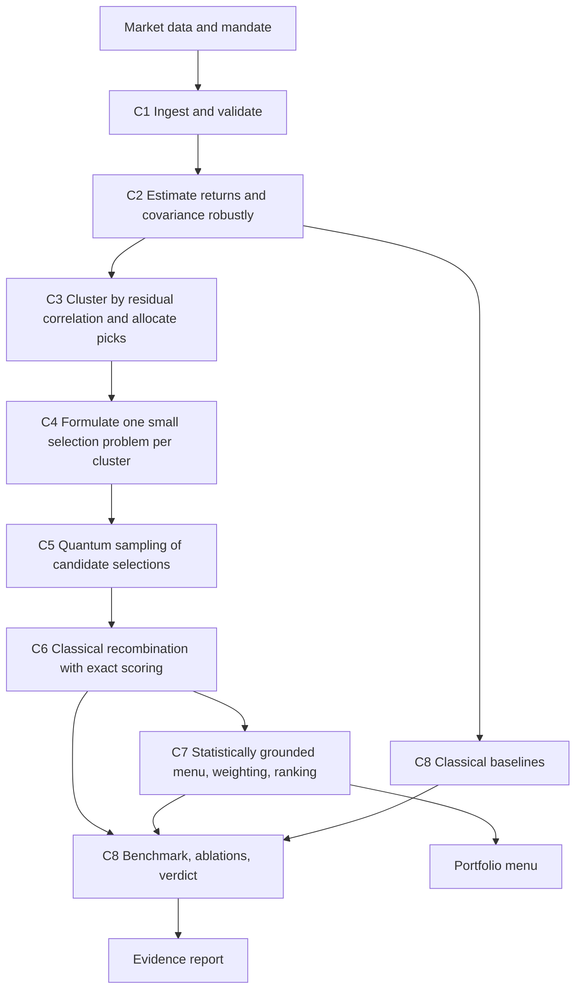
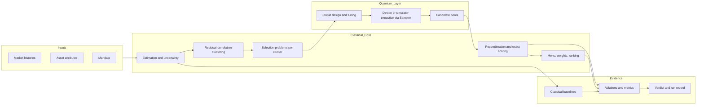

# Quantum-Sampled, Cluster-Decomposed Portfolio Selection — Idea Specification and Research Rationale

| Field | Value |
|---|---|
| **Working name** | QPortfolio (placeholder) |
| **Document type** | Idea-level feature specification with research rationale |
| **Status** | Draft v1.0 — companion to `FEATURE_SPEC.md` (which is unchanged) |
| **Quantum platform in scope** | IBM Quantum via Qiskit |
| **Deliberately excluded** | Repository structure, delivery phases or timelines, source code, coding steps |
| **Audience** | Anyone: executives, quants, engineers, researchers, reviewers |

---

## 0. How to Read This Document

### 0.1 Purpose
This document describes **what the idea is**, **what the system would do**, and — most importantly — **why this design is a better bet than the alternatives**. It is written so that a reader with no finance or quantum background can follow it from start to finish. It does not tell anyone how to build it.

### 0.2 Evidence conventions
Every important claim in the research sections carries one of four tags, so you can see how much weight it can bear.

| Tag | Meaning |
|---|---|
| **[E] Established** | Well documented in the academic or industry literature; broadly accepted. |
| **[S] Supported** | Published evidence exists, but for limited settings or small scale. |
| **[P] Plausible** | Reasoned from established facts; not demonstrated for this exact problem. |
| **[X] Speculative** | A hypothesis worth testing; could easily be wrong. |

### 0.3 Honesty statement about sources
- No live web access or IBM Qiskit documentation was available while drafting. Literature references (§16) are cited **from memory** and must be verified before being quoted externally.
- Statements about specific Qiskit or IBM Quantum capabilities are **working assumptions** and are collected in §15 for verification.
- Numeric illustrations (gate counts, fidelity estimates) are **order-of-magnitude teaching figures**, labelled as such, not measurements.

---

## 1. Executive Summary

**The idea in one sentence.** Choose which assets to hold from a large universe by splitting it into groups of related assets, asking a quantum sampler to propose many good selections for each group, recombining those proposals into complete portfolios that are scored *exactly* on classical machines, and presenting a short menu of distinct near-optimal portfolios — while measuring everything against strong classical methods so that the project produces evidence rather than hype.

**Five design pillars**

| # | Pillar | One-line rationale |
|---|---|---|
| 1 | **Decompose** the universe into small clusters | Today's quantum devices are small and noisy; financial assets naturally form groups. |
| 2 | **Sample** many good answers per cluster | Quantum circuits produce distributions; investors want options; the "optimum" of noisy estimates is not special. |
| 3 | **Recombine and re-score classically** | Correctness never depends on noisy hardware; the device only *proposes*. |
| 4 | **Present a statistically meaningful menu** | Near-optimal portfolios within estimation noise are indistinguishable; choose among them on practical criteria. |
| 5 | **Benchmark by design** | There is no proven quantum advantage here; credible work must measure honestly, including negative results. |

**What this idea is — and is not.** It is a rigorous, forward-compatible *test-bed and decision-support concept*. It is **not** a claim that quantum hardware beats classical solvers today. §8 explains plainly why classical methods may match or beat the quantum component on pure quality, and why the architecture is still the best way to find out — and to be ready if that changes.

---

## 2. Plain-English Primer

### 2.1 What is a portfolio, and what is "selection"?
A portfolio is a collection of investments. Building one has two questions:
1. **Selection** — *which* assets do we include?
2. **Weighting** — *how much* money goes into each?

This idea focuses the quantum effort on **selection**, which is the hard, all-or-nothing part. Weighting is a smooth problem that ordinary classical mathematics already solves well.

### 2.2 Risk, return and covariance
- **Expected return** is the average gain we expect from an asset.
- **Risk** is how much its value swings, measured by variance.
- **Covariance** measures how two assets move *together*. Holding two assets that rise and fall in unison gives less protection than holding two that move independently. The **covariance matrix** records this for every pair of assets.

### 2.3 Markowitz in a nutshell
The classic approach (Markowitz, 1952) trades expected return against variance. A single dial — **risk aversion** — says how much we dislike risk relative to return. Without extra rules it is a smooth problem and easy to solve.

### 2.4 Why real portfolios are hard
Real mandates add rules: hold exactly K names, cap each sector, trade only in round lots, limit turnover, meet an ESG floor. Each rule that forces discrete choices turns a smooth problem into a **combinatorial** one: choose the best subset from an astronomically large number of subsets.

> Choosing 50 names from 1,000 offers roughly 10⁸⁵ possible selections — vastly more than the roughly 10⁸⁰ atoms in the observable universe.

Problems of this type are **NP-hard** in general: no known method solves every large instance exactly in reasonable time. Practitioners use heuristics and mixed-integer solvers that work well in practice but give no guarantee and can be trapped in poor local choices when many constraints interact.

### 2.5 What a quantum computer does here
A small quantum computer can be programmed so that its measurement results are **bitstrings** (for example `0110…`), where each bit says "include" or "exclude" for one asset. Running it many times produces a **distribution** over bitstrings. A well-designed program makes good selections appear more often. We therefore use the device as a **generator of candidate selections**.

### 2.6 Why not run everything on the quantum computer?
Today's devices are **NISQ** — noisy, intermediate-scale. They have on the order of 100–160 qubits (to be verified for the target backend), every operation introduces errors, and circuits must stay short. A realistic 1,000-asset problem does not fit. A **hybrid** design lets classical computers do the heavy lifting and gives the quantum device only small, self-contained pieces.

---

## 3. Glossary

### 3.1 Finance

| Term | Meaning |
|---|---|
| **Asset / Universe** | A single investable item / the full set we may choose from. |
| **Portfolio / Weight** | A chosen set of assets / the fraction of money in each (weights sum to 100%). |
| **Expected return (μ)** | Vector of average expected gains per asset. |
| **Covariance matrix (Σ)** | Table of how every pair of assets moves together; the diagonal holds each asset's own variance. |
| **Correlation** | Covariance rescaled to lie between −1 and +1. |
| **Risk aversion (λ)** | Dial controlling how strongly risk is penalized versus return. |
| **Cardinality (K)** | The exact number of assets to hold. |
| **Sector cap** | Maximum total allocation to one industry. |
| **Turnover** | How much a new portfolio differs from current holdings. |
| **Lot size** | Minimum tradable increment. |
| **Liquidity** | How easily an asset trades without moving its price. |
| **ESG** | Environmental, Social, Governance rating. |
| **Rebalancing** | Periodically adjusting holdings toward targets. |
| **Sharpe ratio** | Return per unit of risk. |
| **Estimation error** | The unavoidable inaccuracy of μ and Σ because they are inferred from limited history. |
| **Error maximization** | The tendency of an optimizer to exploit estimation errors, overweighting assets whose inputs happen to be flattering by chance (Michaud, 1989). |
| **Shrinkage** | Statistical technique that pulls a noisy covariance estimate toward a simpler, stable target (e.g., Ledoit–Wolf). |
| **Market mode / Common factor** | The dominant movement shared by nearly all stocks (the "market"); shows up as one very large eigenvalue of the correlation matrix. |
| **Random matrix theory (RMT)** | Mathematics used to separate genuine correlation structure from noise in large correlation matrices. |
| **Out-of-sample** | Performance on data not used to build the portfolio; the honest test of any method. |

### 3.2 Optimization

| Term | Meaning |
|---|---|
| **Objective** | The score to minimize or maximize. |
| **Constraint / Feasible** | A rule that must hold / a solution that obeys all rules. |
| **Combinatorial optimization** | Picking the best combination from a huge discrete set. |
| **NP-hard** | A class of problems with no known efficient exact algorithm in general. |
| **Local optimum** | A solution that beats its neighbours but not the global best. |
| **Heuristic** | A practical method that finds good, not guaranteed best, answers. |
| **Optimality gap** | Percentage distance from the best known objective. |
| **MIQP** | Mixed-integer quadratic programming; the standard classical exact/near-exact approach (commercial and open-source solvers exist). |
| **Solution pool** | Several good solutions retained by a classical solver, not just the best. |
| **Penalty term** | Extra cost added when a rule is violated, folding constraints into the objective. |
| **Slack variable** | Extra variable used to convert an inequality into an equality; consumes additional qubits. |
| **QUBO** | Quadratic Unconstrained Binary Optimization: minimize a quadratic expression in yes/no variables. The standard input for many quantum optimizers. |
| **Ising model / Hamiltonian** | The physics form of a QUBO. A Hamiltonian assigns an "energy" to each configuration; the lowest-energy state (**ground state**) is the best answer. |
| **Simulated annealing** | Classical randomized search imitating the cooling of a metal; a common baseline. |
| **Parallel tempering / MCMC** | Classical sampling methods that explore many good configurations; baselines for the sampling claim. |
| **Determinantal point process (DPP)** | A probability model that naturally favours *diverse* subsets; a principled classical way to sample varied selections. |
| **Beam search** | Search that keeps only the best N partial solutions at each step. |
| **Proposal distribution** | In sampling methods, the source of candidate moves or solutions that are then accepted or scored by an exact rule. Our quantum device plays this role. |

### 3.3 Quantum computing

| Term | Meaning |
|---|---|
| **Qubit** | Quantum bit; can be in a blend of 0 and 1 until measured. |
| **Superposition** | The blend of 0 and 1 described above. |
| **Entanglement** | Correlation between qubits that has no classical equivalent. |
| **Gate / Circuit / Depth** | A basic operation / a sequence of gates ending in measurement / the number of sequential layers. |
| **Two-qubit gate** | A gate acting on a pair of qubits; the dominant source of error on current hardware. |
| **Shot** | One run-and-measure of a circuit; thousands of shots build a distribution. |
| **Measurement** | Reading qubits, producing one bitstring per shot. |
| **NISQ** | Noisy Intermediate-Scale Quantum — today's era of hardware. |
| **Noise / Fidelity** | Errors in operations / how closely an actual result matches the ideal one. |
| **Error suppression / mitigation** | Techniques that reduce noise effects without full error correction. |
| **Transpilation** | Rewriting a circuit to fit a device's native gates and qubit connections. |
| **Connectivity (heavy-hex)** | Which qubit pairs can interact directly; IBM devices use a sparse "heavy-hexagon" layout, so distant qubits need extra swap operations. |
| **Backend / QPU** | A target for running circuits (simulator or hardware) / the quantum chip. |
| **Primitive (Sampler, Estimator)** | Qiskit's high-level execution interfaces. A **Sampler** returns distributions over bitstrings; an **Estimator** returns averaged values. |
| **QAOA** | Quantum Approximate Optimization Algorithm: alternates a *cost* step (encodes the problem) and a *mixer* step (moves probability between candidates), repeated *p* times, with angles tuned by a classical optimizer. |
| **VQE** | Variational Quantum Eigensolver; tunes a circuit to approach a Hamiltonian's lowest-energy state. |
| **Variational algorithm** | Hybrid loop: classical optimizer proposes circuit parameters, quantum device evaluates them. |
| **Ansatz** | The circuit template whose parameters are tuned. |
| **Mixer** | The QAOA step that explores alternatives; the standard one allows any bitstring, an alternative one preserves a fixed number of 1s (see below). |
| **Hamming weight** | The number of 1s in a bitstring — here, the number of selected assets. |
| **Dicke state** | An equal blend of *all* bitstrings with a given Hamming weight; a natural starting state when exactly K assets must be chosen. |
| **XY mixer** | A mixer that only swaps bits between positions, so the Hamming weight never changes; keeps the search inside "exactly K assets". |
| **CVaR objective (training)** | Tuning circuit parameters on the average of only the best fraction of samples rather than all samples (Barkoutsos et al., 2020). *Not* to be confused with CVaR as a financial risk measure. |
| **Barren plateau** | A flat region of the tuning landscape where training signals vanish; a known obstacle to variational methods. |
| **Warm start** | Initializing a quantum algorithm from a classical approximate solution. |
| **Quantum advantage** | A quantum method beating the best classical method on a meaningful task. Not established for this problem. |
| **Quantum-inspired** | Classical algorithms that borrow ideas from quantum methods; used here as baselines. |

### 3.4 Terms specific to this idea

| Term | Meaning |
|---|---|
| **Cluster** | A group of assets that move together, found by grouping the correlation matrix. |
| **Sub-problem** | The selection problem restricted to one cluster. |
| **Candidate pool** | The set of good selections proposed for one cluster, each with its exact classical score. |
| **Recombination (master step)** | The classical stage that picks one candidate per cluster to assemble a full portfolio and checks global rules. |
| **Decomposition loss** | How much worse the decomposed result is than the best full-problem result, when the latter is known. |
| **Cut share** | The fraction of total covariance that lies *between* clusters and is therefore ignored inside each sub-problem. |
| **ε-band** | The tolerance within which portfolios are considered equally good; in this idea tied to estimation uncertainty (§6.2). |
| **Portfolio menu** | The final short list of distinct, near-optimal, ranked portfolios. |
| **Diversity (of the menu)** | How different menu members are from each other, e.g., by Jaccard distance. |
| **Jaccard distance** | 1 minus the overlap divided by the union of two selections; 0 = identical, 1 = no shared assets. |
| **Ablation** | An experiment that removes or swaps one ingredient to see what it contributes. |
| **Time-to-target** | Wall-clock time needed to reach a stated solution quality; a fair way to compare methods. |
| **Falsifiable hypothesis** | A claim stated so that a specific result would prove it wrong. |

---

## 4. The Problem and Where It Is Genuinely Hard

### 4.1 Definition
**Given** a universe of N assets (range of interest: 100 to 5,000), estimates of expected returns and covariance, and a mandate (exact count K, sector caps, optional turnover and ESG limits, forced inclusions or exclusions),
**produce** a small menu of feasible portfolios that are near-optimal and meaningfully different from one another, together with an honest comparison against classical methods.

### 4.2 Honest difficulty assessment
Not all portfolio-selection problems are hard for classical solvers. This matters for deciding where the idea could add value.

| Situation | Classical difficulty | Comment |
|---|---|---|
| Continuous weights, few constraints | Easy | Textbook quadratic programming. |
| Cardinality-constrained, up to a few hundred assets | Usually manageable | Established benchmark sets of this size exist (Beasley OR-Library, ≤ 225 assets); modern solvers do well **[S]**. |
| Cardinality + sector caps + lot sizes + transaction costs + turnover at 1,000+ assets | Can become hard | Many interacting discrete rules create a rugged landscape; solver times and solution quality become unpredictable **[P]**. |
| Needing *many* distinct near-optimal solutions | Underserved | Standard solvers target one optimum; solution pools are an add-on and tend to cluster around similar solutions **[P]**. |

**Where the idea aims:** the last two rows — rugged, heavily constrained selection at scale, and generation of *varied* good answers.

### 4.3 Why existing approaches fall short

| Approach | Gap |
|---|---|
| Classical mixed-integer solvers | Strong, but typically return one answer; difficult instances have long and variable runtimes. |
| Classical heuristics | Fast, but can stall in local optima as constraints multiply. |
| Typical quantum demos | Map the whole problem onto the device, so work only at toy scale; rarely compared fairly with strong classical baselines. |
| Quantum annealing demos | Vendor-specific and subject to embedding limits for dense problems (§6.4). |

---

## 5. The Idea in Detail: What the System Does

The system is described as eight **capabilities**. They are conceptual building blocks, not implementation tasks.

### C1 — Data intake and validation
**Purpose.** Establish a trustworthy starting point.
**Behaviour.** Accepts return histories and asset attributes (sector, liquidity, ESG, current holdings) plus the mandate. Detects short histories, gaps and contradictory mandates (for example K larger than the universe, or sector caps that cannot sum to a valid allocation). A reproducible synthetic data generator allows controlled experiments in which the "true" structure is known.
**Why it matters.** Optimizers amplify bad inputs (see error maximization).

### C2 — Robust estimation of returns and covariance
**Purpose.** Provide inputs that are stable enough to optimize.
**Behaviour.** Estimates expected returns and covariance with shrinkage, repairs matrices that are not valid covariance matrices, and — crucially — also produces an **uncertainty estimate** for these inputs (for example by repeated resampling of the history). That uncertainty feeds the ε-band in C7.
**Research basis.** Raw sample covariance from limited data is noisy and the optimizer exploits the noise (Michaud 1989; Ledoit & Wolf 2004) **[E]**. Even naive equal-weighting often rivals optimized portfolios out of sample because of this (DeMiguel et al. 2009) **[E]**.

### C3 — Clustering and allocation of picks
**Purpose.** Cut the universe into groups small enough for the quantum device and decide how many picks each group should contribute.
**Behaviour.**
1. Measure similarity using the correlation matrix, but **after removing the dominant market mode** (and optionally a few leading common factors), so clusters reflect genuine sub-structure rather than the shared market movement.
2. Group assets hierarchically (default), with alternative grouping methods available for comparison.
3. Enforce a **size ceiling** derived from the qubit and circuit-depth budget of the target backend, splitting oversize groups.
4. Optionally keep clusters sector-homogeneous so sector caps reduce to a question of how many picks each cluster gets.
5. **Allocate picks:** decide a target number of selections for each cluster so the totals reach K; also keep neighbouring allocations (one more or one fewer here, compensated elsewhere) so recombination can explore.
6. Report **cut share** and intra- versus inter-cluster correlation so users can see what the decomposition ignores.

**Research basis.** Financial correlation matrices contain a few strong common factors and a large noise bulk (Laloux et al. 1999) **[E]**; hierarchical clustering of correlations recovers economically meaningful groups (Mantegna 1999) **[E]**; portfolio construction that exploits hierarchical structure is established practice (López de Prado 2016) **[S]**.

### C4 — Formulation of each cluster's selection problem
**Purpose.** Express each cluster's task in the form quantum optimizers accept.
**Behaviour.** One yes/no variable per asset in the cluster; risk enters through covariance, return through expected returns; the cluster's pick count is enforced either by a **penalty** or by a **constraint-preserving encoding** (a design choice studied explicitly in §6.8). Forced inclusions/exclusions fix variables. Inequality rules such as sector caps are enforced primarily at recombination to avoid spending qubits on slack variables, with slack-based enforcement available as an option. A **pre-flight report** states the number of qubits, the number of pairwise interactions, and the range of coefficient sizes before anything is sent to hardware.
**Why it matters.** Penalty tuning is a known pain point: too weak and answers break the rules; too strong and it drowns the real signal and strains noisy hardware.

### C5 — Quantum sampling of candidate selections
**Purpose.** Obtain, for every cluster, a pool of good candidate selections.
**Behaviour.**
- A QAOA-style algorithm is the default; alternatives (VQE-style, warm-started variants, constraint-preserving variants) are interchangeable.
- The circuit parameters are tuned using a **tail-focused objective** (CVaR-style) because the goal is good *samples*, not a good *average* (§6.5).
- The circuit is adapted to the device and run through a **Sampler** for many shots; configurable error suppression/mitigation may be applied.
- **Every returned bitstring is re-scored classically and exactly.** The device is a proposer, never a judge.
- Candidates are de-duplicated, optionally repaired to satisfy the cluster's pick count, and the best are kept with their device frequencies.
- Cost guards stop a run when a quantum-time or job budget is exhausted; a **dry-run** mode reports expected resource use without submitting anything.

### C6 — Recombination with exact scoring
**Purpose.** Assemble whole portfolios from cluster proposals and repair the damage caused by ignoring between-cluster covariance.
**Behaviour.** Selecting one candidate per cluster is a small "multiple-choice" problem. Each combination is scored with the **full** covariance (including cross-cluster terms) and gated on every hard constraint (total count, sector caps, turnover, ESG). A beam search explores combinations; an optional local-swap polish fixes residual cut-induced errors. The stage reports **decomposition loss** whenever a full-problem reference exists. It never outputs a rule-breaking portfolio.

### C7 — Menu: statistically grounded selection, weighting and ranking
**Purpose.** Turn recombined candidates into the deliverable.
**Behaviour.**
1. **ε-band.** Keep portfolios whose score is within a tolerance of the best. The tolerance is set from the **estimation uncertainty** measured in C2: differences smaller than the noise in the inputs are not real differences.
2. **Diversity selection.** Greedily pick portfolios that are mutually as different as possible (Jaccard distance), subject to the ε-band.
3. **Weighting.** For each chosen set, solve the smooth classical weighting problem (long-only, per-asset and sector caps).
4. **Ranking.** Order the menu by practical criteria — liquidity, ESG, turnover versus current holdings, sector balance, client preferences — using configurable weights or a priority order.
5. **Explanation.** For every portfolio: headline statistics, constraint slack, and what differs from the top-ranked one.

### C8 — Baselines, ablations and verdict
Described fully in §7 and §9. The defining feature: **every result is accompanied by what classical methods achieve on the identical problem**, and a plain-language verdict states where quantum helped, did not help, or could not be assessed.

### 5.1 Design principles
1. **Quantum is a replaceable component.** The same slot accepts classical solvers, so fair comparison is structural, not an afterthought.
2. **Noise can reduce quality, never correctness.** Exact classical re-scoring decouples results from hardware errors.
3. **Same logic on simulator and hardware.** Only the execution target changes.
4. **Fail loudly.** Infeasible or unresolvable cases are reported, not hidden.
5. **Every run is reproducible and auditable** through a record of inputs, settings, versions, random seeds, backend and job identifiers.
6. **Negative results are results.** The system is built to report them.

---

## 6. Research Deep-Dive: Why This Architecture

This is the core argument. It proceeds as six claims, an encoding study, a comparison with alternatives, and an evidence ledger.

### 6.1 The thesis
> Because (a) the inputs to portfolio optimization are noisy, (b) financial assets cluster, (c) current quantum hardware is small and noisy, (d) quantum devices naturally sample, and (e) honest evaluation requires strong baselines — the best available design is a **decomposed, sampling-first, classically-verified hybrid with benchmarking built in**.

Each element below is justified separately so the thesis can be challenged piece by piece.

---

### 6.2 Claim 1 — The "single best portfolio" is largely an illusion, so a menu is more honest

**Argument.** The optimizer's input (expected returns and covariance) is estimated from limited history. The portfolio it returns as "optimal" is optimal *for the estimates*, not for reality. Portfolios whose scores differ by less than the estimation noise cannot be told apart in any meaningful statistical sense.

**Evidence.**
- Optimizers amplify estimation errors, favouring assets whose inputs are accidentally flattering (Michaud 1989) **[E]**.
- Better covariance estimators (shrinkage) substantially improve out-of-sample behaviour (Ledoit & Wolf 2004) **[E]**.
- A naive 1/N portfolio often matches or beats optimized portfolios out of sample unless estimation windows are very long (DeMiguel et al. 2009) **[E]**.

**Implication for design.** If many portfolios are statistically tied, then:
1. Returning one of them as "the answer" overstates precision.
2. Returning *several* tied portfolios and letting users choose on practical grounds (liquidity, ESG, turnover) adds real value at no statistical cost.
3. The ε-band should be **derived from estimation uncertainty**, not set arbitrarily. This is a refinement over a fixed percentage tolerance.

**Strength: [E] for the premise, [P] for the benefit of a statistically-derived ε-band.**

---

### 6.3 Claim 2 — Financial covariance has structure that makes decomposition natural

**Argument.** Equity correlation matrices are dominated by a small number of common factors (chiefly the market), plus industry/style groupings, plus a large noise bulk. That makes block-like grouping a natural, economically meaningful way to split a large universe.

**Evidence.**
- Random-matrix analyses show only a handful of eigenvalues lie outside the noise band; the largest corresponds to the market mode (Laloux et al. 1999) **[E]**.
- Hierarchical trees built from correlations recover sector structure (Mantegna 1999) **[E]**.
- Hierarchical approaches to allocation are used in practice and perform well out of sample (López de Prado 2016) **[S]**.
- Decomposing optimization problems for small quantum computers using community detection has been proposed and demonstrated at modest scale (Shaydulin et al. 2019; Ushijima-Mwesigwa et al. 2021) **[S]**; divide-and-conquer QAOA variants exist (Li, Alam & Ghosh) **[S]**.

**A critical refinement from this research.** Because the market mode makes almost *all* stock pairs positively correlated, naive clustering on raw correlation produces blurry, unbalanced groups. **Cluster on residual correlation after removing the market mode (and a few leading factors).** This is the single most important preparation step for decomposition quality **[P]**.

**What decomposition costs.** Whatever covariance lies between clusters (the *cut share*) is invisible to each sub-problem. The design therefore (a) measures cut share, (b) restores cross-cluster terms exactly during recombination, and (c) offers swap polish. Decomposition loss is a first-class reported metric.

**Strength: [E] for structure, [S] for decomposition, [P] for residual-correlation clustering improving results.**

---

### 6.4 Claim 3 — Hardware reality forces small, shallow, simple sub-problems

**Argument.** The covariance matrix is dense: every asset interacts with every other. A cost layer therefore needs an interaction for every *pair* of qubits. On IBM-style sparse-connectivity chips, interactions between non-neighbours require extra swap operations. Two-qubit gate errors accumulate multiplicatively, so large dense problems quickly drown in noise.

**Illustration (order of magnitude; assumes about 0.3% effective error per two-qubit gate, about 2 two-qubit gates per pairwise interaction, one QAOA layer, and ignores routing overhead, the mixer and measurement error).**

| Cluster size n (qubits) | Pairwise interactions | Two-qubit gates per layer | Rough chance of an error-free run |
|---|---|---|---|
| 10 | 45 | ~90 | ~76% |
| 20 | 190 | ~380 | ~32% |
| 30 | 435 | ~870 | ~7% |
| 40 | 780 | ~1,560 | ~1% |
| 60 | 1,770 | ~3,540 | ~0.002% |

Routing overhead on sparse hardware typically multiplies gate counts further, and more layers multiply them again. The "error-free run" figure is a pessimistic proxy — noisy runs still carry *some* signal, and mitigation helps — but the exponential trend is the point.

**Consequences for design.**
1. **Keep clusters small** (tens of qubits, not hundreds).
2. **Keep circuits shallow** (few layers).
3. **Consider thinning weak couplings** inside a cluster to reduce gate counts, trading fidelity of the formulation against fidelity of the execution **[P]**.
4. **Use the largest cluster size only where it can be validated** (see §8.2).

**Also consider the whole-problem alternative.** Running the full problem needs one qubit per asset (1,000 qubits for 1,000 assets), vastly beyond today's devices **[E]**. Quantum annealers also face limits: a dense problem needs many physical qubits chained to represent each logical variable, which restricts fully connected problem sizes to a few hundred variables at best (to be verified for current annealing hardware) **[S]**.

**Related theory.** Low-depth QAOA has limited "reach" — each output bit depends only on a bounded neighbourhood of the problem (Farhi, Gamarnik & Gutmann 2020) — which is a reason shallow circuits struggle on large, globally coupled problems and another reason to confine the quantum step to modest, tightly coupled sub-problems **[S]**.

**Strength: [E] for the noise/dense-coupling trade-off; the numbers are illustrative.**

---

### 6.5 Claim 4 — Sampling is what the device does well, and it fits the goal

Three separate arguments support the sampling-first design.

**(a) It matches what the hardware natively produces.** A circuit measured over many shots *is* a sampler. Reading out only the single best bitstring discards information; a distribution reveals many good candidates at the same cost **[E]**.

**(b) Training should target good samples, not good averages.** The standard QAOA recipe tunes parameters to minimize the *average* cost across all shots. But if we only need the best few samples, an average is the wrong target: noise in the bulk of the distribution drags it around. Tuning on the **best fraction of samples** (CVaR-style objective) was shown to improve convergence and solution quality on several optimization problems (Barkoutsos et al. 2020) **[S]**. This design adopts a tail-focused objective as the default.

**(c) The device is a proposal generator, not an authority.** The classic structure of sampling algorithms is: *propose, then accept or reject using an exact rule*. Here every proposed bitstring is re-scored exactly on classical machines. This yields a property that is rare in quantum demos: **noise cannot make a reported result wrong**. At worst it makes proposals less useful. In effect the quantum device is judged only by whether its proposals are any good — which the benchmark measures **[P]**.

**An important caution.** Quantum samplers do not sample from a clean, well-understood distribution over near-optimal solutions. Annealers, for instance, are known not to produce exact thermal (Boltzmann) samples (e.g., Raymond et al. 2016), and QAOA outputs depend on circuit depth, tuning and noise **[S]**. We therefore make **no claim** that quantum sampling is "fair" or uniform over good solutions; we simply measure the diversity and quality of the pool that results. Classical alternatives for diverse sampling exist (parallel tempering, determinantal point processes), and they are included as baselines (§7.3).

---

### 6.6 Claim 5 — Diversity multiplies under decomposition

**Argument.** Suppose the universe splits into c clusters and each cluster's sampler supplies m good candidates. After recombination the number of potential whole-portfolio combinations grows as roughly **m to the power c**, before constraints prune it.

*Illustration:* with 30 clusters and 20 candidates each, the combination space is on the order of 10³⁹, far more than needed for a menu of ten. A *modest* sampler per cluster therefore supports a *rich* choice of whole portfolios.

**Why this matters.** It resolves a practical tension: the device only has to produce small, reasonably varied pools, while the master step multiplies them into a large set of alternatives that can be exactly scored, filtered by the ε-band, and diversified.

**Caveats.**
- Clusters are not truly independent; the combinations are scored with full covariance precisely to account for that.
- Constraints prune the space significantly; the usable fraction is an empirical question.
- A classical decomposed method with a classical sampler would have the same multiplicative property. Therefore **the decomposition's diversity benefit is not a quantum benefit**, and the benchmark isolates it (§7.2, ablation A2).

**Strength: [E] for the arithmetic; [P] for practical usefulness.**

---

### 6.7 Claim 6 — Benchmarking must be part of the product

**Argument.** Reviews of quantum finance and quantum optimization consistently conclude that a practical advantage over strong classical methods has not been demonstrated for problems like this one, and that comparisons are often against weak baselines (Herman et al. 2023; Abbas et al. 2024; Egger et al. 2020) **[S]**. Results on the specific portfolio problem with QAOA on current devices show feasibility at small scale, with quality limited by noise and by penalty design (Hodson et al. 2019; Brandhofer et al. 2022; Mugel et al. 2022 for a tensor-network/quantum-inspired comparison) **[S]**.

Therefore a credible project must:
1. Compare against strong baselines on identical problems and identical constraints.
2. Include baselines that *isolate* the quantum contribution from the decomposition and the sampling contributions.
3. Report distributions over many runs, not best runs.
4. Publish negative results with the same prominence as positive ones.

This is why benchmarking is a capability (C8) rather than an appendix.

---

### 6.8 Encoding study — penalties versus constraint-preserving circuits

The "exactly K assets" rule can be handled in two ways. The choice has large practical consequences and should be studied explicitly, not assumed.

| Aspect | Penalty approach | Constraint-preserving approach |
|---|---|---|
| **Idea** | Add a cost for violating the pick count; let the solver find its way. | Start in an equal blend of all selections with exactly K picks (Dicke state) and use a mixer that only swaps picks around (XY-type mixer), so the count is never violated. |
| **Search space** | All 2ⁿ bitstrings | Only the C(n, K) bitstrings with K picks |
| **Tuning burden** | Penalty weight must be calibrated; poor choices wreck results | None for this rule |
| **Hardware cost** | Simple mixer, shallow | Extra gates to prepare the starting state and to run the mixer; deeper circuits |
| **Failure mode** | Infeasible samples; flattened landscape | Noise can still break the count; deeper circuit means more noise |
| **Evidence** | Widely used, simple, known to be delicate (Lucas 2014 for formulations) | Proposed in the quantum alternating operator ansatz (Hadfield et al. 2019); Dicke-state preparation is efficient (Bärtschi & Eidenbenz 2019); used for portfolio problems in experiments (Hodson et al. 2019; Herman et al. 2023 used a different Zeno-based constraint technique) |
| **Strength** | [E] | [S] |

**Position taken in this idea.** Treat the encoding as a **primary experimental factor**. The hypothesis (H5, §7.1) is that constraint-preserving circuits yield better sample quality per unit of hardware noise at moderate cluster sizes, because they shrink the search space and remove a fragile tuning step, even though each layer costs more gates **[P]**. If the hypothesis fails, the penalty approach remains the fallback.

---

### 6.9 Comparison with alternative architectures

| Alternative | What it is | Where it wins | Why it is not the primary choice |
|---|---|---|---|
| **A. Pure classical mixed-integer solving** | Commercial or open-source MIQP solver | Strongest known quality for mid-size instances; no quantum noise | Not an alternative to *this* idea but its essential **baseline**. Typically returns one answer; limited diversity tooling. |
| **B. Whole-problem QAOA/VQE** | Map all assets to qubits | Conceptually simple | Exceeds hardware size beyond ~100 assets; dense couplings overwhelm noise; no scaling path. |
| **C. Quantum annealing only** | Embed full QUBO on an annealer | Mature hardware, hybrid vendor solvers | Vendor-specific (outside Qiskit); embedding limits for dense matrices; non-thermal sampling. |
| **D. Quantum-inspired solvers** (digital annealers, simulated bifurcation, tensor-network methods) | Classical hardware imitating quantum search | Available today, scalable, strong results reported (e.g., Mugel et al. 2022) | Not quantum; best used as a **baseline** and as a deployment fallback. |
| **E. Quantum amplitude estimation for risk (VaR/CVaR)** | Quadratic speed-up for Monte Carlo risk estimation (Montanaro 2015; Woerner & Egger 2019) | Strong theoretical speed-up | Requires fault-tolerant-scale hardware to pay off; out of NISQ reach; different problem (risk estimation, not selection). |
| **F. Quantum linear-algebra portfolio algorithms** | HHL-style algorithms (Rebentrost & Lloyd 2018) | Potential asymptotic speed-ups for continuous problems | Strict assumptions (data loading, conditioning) and fault-tolerant hardware; not NISQ-ready; not the discrete problem. |
| **G. Quantum generative scenario modelling** | Learn return distributions with quantum circuits | Potentially captures tail dependence | Research stage; unclear advantage; heavy data-loading questions. Candidate for later work. |
| **H. This idea** | Decompose, sample, recombine, verify, benchmark | Fits real hardware; produces menus; measures honestly; swappable parts; scale-up path | Quality may only match classical; diversity benefit is partly a classical effect; value is concentrated in evidence and readiness. |

**Why H is preferred as a Qiskit-based programme.** It is the only option that (i) runs on today's IBM devices, (ii) uses the Sampler primitive for what it is designed for, (iii) turns the weaknesses of current hardware into design constraints rather than hidden failures, (iv) includes the alternatives (A and D) as built-in baselines, and (v) leaves room to adopt B, G or fault-tolerant methods later without redesign.

---

### 6.10 The central honest limitation

> At the cluster sizes today's hardware can handle, a classical computer can solve each sub-problem exactly or near-exactly. The quantum component therefore **cannot produce better quality than classical** at those sizes. The hope lies elsewhere.

**The arithmetic.** A 30-asset cluster with 10 picks has about 3 × 10⁷ possible selections — a trivially small search for a laptop. Exact quantum simulation also tops out at roughly 30–35 qubits on well-provisioned machines (30 qubits already needs on the order of 17 GB of memory for the full state), which is the very regime where classical exact methods are easiest. Larger clusters (50–100 qubits) can only be run on real hardware, but classical heuristics for 100-variable problems are also very strong **[E]**.

**So why do this?** Because the idea earns its keep in four other ways:

| Value source | Explanation | Strength |
|---|---|---|
| **1. Measured knowledge** | A rigorous, reproducible answer to "where does a quantum sampler help, if anywhere, on this problem class?" | [P] |
| **2. Distributional properties** | Whether quantum pools have different diversity or coverage characteristics than classical samplers, perhaps at lower cost for rugged landscapes | [X] |
| **3. Scale-up path** | The architecture is ready to use larger clusters and deeper circuits as hardware improves, with the benchmark already in place to detect when parity turns into advantage | [P] |
| **4. Organizational readiness** | Skills, pipelines and data practices that transfer to other combinatorial finance problems (collateral, liquidity, index tracking) | [P] |

**What would need to be true for quantum to add quality value** (to be monitored, not assumed):
- Hardware with substantially lower error rates and more qubits, allowing clusters beyond classical exhaustive reach with usable circuit depth.
- Problem instances with genuinely rugged landscapes where strong classical heuristics visibly struggle (dense covariance, many tight discrete rules).
- Evidence from the benchmark that quantum proposals reach target quality faster, or cover near-optimal regions classical samplers miss.

---

### 6.11 Evidence ledger

| # | Claim | Strength | Primary support | What would falsify it |
|---|---|---|---|---|
| L1 | Optimizers amplify estimation error | [E] | Michaud 1989; Ledoit & Wolf 2004; DeMiguel et al. 2009 | — (well established) |
| L2 | Near-optimal portfolios within estimation noise are statistically indistinguishable, so a menu is more honest than a single answer | [P] | Follows from L1 | Bootstrap analysis shows the "best" portfolio is reliably better out of sample than other ε-band members |
| L3 | Equity correlations are dominated by few factors plus noise | [E] | Laloux et al. 1999 | — |
| L4 | Clustering on correlations recovers meaningful groups | [E] | Mantegna 1999 | — |
| L5 | Clustering on *residual* correlation (market mode removed) gives lower cut share than raw-correlation clustering | [P] | Reasoned from L3 | Measured cut share is no better after market-mode removal |
| L6 | Dense couplings plus sparse hardware connectivity make large clusters infeasible on NISQ devices | [E] | Standard hardware constraints | A routed circuit for a 40–60 asset dense cluster retains usable signal under mitigation |
| L7 | Tail-focused (CVaR-style) training improves QAOA sample quality | [S] | Barkoutsos et al. 2020 | No improvement over mean-cost training on portfolio clusters |
| L8 | Exact classical re-scoring makes reported quality independent of hardware noise | [E] | By construction | — |
| L9 | Decomposition multiplies the number of available whole-portfolio alternatives | [E] arithmetic / [P] usefulness | Combinatorics | Constraint pruning leaves too few feasible combinations for a useful menu |
| L10 | Constraint-preserving encodings beat penalties at moderate cluster sizes on noisy hardware | [P] | Hadfield et al. 2019; Bärtschi & Eidenbenz 2019 | Penalty encodings match or beat them in equal-resource tests |
| L11 | Quantum sampling offers a diversity/coverage benefit over strong classical samplers | [X] | None established | Classical samplers (tempering, DPP, multi-restart) match or exceed it |
| L12 | Quantum advantage in portfolio selection exists today | Not supported | Reviews (Herman et al. 2023; Abbas et al. 2024) | — (the project tests it) |

---

## 7. Hypotheses and Experimental Design

This section turns the argument into a **testable research design**, not a delivery plan.

### 7.1 Hypotheses

| ID | Hypothesis | Refutation criterion |
|---|---|---|
| **H1** | Menus built from statistically derived ε-bands are no worse out of sample than single "best" portfolios, and give users more practical flexibility. | Single best portfolios outperform ε-band members out of sample with statistical significance. |
| **H2** | Clustering on residual correlation yields a lower cut share and lower decomposition loss than clustering on raw correlation. | No measurable difference. |
| **H3** | Decomposition loss stays below a small threshold (to be fixed in advance, for example under 1% objective gap) for realistic universes after recombination and polish. | Loss exceeds the threshold on most instance families. |
| **H4** | Tail-focused training produces higher-quality sample pools than mean-cost training at the same shot budget. | No improvement across instance families and seeds. |
| **H5** | Constraint-preserving encodings produce higher-quality, more feasible pools than penalty encodings at equal hardware budget and moderate cluster size. | Penalty encodings match or exceed them. |
| **H6** | On hardware, quantum proposals reach a target quality with fewer proposals, or in less total time, than a classical sampler of equal cost, on at least some instance families. | Classical samplers dominate everywhere. |
| **H7** | The quantum-derived menu is more diverse (at equal quality) than menus from strong classical samplers. | Classical menus are equally or more diverse. |
| **H8** | Quality degrades predictably with hardware noise (ideal simulator → noisy simulator → hardware), and mitigation recovers a measurable fraction. | No predictable pattern, or mitigation gives no benefit. |

**Expectation management.** The authors' prior is that H1–H5 are likely to hold in some form (they are classical-side or encoding-side claims), H8 will hold, and **H6 and H7 are genuinely uncertain and may well fail**. A programme in which H6 and H7 fail but H1–H5 hold is still a successful programme: it yields a validated hybrid method and a clear negative result for the quantum component.

### 7.2 Ablation design
The core method has three independent ingredients: **decomposition**, **sampling for diversity**, and **quantum as the sampler**. Ablations separate their effects.

| Study | Variation | Isolates |
|---|---|---|
| **A1** | Full-problem classical solver vs. decomposed classical solver | Cost/benefit of decomposition alone |
| **A2** | Decomposed + classical sampler vs. decomposed + quantum sampler | The quantum contribution specifically |
| **A3** | Single-best output vs. menu output (same solver) | Value of the menu, independent of solver type |
| **A4** | Raw-correlation vs. residual-correlation clustering | Effect of market-mode removal (H2) |
| **A5** | Mean-cost vs. tail-focused training | Effect of training objective (H4) |
| **A6** | Penalty vs. constraint-preserving encoding | Effect of encoding (H5) |
| **A7** | Ideal vs. noisy simulator vs. hardware; with/without mitigation | Effect of noise (H8) |
| **A8** | Cluster-size sweep | Where fidelity breaks down; where classical exactness stops |
| **A9** | Coupling-thinning sweep | Trade-off between formulation fidelity and execution fidelity |

### 7.3 Baselines (all on identical inputs and constraints)

| Baseline | Role |
|---|---|
| Equal-weight / naive selection | Sanity floor and 1/N reference |
| Greedy selection | Simple heuristic reference |
| Exact mixed-integer solver (small instances) | Ground truth |
| Mixed-integer solver with time limit (large instances) | Practical strong competitor |
| Simulated annealing on the same selection problem | Classical analogue of the formulation |
| Decomposed pipeline with classical sub-solver | Isolates quantum contribution (A2) |
| Multi-restart classical sampler, parallel tempering | Fair test of the sampling/diversity claim (H6, H7) |
| Determinantal point process style diverse sampler | Principled classical diversity competitor (H7) |
| Quantum-inspired solver (optional) | Hardware-free "quantum-style" reference |

### 7.4 Metrics

| Category | Metrics |
|---|---|
| **Quality** | Objective value; optimality gap against best known; feasibility rate |
| **Statistical quality** | Out-of-sample performance via rolling or bootstrap evaluation; stability of selections across resamples |
| **Diversity** | Mean and minimum pairwise Jaccard distance across the menu; number of distinct portfolios within the ε-band; coverage of near-optimal regions |
| **Efficiency** | Time-to-target; quantum time used; jobs; shots; proposals required to reach target |
| **Scale** | Qubits per cluster; two-qubit gate counts after adaptation to the device; number of clusters |
| **Decomposition** | Cut share; decomposition loss |
| **Robustness** | Variation across random seeds; sensitivity to risk aversion, K, penalty weight, cluster size |
| **Noise** | Quality on ideal simulator vs. noisy simulator vs. hardware, with and without mitigation |
| **Cost** | Estimated cost per run in money or credits |

### 7.5 Instance families

| Family | Description | Size range |
|---|---|---|
| **Synthetic factor models** | Seeded generator with a known number of factors, sectors and noise level, so the "true" structure is known | 20 to 5,000 |
| **Classical benchmark sets** | Published cardinality-constrained portfolio instances, e.g., the Beasley OR-Library sets (from memory, ≤ 225 assets; to be verified) | 31 to 225 |
| **Public market data** | Open equity datasets, evaluated out of sample | 50 to 500 |
| **Constrained variants** | Any of the above with sector caps, turnover, ESG and lot-size rules | as above |
| **Hard instances** | Dense, strongly correlated universes designed to defeat greedy methods | 50 to 100 |

### 7.6 Fairness rules for comparison
1. Equal information: every method sees the same μ, Σ and constraints.
2. Equal budgets: compare at equal wall-clock **and** at equal number of proposals; report both.
3. Count everything: queue time, transpilation, tuning iterations and classical post-processing are part of the cost.
4. Strong baselines tuned with the same care as the quantum method.
5. Distributions, not champions: at least ten seeds on simulators (fewer on hardware, stated explicitly); report medians and confidence intervals.
6. Pre-registration: hypotheses and refutation criteria are fixed before results are examined.

---

## 8. Architecture Notes (Conceptual)

### 8.1 Layers and data flow

### 8.2 The cluster-size tension
Cluster size is the key dial, and it pulls in two directions:

| Smaller clusters (≈ 10–30) | Larger clusters (≈ 40–100) |
|---|---|
| Classically verifiable; fits simulators; higher hardware fidelity | Beyond exact simulation; only testable on hardware |
| Quantum step is redundant (classical exact is trivial) | Closer to the regime where quantum could matter |
| Smaller cut cost per cluster is lower in count but more cut overall | Lower cut share overall |

The design therefore **sweeps** cluster size (ablation A8) and uses small clusters for *validation* and larger clusters for *exploration*.

### 8.3 Position of Qiskit and IBM Quantum
Reasons the IBM/Qiskit stack suits this idea (all to be verified, see §15):
- Access to real devices in the 100+ qubit range and noise-model-based simulators from the same toolchain.
- A **Sampler** abstraction designed for bitstring distributions.
- Built-in or optional error suppression/mitigation.
- Open tooling for optimization problem formulation and QAOA.
- Possible partner-provided optimization services ("functions") that could be evaluated as additional baselines or components.

---

## 9. Output and Reporting

| Output | Content |
|---|---|
| **Portfolio menu** | For each member: selected assets, weights, expected return, volatility, Sharpe, constraint slack, differences from rank 1, ranking scores |
| **Menu diversity summary** | Pairwise distance statistics and overlap view |
| **Decomposition report** | Clusters, sizes, cut share, K-allocation, decomposition loss |
| **Quantum resource report** | Qubits, interactions, gate counts after adaptation, shots, jobs, quantum time, noise-impact results |
| **Benchmark report** | Methods × metrics with distributions; ablation results; hypothesis outcomes |
| **Verdict** | Plain-language statement of where quantum helped, did not help, or could not be assessed |
| **Run record** | Everything needed to reproduce or audit a run: inputs, settings, versions, seeds, backend and job identifiers |

The verdict is mandatory and must be written to be accurate even when unfavourable.

---

## 10. Non-Functional Expectations

| Area | Expectation |
|---|---|
| **Correctness** | No rule-breaking portfolio is ever reported as feasible; all outputs are exactly re-scored classically. |
| **Reproducibility** | Same inputs, settings and seed give identical results on simulators; hardware runs record all details needed for audit. |
| **Modularity** | Each capability can be swapped (clustering method, solver, recombiner, ranking rule) without changing the others. |
| **Cost control** | Hard limits on quantum time and jobs; dry-run reporting before any submission. |
| **Security** | Credentials never stored with code or configuration; handled via a secrets mechanism. |
| **Auditability** | Run records are mandatory; constraint slack is reported for every portfolio. |
| **Transparency** | Assumptions and caveats are visible in every report. |
| **Disclaimer** | Outputs are decision-support, not investment advice. |

---

## 11. Risks

| # | Risk | Likelihood | Impact | Mitigation within the idea |
|---|---|---|---|---|
| R1 | Classical baselines match or beat quantum on quality | High | Medium | Expected; value framed as evidence, diversity study and readiness; honest verdict |
| R2 | Hardware noise destroys the useful signal at the cluster sizes of interest | High | High | Small clusters, shallow circuits, mitigation, coupling thinning, exact re-scoring |
| R3 | Penalty tuning is unstable | High | High | Study constraint-preserving encodings as an alternative; calibrate and report |
| R4 | Decomposition discards important cross-cluster structure | Medium | Medium | Residual-correlation clustering, cut-share reporting, exact recombination, swap polish |
| R5 | Classical samplers match the diversity claim | Medium | Medium | Include tempering and DPP-style baselines; claim nothing unmeasured |
| R6 | Covariance noise swamps all method differences | High | High | Shrinkage; uncertainty-aware ε-band; sensitivity analysis |
| R7 | Training stalls (flat landscapes) or sampling fails to concentrate | Medium | Medium | Shallow circuits, tail-focused training, warm starts, post-sample classical refinement |
| R8 | Platform or library changes alter behaviour | Medium | Medium | Record versions in run records; keep solver slot abstract |
| R9 | Quantum time and queueing limit experiment size | High | Medium | Simulator-first studies; reserve hardware for decisive experiments |
| R10 | Misreading as investment advice or as proof of quantum advantage | Medium | High | Disclaimers; mandatory verdict; sober language |
| R11 | Data licensing for real market data | Medium | Low | Synthetic and open data first |
| R12 | Multiple-testing and over-fitting in the research itself | Medium | Medium | Pre-registered hypotheses; out-of-sample evaluation; report all ablations |

---

## 12. Success Criteria (Evidence-Based)

The idea is considered **validated** if the programme can demonstrate, with documented evidence:

| ID | Criterion |
|---|---|
| S1 | For small universes, the formulation's optimum equals the true optimum found by exhaustive search. |
| S2 | The decomposed pipeline produces feasible menus for universes of at least several hundred assets, with decomposition loss quantified. |
| S3 | No reported portfolio ever violates a hard constraint, across all experiments. |
| S4 | Menus meet the ε-band and a stated minimum diversity, or the report explains why not. |
| S5 | At least one complete run on real IBM hardware is documented end to end. |
| S6 | All baselines in §7.3 are run, with distributions over seeds. |
| S7 | Hypotheses H1–H8 each have a documented outcome (supported, refuted or inconclusive). |
| S8 | A verdict is published that a sceptical expert would consider fair. |
| S9 | Any run can be reproduced from its run record on a simulator. |

**An important point.** Criteria S1–S9 are about *evidence quality*, not about quantum winning. A clear, well-supported answer of "quantum does not currently help, and here is the regime where it might" meets them.

---

## 13. Out of Scope and Future Directions

| Direction | Note |
|---|---|
| Quantum risk estimation (VaR, CVaR as risk measures) via amplitude estimation | Needs fault-tolerant-scale hardware; separate problem |
| Quantum generative scenario modelling | Research stage; a potential later extension |
| Multi-period (dynamic) rebalancing | Extend the formulation across time steps |
| Transaction cost and market impact modelling | Add to the objective |
| Short positions | Require richer encodings |
| Privacy-preserving / blind quantum computing | Research dependency |
| Qubit-efficient or circuit-cutting techniques for larger clusters | Evaluate as hardware and tooling evolve |
| Live data, trading and execution | Not part of this idea |
| Any user interface | Not part of this idea |

---

## 14. Worked Illustration (Conceptual)

**Setting.** A universe of 1,000 stocks; mandate: hold exactly 50, no sector above 25%, turnover below 20%.

1. **Intake and estimation.** Five years of daily returns are cleaned. Shrinkage stabilizes the covariance. Resampling shows that portfolios whose scores differ by less than about 1.5% cannot be statistically separated; this becomes the ε-band.
2. **Clustering.** The market mode is removed. Hierarchical grouping yields about 35 clusters of 15–35 assets, mostly aligned with sectors. The cut share is reported as a small fraction of total covariance. Picks are allocated: cluster 7 (large, highly redundant technology names) gets 2 picks; cluster 19 (diverse industrials) gets 3; neighbouring allocations are kept.
3. **Formulation.** Each cluster gets its small selection problem; the pre-flight report shows qubits, interactions and coefficient ranges.
4. **Sampling.** Each cluster's problem is run for thousands of shots; a tail-focused tuning objective is used. For cluster 19, the strongest 40 distinct valid bitstrings are kept after exact re-scoring.
5. **Recombination.** One candidate per cluster is combined; every combination is scored with the full covariance and checked against the 25% sector cap and the turnover limit. Swap polish repairs residual cut effects.
6. **Menu.** About two hundred combinations fall within the ε-band. Ten are chosen to be mutually distinct (e.g., minimum pairwise Jaccard distance 0.12). Weights are set for each. Rankings use liquidity, ESG and turnover.
7. **Evidence.** The same instance is solved by an exact solver with a time limit, by simulated annealing, by a decomposed classical pipeline and by a classical diverse sampler. The report shows quality, diversity and cost for all, and states in plain language whether the quantum sampler contributed anything the classical alternatives did not.

**What a reader should take away:** the quantum device appears in exactly one step, its outputs are always independently verified, and the surrounding system is designed to tell the truth about its value.

---

## 15. Verification Checklist and Open Questions

### 15.1 Items to verify against current official IBM/Qiskit documentation

| # | Item |
|---|---|
| V1 | Current backends: qubit counts, connectivity, typical two-qubit error rates, and how noise models can be obtained for simulation. |
| V2 | Current Sampler primitive behaviour: how to obtain full bitstring distributions, shot limits, execution modes available on the intended plan. |
| V3 | Available error suppression/mitigation options and their effect on sampling workloads. |
| V4 | Current status of the Qiskit application libraries for optimization and finance, and of QAOA support, including tail-focused (CVaR-style) objectives, warm starts and mixer customization. |
| V5 | Support for constraint-preserving circuits (Dicke-state preparation, XY-type mixers) in current tooling. |
| V6 | Availability of circuit-cutting or related tooling that might extend usable cluster sizes. |
| V7 | Availability, terms and capabilities of partner optimization services ("functions") that could serve as additional baselines. |
| V8 | Plan limits: quantum time budget, queueing characteristics, cost model. |
| V9 | Current best practice for credential handling. |
| V10 | Details of the benchmark sets named here (Beasley OR-Library instances) and their licensing. |

### 15.2 Open questions for decision

| # | Question | Why it matters |
|---|---|---|
| Q1 | Which universe and data source will anchor the first studies (open or internal)? | Determines instance families and out-of-sample design. |
| Q2 | What is the target backend and quantum-time budget? | Sets the feasible cluster-size range and number of hardware experiments. |
| Q3 | Which classical solvers are permitted as baselines (open-source only, or commercial)? | Strength and credibility of baselines. |
| Q4 | Is long-only sufficient? | Shorts require richer encodings. |
| Q5 | Who is the primary audience for the first report? | Shapes the verdict's tone and depth. |
| Q6 | What decomposition-loss threshold will count as acceptable (H3)? | Must be fixed before experiments. |
| Q7 | How large an out-of-sample evaluation window is acceptable for H1? | Statistical power of the menu claim. |

---

## 16. References

> **Cited from memory — verify titles, venues and years before quoting externally.** They are grouped by the claim they support.

**Estimation error and portfolio theory**
- Markowitz, H. (1952). Portfolio Selection. *Journal of Finance*.
- Michaud, R. (1989). The Markowitz Optimization Enigma: Is "Optimized" Optimal? *Financial Analysts Journal*.
- Ledoit, O. & Wolf, M. (2004). A well-conditioned estimator for large-dimensional covariance matrices. *Journal of Multivariate Analysis*.
- DeMiguel, V., Garlappi, L. & Uppal, R. (2009). Optimal versus naive diversification: How inefficient is the 1/N portfolio strategy? *Review of Financial Studies*.

**Structure of financial correlations and clustering**
- Laloux, L., Cizeau, P., Bouchaud, J.-P. & Potters, M. (1999). Noise dressing of financial correlation matrices. *Physical Review Letters*.
- Mantegna, R. N. (1999). Hierarchical structure in financial markets. *European Physical Journal B*.
- López de Prado, M. (2016). Building diversified portfolios that outperform out of sample. *Journal of Portfolio Management*.

**Classical cardinality-constrained portfolio problems and benchmarks**
- Bienstock, D. (1996). Computational study of a family of mixed-integer quadratic programming problems. *Mathematical Programming*.
- Chang, T.-J., Meade, N., Beasley, J. E. & Sharaiha, Y. M. (2000). Heuristics for cardinality constrained portfolio optimisation. *Computers & Operations Research*.
- Bertsimas, D. & Shioda, R. (2009). Algorithm for cardinality-constrained quadratic optimization. *Computational Optimization and Applications*.

**Quantum optimization methods**
- Farhi, E., Goldstone, J. & Gutmann, S. (2014). A Quantum Approximate Optimization Algorithm. arXiv.
- Hadfield, S., Wang, Z., O'Gorman, B., Rieffel, E., Venturelli, D. & Biswas, R. (2019). From the Quantum Approximate Optimization Algorithm to a Quantum Alternating Operator Ansatz. *Algorithms*.
- Bärtschi, A. & Eidenbenz, S. (2019). Deterministic preparation of Dicke states. *FCT 2019*.
- Barkoutsos, P. et al. (2020). Improving variational quantum optimization using CVaR. *Quantum*.
- Egger, D., Marecek, J. & Woerner, S. (2021). Warm-starting quantum optimization. *Quantum*.
- Lucas, A. (2014). Ising formulations of many NP problems. *Frontiers in Physics*.
- Farhi, E., Gamarnik, D. & Gutmann, S. (2020). The Quantum Approximate Optimization Algorithm needs to see the whole graph: A typical case. arXiv.
- Bravyi, S., Kliesch, A., Koenig, R. & Tang, E. (2020). Obstacles to variational quantum optimization from symmetry protection. *Physical Review Letters*.
- McClean, J. et al. (2018). Barren plateaus in quantum neural network training landscapes. *Nature Communications*.
- Raymond, J. et al. (2016). Global warming: Temperature estimation in annealers. *Frontiers in ICT*.

**Decomposition for small quantum computers**
- Shaydulin, R., Ushijima-Mwesigwa, H., Negre, C., Safro, I., Mniszewski, S. & Alexeev, Y. (2019). A hybrid approach for solving optimization problems on small quantum computers. *IEEE Computer*.
- Ushijima-Mwesigwa, H. et al. (2021). Multilevel combinatorial optimization across quantum architectures. *ACM Transactions on Quantum Computing*.
- Li, J., Alam, M. & Ghosh, S. (2023). Large-scale quantum approximate optimization via divide-and-conquer. *IEEE Transactions on Computer-Aided Design*.

**Quantum finance surveys and portfolio experiments**
- Egger, D. et al. (2020). Quantum computing for finance: State-of-the-art and future prospects. *IEEE Transactions on Quantum Engineering*.
- Herman, D. et al. (2023). Quantum computing for finance. *Nature Reviews Physics*.
- Abbas, A. et al. (2024). Challenges and opportunities in quantum optimization. *Nature Reviews Physics*.
- Hodson, M., Ruck, B., Ong, H., Garvin, D. & Dulman, S. (2019). Portfolio rebalancing experiments using the Quantum Alternating Operator Ansatz. arXiv.
- Brandhofer, S. et al. (2022). Benchmarking the performance of portfolio optimization with QAOA. *Quantum Information Processing*.
- Mugel, S. et al. (2022). Dynamic portfolio optimization with real datasets using quantum processors and quantum-inspired tensor networks. *Physical Review Research*.
- Herman, D. et al. (2023). Constrained optimization via quantum Zeno dynamics. *Communications Physics*.

**Quantum algorithms for continuous or risk problems (future directions)**
- Rebentrost, P. & Lloyd, S. (2018). Quantum computational finance: Quantum algorithm for portfolio optimization. arXiv.
- Montanaro, A. (2015). Quantum speedup of Monte Carlo methods. *Proceedings of the Royal Society A*.
- Woerner, S. & Egger, D. (2019). Quantum risk analysis. *npj Quantum Information*.

**Diverse subset sampling**
- Kulesza, A. & Taskar, B. (2012). Determinantal point processes for machine learning. *Foundations and Trends in Machine Learning*.

---

*End of document. This is an idea specification and research rationale. It deliberately contains no repository layout, delivery plan, source code or coding steps.*
