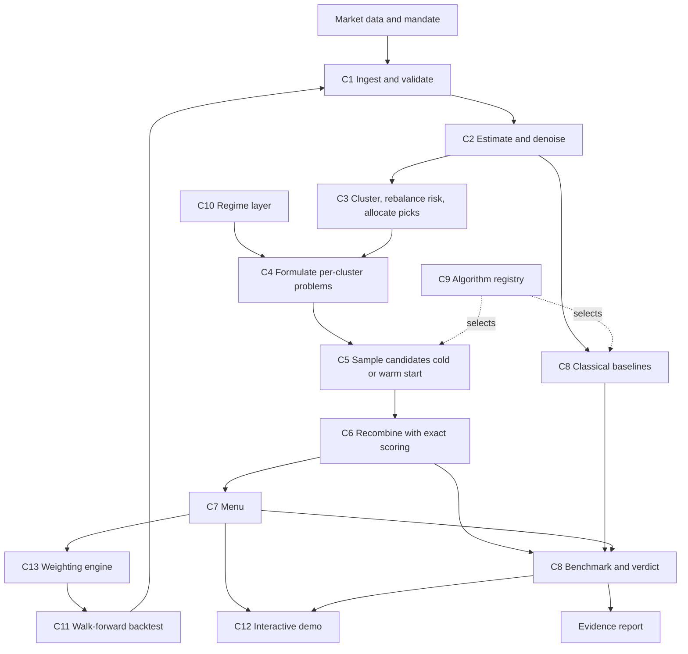
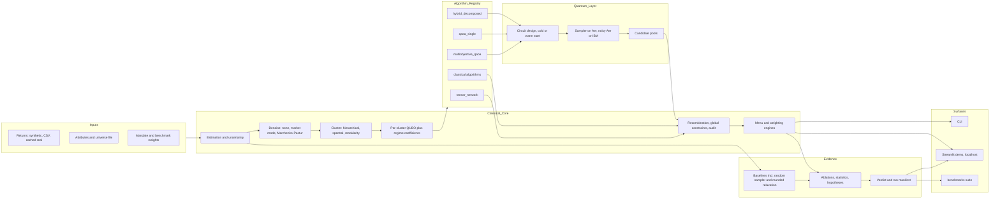
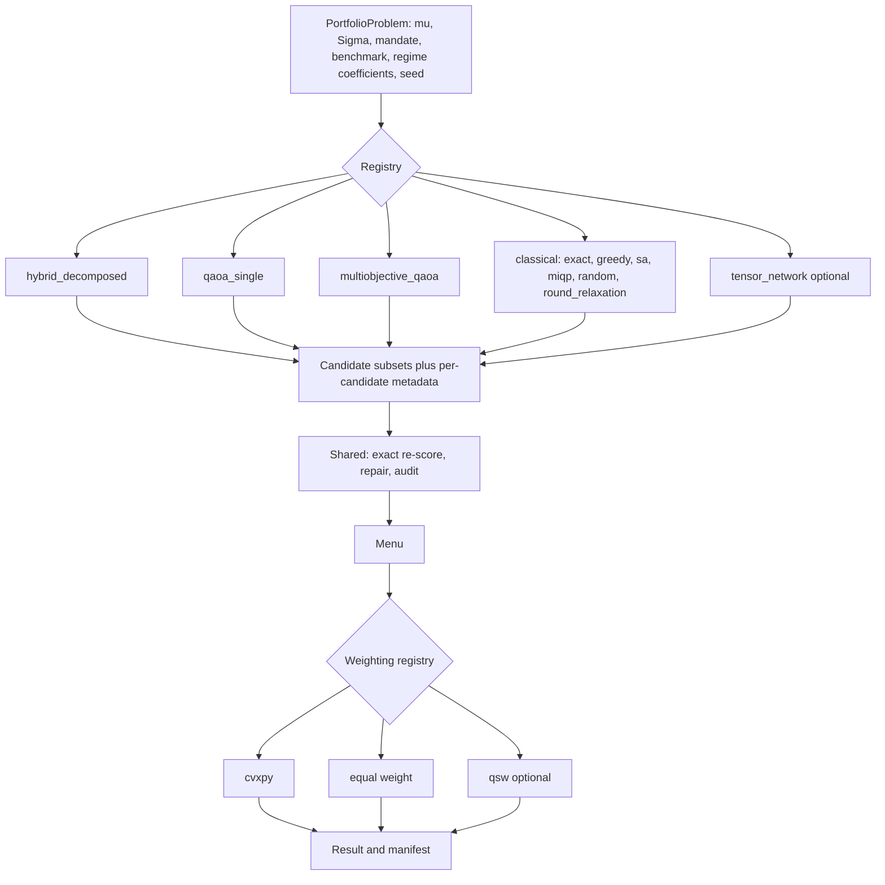

# Hybrid, Regime-Aware, Quantum-Sampled Portfolio Engine with Interactive Demo and Benchmark Suite — Combined Feature Specification

| Field | Value |
|---|---|
| **Working name** | QPortfolio |
| **Document type** | Combined feature specification with research rationale, demo specification and benchmark design |
| **Status** | Draft 1 — 15 Nov 2026; implementation status and measured results updated 16 Nov 2026 |
| **Quantum platform in scope** | IBM Quantum via Qiskit (simulator-first; hardware as a gated option) |
| **Host repository** | `quantum-portfolio-optimization/` (Python package `qportfolio`) |
| **Market focus** | Australia and New Zealand (ANZ) finance and insurance ✱ |
| **Relationship to other documents** | Extends, and does not replace, `FEATURE_SPEC.md` (build spec) and `FEATURE_SPEC_IDEA_RESEARCH.md` (research rationale), both of which stay unchanged. Reuses the structure of `portfolio_engine_feature_spec.md`. |

---

## 0. How to Read This Document

### 0.1 Purpose
This document merges five inputs into one design: the existing QPortfolio specification, a pasted "Hybrid Spectral-Decomposition + Warm-Start CVaR-QAOA" feature description, a built Flask demo (`quantum_app`), a technical design document for an adaptive-QUBO demo (the "TDD"), and a set of papers and web resources. It states **what to build, why, how to tell whether it works, and which claims must not be made**. It does not contain implementation code.

### 0.2 Evidence conventions
Every important claim carries a tag, so you can see how much weight it can bear.

| Tag | Meaning |
|---|---|
| **[E] Established** | Well documented in the literature; broadly accepted. |
| **[S] Supported** | Published evidence exists, but for limited settings or small scale. |
| **[P] Plausible** | Reasoned from established facts; not demonstrated for this exact problem. |
| **[X] Speculative** | A hypothesis worth testing; could easily be wrong. |
| **[V] Verified here** | Measured in this repository, or read directly from the cited source text or code during preparation of this document. The source status of each reference is in §22. Figures marked "(computed)" are my own arithmetic from stated formulas (for example (1−ε)ⁿ), not measurements; they are exact given the formula but not experimental results. |
| **[U] Unverified** | Not opened, not run, or only seen in a summary. Do not quote externally. |
| **✱** | An ANZ market, regulatory or commercial statement that needs checking before external use. |

### 0.3 How the sources were handled
- Papers and web pages were fetched and read in full or in part; §22 lists exactly how much of each was read.
- Where a source's headline conflicts with its own body text, this document follows the body text and says so.
- Code that was only read, not run, is marked as such.

---

## 1. Executive Summary

**The idea in one sentence.** Choose which assets to hold from a large universe by denoising and splitting it into groups of related assets, letting a quantum sampler propose candidate selections for each group (optionally warm-started and optionally adapted to the market regime), recombining those proposals into full portfolios that are re-scored **exactly** on classical machines, presenting a short menu of distinct near-optimal portfolios through an interactive demo, and measuring everything against strong classical baselines in a separate benchmark suite so that the project produces evidence rather than hype.

**Eight design pillars**

| # | Pillar | One-line rationale | Origin |
|---|---|---|---|
| 1 | **Decompose** the universe into small clusters | Devices are small and noisy; assets form groups. | Base spec, JPMorgan/Amazon paper |
| 2 | **Sample** many good answers per cluster | Circuits produce distributions; investors want options. | Base spec |
| 3 | **Recombine and re-score classically** | Correctness never depends on noisy hardware. | Base spec |
| 4 | **Present a statistically meaningful menu** | Near-optimal portfolios inside estimation noise are indistinguishable. | Base spec |
| 5 | **Benchmark by design** | No quantum advantage is established here; measure honestly. | Base spec, TDD |
| 6 | **Adapt** the formulation to the market regime, against a tuned static baseline | Tests a claim that does not depend on quantum hardware. | TDD, `quantum_app` |
| 7 | **Demonstrate** through an interactive demo, separate from the benchmark suite | Stakeholders need to see the workflow; evidence needs a clean lab. | Pasted spec, TDD |
| 8 | **Keep a claims register** | Several popular claims about this approach are wrong or unmeasured (§17). | This document |

**What this design is, and is not.** It is a rigorous test-bed, a decision-support concept and a stakeholder demo. It is **not** a claim that quantum hardware beats classical solvers today. Every source that reports a controlled comparison agrees: the IBM multi-objective tutorial states that at 40 assets "uniform random sampling performs about as well as the QAOA sampler" **[V]**; the JPMorgan/Amazon decomposition paper solves its sub-problems with classical branch-and-bound, not a quantum device **[V]**; the quantum-stochastic-walk paper's implementation "is entirely classical and quantum-inspired" **[V]**.

### 1.1 What changed relative to the base specification

| Area | Base spec | This document |
|---|---|---|
| User interface | "Not part of this idea" | Streamlit demo, localhost only (§10) |
| Correlation preprocessing | Remove the market mode | Adds Marchenko–Pastur denoising (C2) |
| Clustering | Hierarchical, spectral | Adds modularity bisection (C3) |
| Per-cluster risk scale | None | Adds risk rebalancing per the JPMorgan/Amazon paper (C3) |
| QUBO terms | Return, risk, cardinality, sector caps | Adds tracking error and average-ESG handling (C4) |
| QAOA start | Cold start, optional XY/Dicke encoding | Adds warm start and a no-quantum "round the relaxation" control (C5) |
| Adaptivity | None | Regime layer against a tuned static baseline (C10) |
| Time dimension | Single-period | Walk-forward backtest (C11) |
| Algorithms | One pipeline | Registry of selection algorithms and weighting engines (C9) |
| Benchmark | Inside the package | Package code plus a separate top-level `benchmarks/` suite (§11) |
| Baselines | Equal weight, greedy, MIQP, SA, decomposed classical, multistart | Adds a **uniform-random feasible sampler** and a tensor-network baseline |

### 1.2 Source reconciliation

| Source | Take | Do not take |
|---|---|---|
| Base spec (`FEATURE_SPEC*.md`) | Everything; it is the host design | — |
| Pasted "Hybrid Spectral + Warm-Start CVaR-QAOA" text | Storyline, MP filtering, modularity bisection, warm start, three dashboard views, guardrails | Numerical promises (">50% on the optimum", "<5% loss", "near-100% optimality"), the non-polynomial penalty terms, "simulators crash past 20 qubits" (§17) |
| `quantum_app` (Flask) | Regime idea, tracking-error and ESG terms, ASX universe, walk-forward backtest, security posture (localhost, allow-lists) | Hard-coded single pool, hand-set static baseline, Flask stack |
| TDD (`aqpo-demo`) | Experiment rigour (tuned static baseline, oracle, placebo, paired CIs), per-term normalisation, penalty sweep, endianness test, run manifest, performance budget | A second codebase and a second package layout |
| JPMorgan/Amazon decomposition paper | Pipeline stages: RMT cleaning, modularity bisection, risk rebalancing, constraint partitioning | Its results as evidence for a quantum solver (it used none) |
| IBM multi-objective tutorial | Pareto-sweep workflow, XY line mixer, post-selection, random-sampling control, hypervolume metric | Any implication that QAOA beat random sampling at 40 assets (it did not) |
| Quantum stochastic walk paper | Weighting-stage plug-in and a "smart 1/N" baseline | Treating it as a selection algorithm or a quantum result |
| Tensor-network paper and QuFinTN | Tensor-network solver as a classical baseline | QuFinTN's headline numbers (§6.12) |
| HSBC paper and IBM blog | Context; a separate `labs/` folder | Any link to portfolio optimisation (it is bond fill-probability ML) |
| IBM QML course | Training material | Anything in the engine |

### 1.3 Headline findings from reading the sources

1. **The JPMorgan/Amazon pipeline is classical end to end.** Sub-problems went to Gurobi and CPLEX. It reports an approximately 80% reduction in the largest community and a solution within 5% of the optimum for its linear cardinality case, on Russell 3000 data with communities capped at 30 **[V]**. It does not use clusters of 6–10, and its reduction is smaller at small universe sizes (§6.4).
2. **The IBM multi-objective tutorial is a workflow lesson, not an advantage result.** On 8 assets with 100,000 shots over 256 bitstrings it "sees every one of the 70 valid portfolios", so it is "effectively a brute-force check"; at 40 assets QAOA ≈ uniform random sampling **[V]**.
3. **QuFinTN's "MPS optimiser" does not run a tensor-network optimisation** in the version read (§6.12) **[V]**. Its README claim of beating Markowitz is not evidence for tensor networks.
4. **The quantum stochastic walk (QSW) paper is a weighting method**, simulated classically, with strong reported back-tests that are not independently replicated **[V]/[S]**.
5. **The HSBC paper is a machine-learning feature-transform study** on bond RFQ data using 109 qubits. The authors state that noisy simulation did not reproduce the effect and that theory does not explain it **[V]**.
6. **Warm start gives much less initial probability than the pasted text claims** at the default clip (§6.7).
7. **The IBM/Vanguard blog supports our propose-then-refine architecture**, but also notes the classical solver CPLEX solves that problem to optimality at the tested scale **[V]**.
8. **About two thirds of the pasted pipeline already exists** in `qportfolio`; the missing pieces are additive (§5, coverage matrix).

---

## 2. Plain-English Primer

### 2.1 Selection and weighting
A portfolio is a collection of investments. Building one has two questions: **selection** (which assets?) and **weighting** (how much of each?). The quantum effort here targets selection, the all-or-nothing part. Weighting is smooth and classical methods handle it well (a quantum-inspired alternative is covered in C13).

### 2.2 Risk, return and covariance
Expected return is the average gain expected; risk is how much value swings (variance); covariance records how every pair moves together. Two assets that rise and fall together give less protection than two that move independently.

### 2.3 Why real mandates are hard
Real mandates add rules: hold exactly K names, cap each sector, meet an ESG floor, stay close to a benchmark (**tracking error**), limit turnover. Rules that force discrete choices turn a smooth problem into a combinatorial one. Choosing 50 names from 1,000 offers roughly 10⁸⁵ selections.

### 2.4 What a quantum computer does here
A small quantum computer can be programmed so that its measurements are bitstrings (`0110…`, one bit per asset). Many runs give a distribution over bitstrings; a good program makes good selections appear more often. We use the device as a **generator of candidate selections**, never as the judge.

### 2.5 Warm start
A plain ("cold") QAOA starts from an even blend of all 2ⁿ selections. A **warm start** first solves an easy continuous version of the problem on a classical machine, then biases each qubit towards that answer, so the circuit starts nearer a good region. The risk is that a start too close to a single answer leaves little for the quantum steps to add; §6.7 quantifies this.

### 2.6 Market regimes
Markets alternate between calm and stressed periods. A **regime layer** classifies the current period and changes the problem's coefficients (for example, more risk aversion in stress). The test is whether doing so beats a fixed formulation that has been tuned just as carefully (§7).

### 2.7 Why not run everything on the quantum computer?
Today's devices are noisy, with on the order of 100–160 qubits (to be verified for the target backend). A 1,000-asset problem needs 1,000 qubits and deep circuits. A hybrid design gives the device only small self-contained pieces.

---

## 3. Glossary

### 3.1 Finance and statistics

| Term | Meaning |
|---|---|
| **Universe / Mandate** | The set of assets we may pick from / the rules the portfolio must obey. |
| **Cardinality (K)** | The exact number of assets to hold. |
| **Expected return (μ), covariance (Σ), correlation (C)** | Average gain vector / pairwise co-movement matrix / covariance rescaled to −1…+1. |
| **Risk aversion (λ)** | Dial controlling how strongly risk is penalised versus return. |
| **Sector cap** | Maximum allocation to one industry. |
| **ESG score** | Environmental, Social, Governance rating. In this project it is **synthetic unless a licensed source is supplied** (§12). |
| **Tracking error (TE)** | Volatility of the difference between portfolio and benchmark returns. |
| **Information ratio** | Active return divided by tracking error. |
| **Sharpe ratio** | Return per unit of risk. |
| **Turnover** | How much a new portfolio differs from the previous one. |
| **Walk-forward backtest** | Repeated train-then-trade over rolling windows, using only past data at each step. |
| **Look-ahead bias / survivorship bias** | Using future information / testing only on assets that survived. Both inflate results. |
| **Estimation error / error maximisation** | Inaccuracy of μ and Σ / the optimiser's tendency to exploit it (Michaud 1989). |
| **Shrinkage (Ledoit–Wolf)** | Pulling a noisy covariance towards a stable target. |
| **Market mode** | The dominant common movement of stocks; the largest eigenvalue of the correlation matrix. |
| **Random matrix theory (RMT)** | Mathematics used to separate real correlation structure from noise. |
| **Marchenko–Pastur (MP) distribution** | The eigenvalue distribution of a correlation matrix built from purely random data; its upper edge λ₊ marks the noise ceiling. |
| **Regime** | A labelled market state (for example calm, neutral, stressed). |

### 3.2 Optimisation

| Term | Meaning |
|---|---|
| **QUBO / Ising** | Quadratic Unconstrained Binary Optimisation / its physics form; the lowest-energy state is the answer. |
| **Penalty term / slack variable** | Cost for breaking a rule / extra variable converting an inequality into an equality (costs qubits). |
| **Relaxation** | Replacing yes/no variables with continuous 0–1 variables to get an easy classical problem. |
| **MIQP** | Mixed-integer quadratic programming; the standard classical strong baseline. |
| **Branch-and-bound (B&B)** | The exact search used inside MIQP solvers such as Gurobi and CPLEX. |
| **MIP gap** | The proven distance between the best solution found and the best possible. |
| **Simulated annealing (SA)** | Randomised classical search imitating cooling. |
| **Pareto front / dominated** | The set of portfolios no other portfolio beats on every objective at once / a portfolio that is beaten on all. |
| **Hypervolume** | One number measuring how much objective space a Pareto front dominates; larger is better. |
| **Beam search** | Search that keeps the best N partial solutions at each step. |
| **Modularity / modularity bisection** | A score for how well a graph splits into groups / recursively splitting a graph in two using the leading eigenvector of its modularity matrix. |
| **Community** | A group of assets found by modularity bisection; used interchangeably with cluster. |
| **Oracle / placebo classifier** | A regime classifier given the true regimes (upper bound) / one given shuffled regimes (control that should show no benefit). |

### 3.3 Quantum computing

| Term | Meaning |
|---|---|
| **Qubit, shot, circuit, depth** | Quantum bit / one run-and-measure / sequence of gates / number of sequential layers. |
| **Statevector simulation** | Exact classical simulation of n qubits; memory grows as 2ⁿ (16 bytes per amplitude). |
| **QAOA** | Alternates a cost step and a mixer step p times, with angles tuned classically. |
| **CVaR objective (training)** | Tuning angles on the average of only the best fraction α of samples. Not the financial risk measure of the same name. |
| **Warm-start QAOA** | QAOA initialised from a classical relaxation; the mixer is modified to match (Egger, Marecek and Woerner 2021). |
| **ε-clip (warm start)** | Restricting relaxed values to [ε, 1−ε] so no qubit is frozen at 0 or 1. |
| **Dicke state / XY mixer** | An equal blend of all bitstrings with exactly K ones / a mixer that preserves the number of ones. |
| **Post-selection** | Keeping only measured bitstrings that satisfy a rule (for example exactly K ones). |
| **Barren plateau** | A flat training landscape where gradients vanish. Not expected at p = 2 and ≤ 12 qubits. |
| **Sampler primitive** | Qiskit interface returning bitstring distributions. |
| **NISQ / transpilation / heavy-hex** | Noisy mid-scale era / rewriting a circuit for a device / IBM's sparse qubit connectivity. |
| **Quantum-inspired** | Classical algorithms borrowing quantum ideas (tensor networks, quantum walks simulated classically). |
| **Quantum advantage** | A quantum method beating the best classical method on a meaningful task. Not established for this problem. |

### 3.4 Terms specific to this design

| Term | Meaning |
|---|---|
| **Cluster / sub-problem / candidate pool** | Group of related assets / selection problem restricted to a cluster / good selections proposed for it with exact scores. |
| **Recombination (master step)** | The classical stage that assembles full portfolios from cluster pools and checks global rules. |
| **Cut share / decomposition loss** | Fraction of covariance lying between clusters (ignored in sub-problems) / how much worse the decomposed result is than the best full-problem result. |
| **ε-band / portfolio menu / Jaccard distance** | Tolerance within which portfolios count as equally good / the final short list of distinct portfolios / 1 minus overlap over union. |
| **Risk rebalancing** | Rescaling each cluster's risk-aversion so sub-problem risk tolerance matches the whole (§C3). |
| **Mass on the optimum / top-q recall** | Share of shots landing on the best known selection / share of the true top-q selections that appear in the sampled pool. |
| **Selection algorithm / weighting engine** | Anything that proposes asset subsets / anything that turns a chosen subset into weights. |
| **Hero preset** | The single curated demo configuration shown by default. |
| **Run manifest** | The record of inputs, settings, versions, seeds and backend identifiers needed to reproduce a run. |
| **Tuned static baseline** | A fixed-coefficient formulation whose coefficients were grid-searched on the training window with the same budget the adaptive method gets. |

---

## 4. The Problem and Where It Is Genuinely Hard

### 4.1 Definition
**Given** a universe of N assets (range of interest 20 to 5,000), estimates of expected returns and covariance, and a mandate (exact count K, sector caps, optional turnover, tracking-error budget, ESG limits, forced inclusions or exclusions),
**produce** a small menu of feasible portfolios that are near-optimal and meaningfully different from one another, with an honest comparison against classical methods. For the interactive demo the same problem is also solved through time (walk-forward) and for a regime-adaptive formulation.

### 4.2 Honest difficulty assessment

| Situation | Classical difficulty | Comment |
|---|---|---|
| Continuous weights, few constraints | Easy | Textbook quadratic programming. |
| **Selection with n ≤ 20 and exact K** | **Trivial** | C(20,10) = 184,756 subsets; exhaustive search is instant **[V]** (arithmetic). |
| Cardinality-constrained, a few hundred assets | Usually manageable | Classical benchmark sets of this size exist **[S]**. |
| About 1,500 assets with cardinality n/2 | Becomes slow for exact B&B | JPMorgan/Amazon report a ≥ 3× time-to-solution gain from decomposition at about 1,500 assets, and note that a looser MIP gap of 5×10⁻² makes the direct solver comparable on one of their two problems **[V]**. |
| Many discrete rules at 1,000+ assets | Can become hard | Rugged landscape; unpredictable solver times **[P]**. |
| Needing *many* distinct near-optimal solutions | Underserved | Standard solvers target one optimum **[P]**. |

**Implication for the demo.** At the cluster sizes a statevector simulator can handle, a classical exact solver is faster and at least as good. The demo must say so on screen (§10.2).

### 4.3 Where this design aims
Heavily constrained selection at scale and the generation of varied good answers (the last three rows), plus the regime-adaptivity question, which is independent of quantum hardware.

### 4.4 Why existing approaches fall short

| Approach | Gap |
|---|---|
| Classical mixed-integer solvers | Strong, but typically one answer; long and variable runtimes on hard instances. |
| Classical heuristics | Fast, but can stall as constraints multiply. |
| Typical quantum demos | Whole-problem mapping at toy scale; weak or missing classical baselines. |
| Quantum annealing demos | Vendor-specific; embedding limits for dense matrices. |
| Static QUBO coefficients | One fixed formulation in every market state; rarely compared with a *tuned* adaptive alternative. |

---

## 5. The Idea in Detail: What the System Does

The system is described as thirteen **capabilities**. C1–C8 come from the base specification and are extended; C9–C13 are new. Priorities: **M** must (first release), **S** should, **C** could. Status: **E** exists and is verified in the repository, **X** exists and is extended, **N** new. A trailing **✔** means built and covered by tests in the repository on 16 Nov 2026; where the built form differs from the wording of the requirement the difference is stated in the row.



### Capability coverage matrix

| Capability | Pasted spec | `quantum_app` | TDD | Papers/resources | Repo status |
|---|---|---|---|---|---|
| C1 Data and validation | yfinance, N = 30–100 | 30 hard-coded ASX tickers | 20 ASX tickers, synthetic first | — | **E** + N (ASX universe, regime generator) |
| C2 Estimation and denoising | MP filter | — | — | JPMorgan/Amazon | **X** (Ledoit–Wolf exists; MP new) |
| C3 Clustering | Modularity bisection, Frobenius rebalance | — | — | JPMorgan/Amazon | **X** (hierarchical, spectral exist) |
| C4 Formulation | Cardinality, sector, ESG penalties | TE, ESG, sector | TE, ESG, sector | — | **X** |
| C5 Sampling | Warm-start CVaR-QAOA | QAOA, mean loss | CVaR custom loop | Egger et al. | **X** (CVaR, XY exist; warm start new) |
| C6 Recombination | Concatenate + greedy swap | — | repair + 1-swap | JPMorgan/Amazon | **E** (stronger) |
| C7 Menu | — | — | — | IBM tutorial (Pareto) | **E** + N (Pareto mode) |
| C8 Baselines and verdict | Exact, cold start | Exact, greedy, SA | S0–S7 | IBM tutorial (random control) | **X** |
| C9 Algorithm registry | — | — | — | all | **N** |
| C10 Regime layer | — | GMM, bandit | GMM, rules, oracle, placebo | — | **N** |
| C11 Walk-forward backtest | — | yes | yes | QSW paper | **N** |
| C12 Interactive demo | Streamlit or Next.js | Flask, 6 tabs | Streamlit, 6 pages | — | **N** |
| C13 Weighting engines | — | — | equal, mean-variance | QSW paper | **X** (CVXPY exists) |

---

### C1 — Data intake and validation
**Purpose.** Establish a trustworthy starting point. **Why it matters.** Optimisers amplify bad inputs.

| ID | Requirement | Pri | Status |
|---|---|---|---|
| C1-R1 | Accept a wide returns table (CSV/Parquet) plus an attributes table (`asset`, `sector`, `liquidity`, `esg`, `current_weight`) and a mandate. | M | E |
| C1-R2 | Detect short histories, gaps and contradictory mandates (K larger than the universe, infeasible sector caps). | M | E |
| C1-R3 | Seeded synthetic factor-model generator with sectors, liquidity and ESG. | M | E |
| C1-R4 | A **regime-switching** synthetic generator (calm / neutral / stressed with distinct volatility and correlation levels) that also emits the true regime labels, so oracle and placebo tests are possible. | M | N |
| C1-R5 | A bundled stylised universe file `universes/asx20.yaml`: 20 ASX-style tickers, sectors, stylised benchmark weights and **synthetic ESG scores marked `esg_source: synthetic`**. No real prices are shipped. | M | N |
| C1-R6 | An optional loader for real prices (§12) that reads a cached CSV snapshot by default and fetches only on explicit request. | S | N |
| C1-R7 | Data provenance (`synthetic`, `csv`, `vendor:<name>`) and ESG provenance are carried into every report and the demo banner. | M | N |

### C2 — Estimation of returns and covariance, with denoising
**Purpose.** Provide stable inputs and a cleaned correlation structure for clustering.

| ID | Requirement | Pri | Status |
|---|---|---|---|
| C2-R1 | Covariance by sample, Ledoit–Wolf or OAS; shrinkage of μ; annualisation. | M | E |
| C2-R2 | Input-uncertainty estimate by resampling, feeding the ε-band. | M | E |
| C2-R3 | `estimation.denoise` ∈ {`none`, `market_mode`, `marchenko_pastur`}. `market_mode` is today's behaviour (the default). | M | N ✔ (built as `decomposition.denoise` ∈ {`market_mode`, `marchenko_pastur`} plus `remove_market_mode`; no `none` value) |
| C2-R4 | `marchenko_pastur`: eigendecompose the correlation matrix C; treat eigenvalues ≤ λ₊ as noise; remove the largest eigenvalue as the market mode; keep C\* = Σ λᵢvᵢvᵢᵀ over λᵢ > λ₊, i ≠ 1. λ₊ = σ²(1+√β)² where β = n/T. The fit of σ² and of an *effective* β\* (correlated samples are redundant) is a recorded parameter (`mp_fit`: `fixed` or `bulk_fit`). | M | N ✔ (`mp_fit` ∈ {`fixed`, `market_adjusted`}; falls back to market-mode removal when no mode exceeds λ₊) |
| C2-R5 | **Design rule:** the denoised matrix C\* is used **only to find clusters**. Scoring, QUBO coefficients and the audit always use the original Σ. | M | N ✔ by construction (the cleaned matrix is passed only to the clusterer; there is no dedicated test of this rule) |
| C2-R6 | Report the number of eigenvalues above λ₊ and the share of variance they carry, so a user can see how much structure survived. | S | N ✔ (modes above the edge, modes kept, variance share kept are in the cluster summary) |

### C3 — Clustering, risk rebalancing and allocation of picks
**Purpose.** Cut the universe into groups small enough for the device and decide how many picks each group contributes.

| ID | Requirement | Pri | Status |
|---|---|---|---|
| C3-R1 | Hierarchical and spectral clusterers with a size ceiling and an optional sector-homogeneous mode. | M | E |
| C3-R2 | `clusterer: modularity`: recursive bisection by the leading eigenvector of the correlation-based modularity matrix built from C\*; recurse until every community is at most the size ceiling; optionally regroup small communities afterwards. The picking order of the next sub-graph to split is configurable (first-in-first-out or size-proportional; the source paper found these two best). | M | N ✔ (modes `fifo` and `size`; small-community regrouping built) |
| C3-R3 | Size ceiling `max_cluster_size`. The repository default stays 14. **Demo preset 10, demo hard stop 12** (statevector and Dicke limits, §8.3). The JPMorgan/Amazon paper used 30; that value belongs to a separate hardware-oriented preset. | M | X |
| C3-R4 | **Risk rebalancing** (`decomposition.risk_rebalance: none | norm_ratio`): per-cluster risk-aversion q′ = q × [Σₖ‖μₖ‖₂ / ‖μ‖₂] / [Σₖ‖Σₖ‖_F / ‖Σ‖_F], following the source paper's Eq. (15). The aim is to keep the global risk tolerance after the covariance is made block-diagonal. This is an empirical rule, not a guarantee (ablation A13). | S | N ✔ (rescales risk aversion inside cluster QUBOs only; final scoring uses the mandate's own λ) |
| C3-R5 | K-allocation: proportional, risk-aware (effective bets) or user; keep neighbouring allocations for recombination. | M | E |
| C3-R6 | Report cut share, intra- versus inter-cluster correlation and the **compression ratio** (qubits needed with and without decomposition). | M | E (+compression ✔) |
| C3-R7 | Whole-portfolio constraints that the clusters cannot see (sector caps across clusters, average ESG, tracking error) are enforced at recombination (C6), never by concatenation alone. | M | E |

### C4 — Formulation of each cluster's selection problem
**Purpose.** Express each task in the form quantum optimisers accept, with every constraint in a form that is actually quadratic or handled classically.

For a cluster with binary vector x ∈ {0,1}ⁿ, k_c picks assigned to the cluster and K picks in the whole portfolio, the selection surrogate assumes equal weights 1/K on the selected set (the existing convention in `docs/formulation.md`):

    minimise  (λ/K²) · xᵀΣx − (1/K) · μᵀx  [+ γ · TE(x)] [− η · eᵀx/K]  + P · (Σxᵢ − k_c)²

where the terms in brackets are optional. Tracking error TE(x) = (x/K − b)ᵀΣ(x/K − b) for benchmark weights b restricted to the cluster is quadratic in x and so is a valid QUBO term; its cross-cluster part is invisible to the sub-problem and is restored when whole portfolios are scored at recombination (C6).

| ID | Requirement | Pri | Status |
|---|---|---|---|
| C4-R1 | Return, risk and cardinality QUBO; forced-in and forced-out variables fixed. | M | E |
| C4-R2 | Cardinality penalty **P calibrated exactly** (n ≤ 18, from the best objective per cardinality) or by a rigorous per-flip bound otherwise. | M | E |
| C4-R3 | An optional heuristic penalty (`penalty_weight: heuristic`, P = κ × largest absolute coefficient) used **only** for ablation A14 and the penalty-sweep page. | S | N |
| C4-R4 | Sector caps enforced at recombination by default; slack-variable mode optional. | M | E |
| C4-R5 | **Tracking-error term** with weight γ (regime-mapped, §C10). | M | N |
| C4-R6 | **Average-ESG constraint** Σeᵢxᵢ ≥ K·E_min. This is *linear*, so it is **not** written as a squared max(0, ·) penalty (which is not a polynomial and cannot be a QUBO term). Handling: (a) a linear preference term −η·eᵀx in the QUBO; (b) a **hard check and repair** in recombination and the audit; (c) optional slack bits. | M | N |
| C4-R7 | Per-term normalisation: each term is divided by its standard deviation over random feasible subsets before regime weights are applied, so coefficient values are comparable across terms. | M | N |
| C4-R8 | A pre-flight report (qubits, interactions, coefficient range, penalty method) before anything is sent to a backend. | M | E |
| C4-R9 | A **mandatory endianness test**: for n = 8, over all 256 bitstrings, QUBO energy equals the diagonal of the Ising operator and equals the energy Qiskit assigns to the same measured string. Add it if the repository does not already contain an equivalent. | M | N |

### C5 — Quantum sampling of candidate selections
**Purpose.** Obtain, for every cluster, a pool of good candidate selections. The device is a proposer, never a judge.

| ID | Requirement | Pri | Status |
|---|---|---|---|
| C5-R1 | QAOA with a CVaR training objective (default α = 0.25), COBYLA or SPSA, p layers (default 2), NumPy statevector twin for training, Qiskit Sampler for sampling. | M | E |
| C5-R2 | Encodings: `penalty` (uniform start, RX mixer) and `xy` (Dicke start, XY mixer). | M | E |
| C5-R3 | `solver.init` ∈ {`cold`, `warm`, `round_relaxation`}. Default `cold`. | M | N ✔ (built as `solver.start` ∈ {`cold`, `warm`}; `round_relaxation` is a separate registry algorithm, not an `init` value) |
| C5-R4 | **Warm start**: solve the convex relaxation x ∈ [0,1]ⁿ with Σx = k_c (QP; the covariance is positive semi-definite and λ ≥ 0) by CVXPY; clip to [ε, 1−ε] (`warm_epsilon`, default 0.25 to match the library, swept in A10); start each qubit with Rᵧ(θᵢ), θᵢ = 2·arcsin(√cᵢ); use the matching mixer Rᵧ(−θᵢ)·R_z(−2β)·Rᵧ(θᵢ). Warm start **replaces** the standard mixer and does not preserve Hamming weight, so `warm` with `encoding: xy` is rejected at config validation. | M | N ✔ (`warm` with `encoding: xy` rejected at validation) |
| C5-R5 | `round_relaxation`: the same QP, then round to the nearest feasible k_c-subset and feed it to the same repair and recombination. This is the **no-quantum control** that isolates the quantum contribution from the classical relaxation. | M | N ✔ |
| C5-R6 | The NumPy twin is extended to warm-start circuits and re-verified against Qiskit's `Statevector` (fidelity ≥ 1 − 10⁻⁹) in the test suite. | M | N ✔ (fidelity ≥ 1 − 10⁻⁹ against Qiskit `Statevector`) |
| C5-R7 | Every returned bitstring is re-scored exactly, de-duplicated, repaired if needed, and kept with its device frequency. | M | E |
| C5-R8 | Backends: ideal simulator, noisy simulator, IBM hardware; cost guards (`max_qpu_seconds`, `max_jobs`, `max_sim_qubits`); dry-run mode; error suppression/mitigation options. | M | E |
| C5-R9 | Optional **angle reuse between rebalances** (`init_angles: previous`): start the next solve from the previous solve's optimal angles. This is different from the relaxation warm start and is ablated separately. | S | N |
| C5-R10 | Record per solve, for the demo and the benchmark: mass on the best known selection, top-q recall, iterations to reach a target energy, shots, wall time, feasible-sample fraction. | M | N, partly ✔ (mass on best, top-q recall, feasible fraction, seconds; **not** iterations to a target energy) |

### C6 — Recombination with exact scoring
**Purpose.** Assemble whole portfolios from cluster pools and repair the damage caused by ignoring between-cluster covariance.

| ID | Requirement | Pri | Status |
|---|---|---|---|
| C6-R1 | One candidate per cluster, scored with the **full** covariance, gated on every hard constraint; beam search plus swap polish plus neighbourhood expansion. | M | E |
| C6-R2 | Global sector caps, minimum average ESG, tracking-error budget and turnover are checked here and violating combinations are discarded or repaired. | M | X |
| C6-R3 | An **independent audit** re-checks every emitted portfolio. No infeasible portfolio is ever emitted. | M | E |
| C6-R4 | Report decomposition loss whenever a full-problem reference exists. | M | E |

### C7 — Menu: statistically grounded selection, weighting and ranking
**Purpose.** Turn recombined candidates into the deliverable.

| ID | Requirement | Pri | Status |
|---|---|---|---|
| C7-R1 | ε-band from percentage, absolute value or **estimation uncertainty**; diversity selection by Jaccard or Hamming distance; ranking by liquidity, ESG, turnover, sector concentration or objective; per-portfolio explanation and constraint slack. | M | E |
| C7-R2 | A **Pareto-sweep menu mode** (algorithm `multiobjective_qaoa`, §9): objectives risk, return and diversification, weights swept over the simplex; the menu is the non-dominated set plus hypervolume. | C | N |

### C8 — Baselines, ablations and verdict
Described in §7 and §13. New in this document: a **uniform-random feasible sampler** at equal sample budget is a mandatory baseline, a tensor-network (matrix-product-state) solver is an optional baseline, and the verdict covers the new hypotheses H9–H21.

| ID | Requirement | Pri | Status |
|---|---|---|---|
| C8-R1 | Baselines as in the base spec (equal weight, greedy, MIQP with time limit, SA on the QUBO, decomposed classical, multistart classical). | M | E |
| C8-R2 | **Uniform-random feasible sampler** with the same number of candidate evaluations as the quantum sampler. | M | N ✔ (`random_feasible`; plus the `round_relaxation` control) |
| C8-R3 | Tuned static baseline (grid-searched on the training window) for every regime-adaptive comparison. | M | N |
| C8-R4 | Oracle and placebo (shuffled-regime) classifiers for every regime-adaptive comparison. | M | N |
| C8-R5 | The verdict is computed from the numbers and states "no measured quantum advantage" when that is the case. | M | E |

### C9 — Algorithm registry
**Purpose.** Let different algorithms run behind one interface so the demo and the benchmark can swap them without changing anything else. Full design in §9.

| ID | Requirement | Pri | Status |
|---|---|---|---|
| C9-R1 | Two registries: **selection algorithms** (propose subsets) and **weighting engines** (turn a subset into weights). | M | N, partly ✔ (selection-algorithm registry only; no weighting-engine registry) |
| C9-R2 | All selection algorithms receive the same `PortfolioProblem` and return candidate subsets; **the same exact re-scoring, repair and audit runs afterwards for every algorithm**. | M | N |
| C9-R3 | Each algorithm declares its size limits and cost model, and reports them in the run manifest. | M | N |
| C9-R4 | Registering a new algorithm needs no change to the demo or the benchmark runner. | M | N ✔ (`register_solver`) |

### C10 — Regime layer
**Purpose.** Test, on equal terms, whether adapting the QUBO coefficients to the market state helps.

| ID | Requirement | Pri | Status |
|---|---|---|---|
| C10-R1 | Market-signal features computed **only from data up to the day before** each decision date (trailing volatility, drawdown, average pairwise correlation, momentum). | M | N |
| C10-R2 | Classifiers behind one protocol: Gaussian mixture, rule-based, **oracle** (true labels from the synthetic generator), **shuffled** (placebo). Fitted on the training window only. | M | N |
| C10-R3 | A **coefficient mapper**: regime → vector (λ, γ_TE, η_ESG, sector-penalty weight, penalty multiplier), via a table with optional probability blending. | M | N |
| C10-R4 | A **tuned static baseline**: one fixed coefficient vector chosen by the *same* grid and budget the adaptive method uses on the training window. A hand-set static baseline is a strawman and is not allowed in any comparison that supports a claim. | M | N |
| C10-R5 | A learned regime-to-coefficient table (contextual bandit, as in `quantum_app`) is an optional later extension and must beat the fixed table before it is kept. | C | N |

### C11 — Walk-forward backtest
**Purpose.** Evaluate any algorithm through time without look-ahead.

| ID | Requirement | Pri | Status |
|---|---|---|---|
| C11-R1 | Monthly (configurable) rebalancing; training window ending the day before each decision; transaction costs in basis points (default value is illustrative ✱); buy-and-hold drift between rebalances. | M | N |
| C11-R2 | Strategies S0–S8 (§7.3; S0–S7 from the TDD, S8 added here). | M | N |
| C11-R3 | Metrics: return, volatility, Sharpe, max drawdown, tracking error, information ratio, turnover, average ESG, percentage of rebalances breaching a constraint **after** repair (must be 0). | M | N |
| C11-R4 | Multi-seed aggregation, paired bootstrap confidence intervals and an on-disk cache keyed by hash(problem, solver configuration, seed). | M | N |
| C11-R5 | Run profiles: `fast` (n = 12, p = 1, 5 seeds), `standard` (n = 16, p = 2, 10 seeds), `full` (n = 20, p = 2, 20 seeds). | M | N |
| C11-R6 | Verify costs and turnover on a hand-computed toy case before any result is trusted. | M | N |

### C12 — Interactive demo
**Purpose.** Show the workflow to business and technical audiences, with the evidence kept honest. Full design in §10.

| ID | Requirement | Pri | Status |
|---|---|---|---|
| C12-R1 | Streamlit application in `apps/demo/`, bound to `127.0.0.1`, six pages, a standing banner (§10.1). | M | N, partly ✔ (**four** pages, not six; banner and 127.0.0.1 binding built) |
| C12-R2 | An algorithm picker driven by the registry (C9). | M | N ✔ |
| C12-R3 | Never starts a long computation synchronously; loads cached results and offers a background re-run. | M | N |
| C12-R4 | Every page shows provenance (data, ESG, backend, seed, manifest id). | M | N |

### C13 — Weighting engines
**Purpose.** Turn each chosen set into weights.

| ID | Requirement | Pri | Status |
|---|---|---|---|
| C13-R1 | `cvxpy` mean-variance weights with per-asset and sector caps (long-only). | M | E |
| C13-R2 | Equal weight. | M | E |
| C13-R3 | **Quantum stochastic walk (QSW) weighting** as an optional plug-in: assets as graph nodes, covariance and return-to-risk as edge and self-loop weights, weights from the stationary distribution of a density-matrix evolution, with a quantum-versus-classical mixing parameter ω. It is simulated classically (about 100 assets in the source paper), so it is a **quantum-inspired** weighting method and is labelled that way everywhere. | C | N |
| C13-R4 | Any weighting engine is compared with CVXPY and equal weight **net of costs** (hypothesis H20). | M | N |

---

## 6. Research Deep-Dive: Why This Architecture

The argument proceeds as claims, each justified separately so the thesis can be challenged piece by piece. Claims 1–6 are carried over from the base specification (see `FEATURE_SPEC_IDEA_RESEARCH.md` §6 for the full text); this section restates them briefly and spends its effort on what is new.

### 6.1 The thesis
> Because (a) portfolio inputs are noisy, (b) assets cluster and random-matrix theory separates real structure from noise, (c) current quantum hardware is small and noisy, (d) quantum devices naturally sample, (e) a fixed formulation may fit some market regimes poorly, and (f) honest evaluation needs strong baselines including a *random* sampler — the best available design is a **decomposed, sampling-first, classically-verified hybrid, with optional regime adaptation and benchmarking built in, shown through a demo that never over-claims**.

### 6.2 Claim 1 — The "single best portfolio" is largely an illusion, so a menu is more honest
Optimisers amplify estimation error (Michaud 1989; Ledoit and Wolf 2004; DeMiguel et al. 2009) **[E]**; portfolios whose scores differ by less than the input noise cannot be told apart, so a menu of statistically tied portfolios chosen on practical criteria loses nothing **[P]**. The quantum stochastic walk paper adds a consistent data point: it describes naive 1/N as "a surprisingly effective benchmark in the presence of estimation error", and its best method is framed as a "smart 1/N" with small data-driven tilts **[V]**. **Implication:** the menu, the ε-band from estimation uncertainty and an equal-weight baseline stay in the design.

### 6.3 Claim 2 — Financial covariance has structure that makes decomposition natural
Equity correlation matrices have a few strong common factors above a large noise bulk (Laloux et al. 1999) **[E]**; hierarchical trees recover sectors (Mantegna 1999) **[E]**; community-detection decomposition for small quantum computers has been shown at modest scale (Shaydulin et al. 2019; Ushijima-Mwesigwa et al. 2021) **[S]**. The JPMorgan/Amazon paper adds the specific recipe this design adopts: **clean the correlation matrix with random-matrix theory, then split it by modularity bisection** (C2, C3) **[V]**. The paper's own point that standard community detection on a correlation matrix "is not sufficient" because the null model is wrong for correlations is the reason modularity is built on C\* and not on a raw graph **[V]**.

### 6.4 What the JPMorgan/Amazon decomposition paper does and does not show

| Item | What the paper reports | What it means for this design |
|---|---|---|
| Data | Russell 3000, 1,000 daily returns from January 2010, instances from 90 to 1,500 assets **[V]** | Real equity data, US only; not ASX. |
| Problems | Cardinality-constrained mean-variance with exact count n/2; and risk minimisation against a baseline portfolio with a quadratic constraint **[V]** | The first matches our selection problem; the second is a rebalancing problem we do not have. |
| Sub-problem solver | Gurobi (also CPLEX) branch-and-bound, run sequentially **[V]** | **No quantum device was used.** The paper argues the sub-problems become "good targets" for quantum solvers. |
| Quality | Within about 5% of the direct optimum for the linear case; within about 4% for the quadratic case at about 500 assets **[V]** | Supports H3 as a *classical* decomposition result only. |
| Speed | ≥ 3× time-to-solution gain at about 1,500 assets for the linear case; at 800 assets the pipeline takes about 7 s (unrestricted) or 11 s (communities ≤ 30) versus more than 20 s directly **[V]** | For the quadratic case, a direct solver with a looser MIP gap (5×10⁻²) has comparable time **[V]**. Gains are real but depend on the solver settings used as the reference. |
| Size reduction | "Approximately 80%"; the median largest community follows a linear fit of about 0.217·n + 19.8 **[V]** | By that fit the largest community is about 41 assets at n = 100, 63 at n = 200 and 128 at n = 500. The reduction is therefore about 39% at n = 50, 58% at n = 100 and 77% at n = 1,500 (computed from the fit). **The ~80% figure is an asymptotic statement for large universes, not a small-universe result.** |
| Community cap | A cap of 30 was used "to make these subproblems compatible with near-term quantum devices" **[V]** | The paper did **not** test caps of 6–12. Loss at those caps is unmeasured, so this design sweeps it (A8). |
| Marchenko–Pastur fit | For n = 484 and T = 1,260 the fitted λ₊ is 1.23, versus 2.62 with the nominal σ² = 1 (computed); the paper says σ and β "should be treated as adjustable parameters" **[V]** | C2-R4 records the fit mode (`fixed` or `bulk_fit`); the choice changes how many eigenvalues count as signal. |
| Risk rebalancing and rounding | Needed for feasibility: "without the additional steps … the corresponding aggregated solutions become infeasible" **[V]** | Supports a global feasibility step (our C6) and tests the rebalance rule (A13). The rule is empirical; the paper says it cannot be guaranteed. |
| Analytical bound | An appendix gives a bound on the expected decrease in solution quality **[U]** | Appendices were not read. |
| Code | A public demo repository, Apache-2.0, **archived** (last pushed September 2024) **[V]** | A reference to read and compare against; not a dependency. |

**Consequence for the pasted spec.** Its figures "reduces qubit requirements by ~80% with less than 5% optimality loss" combine two numbers the paper reports for a cap of 30 and large universes. They are not guarantees at cap 10 and 50–500 assets. They become hypotheses H3, H11 and H12 here.

### 6.5 Claim 3 — Hardware reality forces small, shallow, simple sub-problems
Dense covariance plus sparse connectivity makes large clusters infeasible on noisy devices (base spec §6.4, with its error-accumulation table) **[E]**. New evidence from the IBM multi-objective tutorial: for a 40-asset, K = 6 problem the authors had to **sparsify the covariance** with a quadratic-assignment truncation to fit hardware, and after trying 24 routing seeds on `ibm_kingston` the best two-qubit depth was 220 (median 261, worst 300) **[V]**. For the tutorial's product-state start (each qubit on with probability K/N), only about 17% of initial shots have exactly 6 of 40 qubits on (computed), so most shots are discarded by post-selection; the yield after the mixer layers was not reported in the text read. **Implication:** keep clusters small, keep `thin_couplings` (ablation A9), and record post-selection yield as a resource metric.

### 6.6 Claim 4 — Sampling fits the device; tail-focused training helps; a random sampler is the control that matters
(a) Measuring a circuit many times *is* sampling **[E]**. (b) Training on the best fraction of samples (CVaR) was reported to give "faster convergence to better solutions for all combinatorial optimization problems tested" in the original paper **[S]** (abstract only was read). (c) The device proposes; exact re-scoring decides, so noise cannot make a reported result wrong **[E]** by construction.

**New control.** The IBM tutorial compares its QAOA sampler with **uniformly random feasible portfolios** and reports that "at this problem size, QAOA performs about as well as uniform random sampling" and that "both recover a large fraction of the exact optimum's hypervolume" **[V]**. That is the right control for any sampling claim, so it becomes a mandatory baseline (C8-R2) and hypothesis H18. A QAOA pool that cannot beat random sampling at equal budget has no sampling value, whatever its energy curve looks like.

**Industry data point.** An IBM/Vanguard write-up describes a 109-qubit sampling-based variational algorithm followed by classical local search on a bond-ETF construction problem. It reports the hybrid "consistently outperformed a purely classical local search approach, especially as problem size increased", while also stating that **CPLEX "is able to solve the problem to optimality at this scale"** **[V]** (blog only; the underlying paper was not identified). It supports the *propose-then-refine* architecture and is a reminder that the stronger comparison is the exact solver.

### 6.7 Claim 5 — Warm start: useful in a specific, measurable way, but not as claimed

**What is established.** Warm-starting QAOA from a relaxation was proposed by Egger, Marecek and Woerner, who report it "is particularly beneficial at low depth" in a portfolio setting **[S]** (abstract only). The installed `qiskit-optimization` implements it; reading its source shows it (i) sets θ = 2·arcsin(√c) and (ii) **replaces the mixer** with Rᵧ(−θ)·R_z(−2β)·Rᵧ(θ), and (iii) clips relaxed values to [ε, 1−ε] with a default ε = 0.25 **[V]**.

**What the starting state can and cannot do.** If every qubit is rotated to probability 1−ε of matching the rounded relaxation, the probability of the rounded bitstring at the start is (1−ε)ⁿ (computed):

| ε (clip) | n = 6 | n = 8 | n = 10 | n = 12 |
|---|---|---|---|---|
| 0.25 (library default, and the pasted spec) | 17.8% | **10.0%** | 5.6% | 3.2% |
| 0.10 | 53.1% | 43.0% | 34.9% | 28.2% |
| 0.05 | 73.5% | 66.3% | 59.9% | 54.0% |

To start above 50% at n = 8 or 10 the clip would have to be about 0.08 or 0.07 (computed), which removes most of the exploration the clip exists to preserve. The pasted claim of ">50% of shots on the optimum in 1–2 layers" is therefore **not supported at ε = 0.25**, and it also needs the rounded relaxation to be (near-)optimal. When that is true, the quantum step adds little over rounding.

**The honest framing.** Warm start is worth testing for what it may improve *at low depth*: mass on the best selection, top-q recall and iterations to reach a target energy. The control that makes the test fair is `round_relaxation` (C5-R5): relax, round, repair, recombine, with no quantum step. **H10** asks whether warm-start QAOA beats that control. If it does not, the result is "the classical relaxation did the work", which is a valid finding and appears in the demo as such.

**Other points.** (i) With `penalty` encoding, warm start does not preserve the number of selected assets, so repair is required; combining it with the XY mixer is rejected (C5-R4). (ii) The relaxation is a convex QP only when the quadratic form is positive semi-definite; the covariance is, and the tracking-error term is, so the relaxation is well-posed. (iii) The pasted spec's "ε = 0.25" is kept as the default and swept in A10.

### 6.8 Claim 6 — Regime adaptation is a testable idea that does not depend on quantum hardware

**The claim under test (from the TDD).** An AI regime layer that re-weights the QUBO coefficients before each solve beats the *same solver* with a fixed QUBO. **[X]**

**Why it must be tested against a tuned static baseline.** In the built Flask demo the static baseline is hand-set, and its own README reports an adaptive-versus-static Sharpe win-rate of about 67%, which is not statistically convincing **[V]** (read from the project's README; the app was not run). A hand-set baseline is a strawman. The TDD's remedy is adopted: the static coefficients are **grid-searched on the training window with the same budget** the adaptive method gets (C10-R4).

**Why the headline is about the regime layer and not about quantum.** At n ≤ 20 an exact solver is instant, so the strategies that use an exact solver (S3, S4) are the ceiling for what any QAOA strategy (S5, S6) can reach. Hypotheses H13–H17 (§7.1) make the logic explicit: adaptivity with a perfect solver (H14); adaptivity with QAOA (H13); QAOA recovers most of exact quality (H15); a shuffled-regime placebo erases the effect (H16); an oracle sets an upper bound (H17).

**Prior.** H14 and H16 are probable on synthetic data because the generator is built with regime-dependent behaviour. That makes a positive result on synthetic data weak evidence of real-world value; real-data evidence is H21 and is optional (§12).

### 6.9 Claim 7 — Multi-objective sampling suits a menu, and gives a natural quantum workflow
The IBM tutorial frames portfolio choice as a **Pareto front** over risk, return and diversification, sweeps objective weights through one trained QAOA circuit, post-selects exactly-K outcomes and scores everything on the true objectives **[V]**. It states plainly that it "teaches the workflow … rather than demonstrating quantum advantage" and that at 8 assets with 100,000 shots over 256 bitstrings "this run sees every one of the 70 valid portfolios", so it is "effectively a brute-force check" **[V]**. The underlying QAMOO paper (Kotil et al., arXiv:2503.22797) reports a max-cut study and "potential to outperform classical approaches" **[S]** (abstract only; an IBM blog calls multi-objective problems a candidate "sweet spot" but says "more study and classical benchmarking are needed" **[V]**).

**Fit.** The weight-sweep produces a *set* of trade-off portfolios, which matches the menu idea. It is added as an optional algorithm (`multiobjective_qaoa`) and a menu mode (C7-R2), evaluated by hypervolume against the exact front for n ≤ 20 and against uniform random sampling for larger n.

### 6.10 Encoding study — penalties versus constraint-preserving circuits
Unchanged from the base specification (§6.8 there): treat the encoding as a primary experimental factor (ablation A6). The IBM tutorial uses a **line** XY mixer with a cheap product start (each qubit on with probability K/N) and post-selection rather than a penalty **[V]**; we already have a ring XY mixer with a Dicke start. A line mixer with post-selection is a cheaper variant worth adding to A6.

### 6.11 Comparison with alternative architectures

| Alternative | What it is | Where it wins | Why not primary here |
|---|---|---|---|
| **A. Classical MIQP** | Exact or time-limited mixed-integer solver | Strongest known quality at mid scale | The essential **baseline**, not an alternative. |
| **B. Whole-problem QAOA/VQE** | One qubit per asset | Conceptually simple | Exceeds hardware beyond about 100 assets; dense couplings overwhelm noise. |
| **C. Quantum annealing** | Embed the QUBO on an annealer | Mature hardware; hybrid cloud solvers | Vendor-specific (outside Qiskit); embedding limits. The tensor-network study reports a hybrid annealing service solved a 1,272-variable problem in 171 s **[V]**; that is a vendor-service result. |
| **D. Quantum-inspired solvers** | Tensor networks, digital annealers | Scalable, available today | Used as **baselines** (§6.12). |
| **E. Quantum stochastic walks** | Graph walk with decoherence; classical simulation | A robust "smart 1/N" weighting at 100 assets | A **weighting** method, not selection; not quantum hardware (§6.13). |
| **F. Quantum amplitude estimation (risk)** | Quadratic speed-up for Monte Carlo | Strong theory | Needs fault-tolerant scale; a different problem. |
| **G. Quantum linear algebra (HHL-style)** | Continuous portfolio problems | Potential asymptotic speed-ups | Strict assumptions; not NISQ. |
| **H. Quantum feature maps for ML (HSBC-style)** | Quantum-transformed features for a classical model | Reported lift on a bond task | Not portfolio selection; kept in `labs/` (§6.14). |
| **I. Quantum random-access and recursive relaxations (QRAO)** | Fewer qubits per variable; recursive rounding | Qubit compression | Shipped in `qiskit-optimization`; not tested here **[V]/[U]**; listed as a future plug-in. |
| **J. This design** | Decompose, sample, recombine, verify, adapt, benchmark, demonstrate | Fits real hardware; produces menus; measures honestly; swappable parts | Quality may only match classical; the value is evidence and readiness. |

### 6.12 Tensor networks and the QuFinTN repository

**What the original study did.** Mugel et al. (arXiv:2007.00017) solve a **dynamic, multi-period** discretised portfolio problem with transaction costs on 8 years of daily prices of 52 assets, comparing a classical solver, exhaustive search, a hybrid annealing service, two VQE variants on IBM hardware and a **quantum-inspired tensor-network optimiser** **[V]**. Its conclusions are measured: tensor networks and the hybrid annealer handle the largest problems (to 1,272 variables); "the solution which minimizes the cost function H does not always extremize the profit, returns, and Sharpe ratio"; in its profit table the classical solver beats the tensor network on two of the larger datasets (54.1% versus 38.2% and 71.6% versus 39.6%), while on the largest dataset only the annealer and tensor network produce a value **[V]**; and "a naive application of universal quantum processors such as IBM-Q still struggle to tackle optimization problems of commercially relevant dimensions" **[V]**. **It is not a cardinality-constrained selection study**, and it does not show tensor networks beating a strong classical solver.

**What QuFinTN is.** A small public Python repository (MIT, no stars, last pushed June 2026) that cites that paper and states, in its README and repository description, that its MPS optimiser outperforms classical Markowitz (Sharpe 1.601 versus 1.376 on 15 US stocks over four years) **[V]**. Reading the code (`qufintn/core/mps_optimizer.py` and `qufintn/classical/markowitz.py`, both in full; the backtester only by keyword search) shows:

| Finding | Detail |
|---|---|
| No tensor-network optimisation runs | `optimize()` returns a fixed placeholder energy (−1.0) and a dummy history; the `use_quimb` and `bond_dim` arguments do not affect the result **[V]**. |
| The weights come from a hand-written scoring rule | A blend of 50% return-to-volatility, 25% inverse volatility, 15% an exponential of the expected return (labelled "momentum" in the code) and 10% an exponential of the negative variance, passed through an exponential transform and clipped to 2%–18% per asset **[V]**. |
| The "Markowitz" baseline is minimum variance | The CVXPY problem minimises variance subject to full investment and long-only; expected returns enter only if a target return is passed **[V]**. |
| The headline comparison is therefore | A return-tilted scoring heuristic with a 2%–18% weight band against a long-only minimum-variance portfolio (the README itself calls it "more concentrated"), on 15 stocks over four years. |

**Conclusion [V]/[P].** In the version read, QuFinTN is **not evidence for tensor networks** and should not be cited as such. A real matrix-product-state optimiser on the QUBO (for example DMRG-style sweeps with a bounded bond dimension) remains a reasonable *classical baseline* and is specified as an optional algorithm (§9) with its own tests. The repository is not a dependency and not a source of code.

### 6.13 Quantum stochastic walks (QSW)

**What it is (arXiv:2507.03963).** Assets are graph nodes; covariance and risk-adjusted return set edge and self-loop weights; a density matrix evolves under a mix of coherent (Hamiltonian) and stochastic (Lindblad/Google-matrix) dynamics, and the weights are the diagonal of the stationary state; ω ∈ [0, 1] mixes quantum and classical channels **[V]**. The authors state that their implementation "is entirely classical and quantum-inspired", GPU-accelerated for about 100 assets, and that hardware encodings are future work **[V]**.

**What it reports.** Over 30 random 100-stock S&P 500 universes from 1990 to 2024 with quarterly re-optimisation on rolling 2-year windows, QSW shows Sharpe 0.979 ± 0.082 versus 0.480 ± 0.114 for maximum-Sharpe mean-variance and 0.742 ± 0.083 for equal weight; turnover about 201% versus 333% and about 0% **[V]** (Table 8). The authors treat transaction costs only through "stylised turnover-based approximations", test only US large caps, and describe the result as structure ("smart 1/N") and not "magic alpha" **[V]**.

**How to read it.** The comparison set is weak in one respect: the main classical rival is *maximum-Sharpe* mean-variance, a method known to be fragile. A shrinkage, minimum-variance or cap-constrained rival is the fairer test, and the result against equal weight (0.98 versus 0.74) is the more informative number. Hyper-parameters are chosen by grid search, and the abstract's "54% of cases" figure refers to the best configuration per random draw **[V]** (abstract). The paper has not been independently replicated here **[U]**.

**Decision.** Add QSW as an optional **weighting engine** (C13-R3), always labelled quantum-inspired, always compared with CVXPY and equal weight net of costs (H20). It is not a selection algorithm and does not replace the cardinality problem.

### 6.14 HSBC and other IBM industry write-ups

**HSBC (arXiv:2509.17715, with an IBM blog post).** The work studies **fill-probability estimation for corporate-bond RFQs**: a quantum circuit on 109 qubits of `ibm_torino` transforms trade-event features, which are then fed to four classical models **[V]**. The blog reports "up to a 34% improvement" in predicting completed trades **[V]**. Reading the paper's own table: noiseless simulated features were 1–7% *worse* than classical for most models; a "shorter" hardware circuit gave about +12% with no market blinding and about −2% with one day of blinding; a "longer" circuit gave +34% and +24% **[V]** (Table 2). The authors report that artificially adding noise in simulation "do[es] not reproduce the beneficial quantum hardware results", that the feature-map form "cannot be used to claim any theoretical understanding", and that the effects need "further investigation" **[V]**. A median test AUC of about 0.97 where classical features reach about 0.6 is a result that needs independent replication before anyone builds on it **[P]** (my assessment, not the authors').

**Relevance.** It is a quantum-feature machine-learning study on a different problem. It does not support portfolio optimisation claims. It goes in `labs/hsbc_pqfm/` as a separate learning exercise, never in the selection pipeline.

**Allstate (IBM blog).** Describes a knapsack-style formulation of an insurance portfolio where correlated catastrophe losses make the portfolio view necessary **[V]** (first part of the post only). It is relevant to the **insurance** side of the ANZ use case ✱ and is a reason the problem definition (§4.1) allows a non-equity "asset" and a different risk model; no claim is taken from it beyond the problem framing.

### 6.15 The central honest limitation
> At the cluster sizes a simulator can handle, a classical computer solves each sub-problem exactly and faster. The quantum component therefore **cannot produce better quality than classical** at those sizes. The hope lies elsewhere.

**The arithmetic (computed).** C(20,10) = 184,756 and C(30,12) = 86,493,225 subsets: both are trivial for a laptop with a vectorised search. Statevector memory is 16 bytes × 2ⁿ: 10 qubits need 16 KiB, 20 qubits 16 MiB, 25 qubits 512 MiB, 30 qubits 16 GiB. A cold-start circuit puts 0.39% of its mass on any one bitstring at n = 8 and 0.098% at n = 10, which is why a single-bitstring figure sounds dramatic and means little when 256 or 1,024 states can be enumerated.

**What we have measured here [V].** On synthetic data and a simulator, the quantum pipeline, simulated annealing and exact search reach the same best objective; the quantum pipeline is about 20–40× slower; and removing the market mode did not lower the cut share (ablation A4).

**Where the value is** (unchanged in spirit): measured knowledge; distributional properties of quantum pools **[X]**; a scale-up path with a benchmark already in place; organisational readiness; and, new here, an **interactive way to explain all of this honestly**.

### 6.16 Evidence ledger

| # | Claim | Strength | Primary support | What would falsify it |
|---|---|---|---|---|
| L1–L12 | As in the base specification (§6.11 there) | as stated | as stated | as stated |
| L13 | Marchenko–Pastur cleaning plus modularity bisection decomposes real equity problems and lets a classical solver run faster at about 1,500 assets | [S] | JPMorgan/Amazon 2024 **[V]** | A re-implementation shows no speed or quality gain at comparable settings |
| L14 | At a cap of 10–12 assets the loss from decomposition stays small | [X] | None; the paper used 30 | A8 shows loss above the pre-registered threshold at cap ≤ 12 |
| L15 | Warm start raises the sampled mass on good selections at low depth | [S]/[P] | Egger et al. abstract; library source **[V]** | H9 finds no gain over cold start |
| L16 | Warm-start QAOA adds value beyond rounding the relaxation | [X] | None | H10 finds `round_relaxation` equals or beats it |
| L17 | A quantum sampler beats uniform random feasible sampling at equal budget | [X] | IBM tutorial says it does **not** at 40 assets **[V]** | H18 shows no gain (expected) |
| L18 | Regime-adaptive coefficients beat a *tuned* static QUBO with the same solver | [X] | TDD hypothesis; Flask demo evidence is weak **[V]** | H13 CI includes zero or the placebo matches the effect |
| L19 | Real hardware noise changes sample quality predictably | [X] | HSBC paper reports a counter-intuitive, unexplained effect **[V]** | H8 finds a monotone loss, or no pattern |
| L20 | A tensor-network (MPS) solver is a strong classical baseline for QUBO selection | [S] | Mugel et al. (profit table is mixed) **[V]** | It loses to simulated annealing and greedy on the same instances |
| L21 | QSW weights beat equal weight and minimum-variance net of costs | [S] | QSW paper (US large caps, grid-tuned) **[V]** | H20 fails on ASX-style or other universes |
| L22 | Pareto-sweep QAOA covers the exact front better than random sampling | [X] | IBM tutorial: about equal at 40 assets **[V]** | H18 variant on hypervolume |
| L23 | Quantum advantage in portfolio selection exists today | Not supported | Reviews and every controlled comparison read here | — (the project tests it) |

---

## 7. Hypotheses and Experimental Design

This section turns the argument into a **testable research design**, not a delivery plan. Hypotheses and refutation criteria are fixed **before** results are examined (pre-registration, §7.7).

### 7.1 Hypotheses

**Carried over from the base specification.**

| ID | Hypothesis | Refutation criterion |
|---|---|---|
| **H1** | Menus built from statistically derived ε-bands are no worse out of sample than single "best" portfolios. | Single best portfolios outperform ε-band members out of sample with statistical significance. |
| **H2** | Clustering on residual correlation yields a lower cut share and decomposition loss than raw correlation. | No measurable difference. (**Existing evidence [V]: refuted on synthetic data for cut share.**) |
| **H3** | Decomposition loss stays below a pre-fixed threshold (default 1% objective gap; the threshold is open question Q6) after recombination and polish. | Loss exceeds the threshold on most instance families. |
| **H4** | Tail-focused training gives higher-quality pools than mean-cost training at equal shots. | No improvement across families and seeds. |
| **H5** | Constraint-preserving encodings give better, more feasible pools than penalty encodings at equal budget and moderate size. | Penalty encodings match or exceed them. |
| **H6** | On hardware, quantum proposals reach a target quality with fewer proposals or less time than a classical sampler of equal cost, on at least some families. | Classical samplers dominate everywhere. |
| **H7** | The quantum-derived menu is more diverse at equal quality than menus from strong classical samplers. | Classical menus are equally or more diverse. |
| **H8** | Quality degrades predictably with noise (ideal → noisy simulator → hardware) and mitigation recovers a measurable fraction. | No pattern, or no mitigation benefit. |

**New in this document.** The TDD's own hypotheses H1–H6 are renumbered here to avoid clashing with the base specification: TDD H1 → **H13**, H2 → **H14**, H3 → **H15**, H4 (placebo) → **H16**, H5 (oracle) → **H17**, H6 (real data) → **H21**.

| ID | Hypothesis | Refutation criterion |
|---|---|---|
| **H9** | Warm-start QAOA gives higher mass on the best known selection, higher top-q recall, or fewer iterations to a target energy than cold-start QAOA at the same depth and shot budget. | No improvement in any of the three metrics across families and seeds (paired CI includes zero). |
| **H10** | Warm-start QAOA adds value beyond `round_relaxation` (the same relaxation with no quantum step). | `round_relaxation` matches or beats it on final objective and diversity. |
| **H11** | Marchenko–Pastur denoising gives lower cut share or decomposition loss than market-mode removal alone. | No measurable difference, or the sign reverses. |
| **H12** | Modularity bisection gives lower decomposition loss than hierarchical or spectral clustering at the same size cap. | Not lower on most families. |
| **H13** | Adaptive QUBO with QAOA (S6) beats **tuned** static QUBO with QAOA (S5) on Sharpe and drawdown. | Paired mean difference over ≥ 20 seeds has a 95% bootstrap CI that includes zero or is negative. |
| **H14** | Adaptivity helps even with an exact solver (S4 ≥ S3). | As H13, for S4 against S3. |
| **H15** | QAOA plus repair recovers most of the exact solver's quality at n ≤ 16 (S6 ≈ S4). | The Sharpe gap or the per-rebalance energy gap is large and consistent. |
| **H16** (placebo) | With shuffled regimes the adaptive advantage disappears (Δ → 0). | The shuffled-regime arm shows an advantage comparable to the real one (the effect is not about regimes). |
| **H17** (upper bound) | With oracle regimes the advantage is at least as large as with the learned classifier. | Oracle is worse than the learned classifier (a sign of leakage or a bug). |
| **H18** | A quantum sampler recovers more of the exact top-q selections, or more Pareto hypervolume, than a uniform random feasible sampler at equal candidate-evaluation budget. | No gain (expected at larger n, by the IBM tutorial). |
| **H19** | Risk rebalancing lowers decomposition loss relative to no rebalancing. | No change or higher loss. |
| **H20** | QSW weights beat CVXPY mean-variance and equal weight on net-of-cost Sharpe on the demo universe. | They do not, or the gain disappears after costs. |
| **H21** (optional, real data) | The directions of H13, H14 and H20 on real ASX history match the synthetic results. | The signs differ (a sign that the synthetic generator is not representative). |

**Expectation management.** My prior is that H1, H4, H5, H11, H14, H16 and H17 are likely to hold in some form, H2 is already refuted, H3, H12 and H19 are uncertain, H9 is plausible, **H10, H13, H15, H18 and H20 are genuinely uncertain**, and H6 and H7 may fail. A programme in which the quantum-specific hypotheses fail and the classical-side ones hold is still successful: it yields a validated hybrid, a demonstrated and honest workflow, and a clear negative result for the quantum component.

### 7.2 Ablation design

| Study | Variation | Isolates | Status |
|---|---|---|---|
| **A1** | Full-problem classical vs decomposed classical | Cost and benefit of decomposition alone | E |
| **A2** | Decomposed + classical sampler vs decomposed + quantum sampler | The quantum contribution | E |
| **A3** | Single best vs menu | Value of the menu | E |
| **A4** | Raw vs residual-correlation clustering | Market-mode removal (H2) | E |
| **A5** | Mean-cost vs tail-focused training | Training objective (H4) | E |
| **A6** | Penalty vs constraint-preserving (ring XY/Dicke, plus new line XY with post-selection) | Encoding (H5) | X |
| **A7** | Ideal vs noisy simulator vs hardware, ± mitigation | Noise (H8) | E |
| **A8** | Cluster-size sweep (6, 8, 10, 12, 14, 20, 30) | Where fidelity breaks; **loss at the caps the pasted spec assumes** | X |
| **A9** | Coupling-thinning sweep | Formulation vs execution fidelity | E |
| **A10** | Warm-start clip ε ∈ {0.05, 0.10, 0.25, 0.40} | Exploration versus start quality (§6.7) | N |
| **A11** | `init` ∈ {cold, warm, round_relaxation}, plus uniform random | Quantum contribution beyond the relaxation (H9, H10, H18) | N |
| **A12** | Denoise ∈ {none, market_mode, marchenko_pastur} (and MP fit mode) | Noise filtering (H11) | **Run**, structure study §7.8 (MP fit mode not varied) |
| **A13** | Risk rebalancing off vs `norm_ratio` | Per-cluster risk rescaling (H19) | **Run**, structure study §7.8 |
| **A14** | Exact penalty calibration vs heuristic κ·max coefficient | Penalty method; includes the penalty-sweep page | N |
| **A15** | Clusterer ∈ {hierarchical, spectral, modularity} | Clustering method (H12) | **Run**, structure study §7.8 |
| **A16** | Angle reuse between rebalances off vs on | Warm start across time, a different mechanism from A11 | N |

### 7.8 Measured outcomes so far (16 Nov 2026)

All results are on **synthetic data**, on a simulator or with an exact sub-solver. None is a result on real markets and none shows a quantum advantage.

**H9 and H10 — preliminary, cluster level, not pre-registered.** 44 cluster sub-problems (40 and 80 assets, 3 seeds, 2 runs each). Median share of shots on the exact optimum: warm-start QAOA 0.752, cold-start QAOA 0.344, rounded relaxation with no quantum step 0.630, uniform random 0.042. Warm start beat cold start in 44 of 44 problems and beat the rounded-relaxation control in 41 of 44. **Reading:** most of warm start's gain over cold start is the classical relaxation. After repair and recombination every sampler tried reached the same best objective on the reference configurations, so at these sizes the classical steps decide the final answer. H9 is supported on sampled mass only; H10 is **not decided** (the cluster-level margin over the control is small and the final-objective test was not run to the pre-registered standard). Iterations to a target energy were not measured.

**H11, H12, H19 — pre-registered structure study** (`benchmarks/structure_study.yaml`, written before any comparison ran; code `src/qportfolio/benchmark/structure_study.py`; report `benchmarks/results/structure_study_report.md`). Design: exact sub-solver in every arm, cluster cap 10, families S, C and H at n = 60, 100 and 140, 12 seeds each (108 instances), 7 arms, paired by instance, 95% percentile bootstrap, Holm–Bonferroni over four tests, tolerance 0.10 percentage points.

| Hypothesis | Outcome by the pre-registered rule | Mean difference in gap (pp), 95% CI | Identical pairs |
|---|---|---|---|
| H11 MP denoising vs market-mode removal | **Refuted** | 0.0007 [0.0000, 0.0020] | 99% |
| H12 modularity vs hierarchical | **Refuted** | 0.0216 [0.0000, 0.0647] | 99% |
| H12 modularity vs spectral | **Refuted** | 0.0060 [−0.0461, 0.0640] | 97% |
| H19 risk rebalancing vs none | **Refuted** | 0.0000 [0.0000, 0.0000] | 100% |

*What "refuted" means here.* The rule marks an arm refuted when its 95% interval lies inside ±0.10 pp. With an exact sub-solver at cluster cap 10, the final objective is the same whatever the decomposition in 97–100% of paired instances, so there is no room to show a benefit. The result is "no practically meaningful difference measured under these conditions". It is not evidence that the techniques are harmful, and it says nothing about larger clusters, an approximate sub-solver or real data.

*Cut share (descriptive).* Against the default, MP, spectral and modularity each left a **larger** share of residual correlation between clusters (+0.019, +0.019 and +0.038; intervals exclude zero). This agrees with the earlier refutation of H2.

*Correctness gate: FAILED.* 46 of 756 runs returned no portfolio (C n = 100: 8, C n = 140: 38); there were 0 audit violations, so no infeasible portfolio was emitted. All failures are in the turnover-constrained family C. In the one case traced (C, n = 140, seed 103) all 1,050 beam candidates passed the structural checks and none passed the exact turnover check; the QUBO has no turnover term. The study did not test other causes. This is a **pipeline limitation** to fix (candidates need a turnover-aware step before the beam is truncated), not a property of the arms. The paired tests above drop the instances where arms differ in feasibility, so they carry a selection effect.

*Limitations.* The gap reference is the best objective found by any arm or by a 6 s MIQP, not a proven optimum, and the MIQP returned no incumbent on several turnover instances. Three synthetic families, sizes 60–140.

### 7.3 Strategies for the walk-forward comparison
Defined in the TDD (read from its tables; a few cells were blank in the conversion, so confirm against the source) and extended with one strategy for our own pipeline.

| ID | Strategy | Role |
|---|---|---|
| **S0** | Benchmark (stylised index weights) | Tracking reference |
| **S1** | Equal weight (1/n) | Naive baseline |
| **S2** | Classical Markowitz (continuous, long-only) | Textbook baseline |
| **S3** | **Tuned static** QUBO + exact solver | Best the static formulation can do |
| **S4** | Adaptive QUBO + exact solver | Ablation isolating adaptivity from the solver |
| **S5** | **Tuned static** QUBO + QAOA | TDD's "what banks do today" analogue |
| **S6** | Adaptive QUBO + QAOA | Headline strategy |
| **S7** | Adaptive QUBO + simulated annealing | Classical-heuristic comparison (optional) |
| **S8** | Adaptive QUBO + `hybrid_decomposed` (this repository's pipeline) at n = 40–100 | New: shows the decomposed pipeline on a size S3–S7 cannot enumerate |

### 7.4 Baselines (all on identical inputs and constraints)

| Baseline | Role |
|---|---|
| Equal weight / naive | Sanity floor |
| Greedy selection | Simple heuristic |
| Exact enumeration (n·C ≤ 2×10⁶) | Ground truth for small instances |
| MIQP with time limit | Practical strong competitor for large instances |
| Simulated annealing on the QUBO | Classical analogue of the formulation |
| Decomposed pipeline with classical sub-solver | Isolates the quantum contribution (A2) |
| Multistart classical sampler | Fair test of the sampling and diversity claim |
| **Uniform random feasible sampler (new, mandatory)** | The control from the IBM tutorial (H18) |
| **Round-the-relaxation (new, mandatory)** | Isolates warm start from its classical ingredient (H10) |
| **Tensor-network (MPS) solver (new, optional)** | Quantum-inspired baseline (L20) |
| Determinantal-point-process sampler (optional) | Principled classical diversity competitor (H7) |

### 7.5 Metrics

| Category | Metrics |
|---|---|
| **Quality** | Objective; optimality gap against best known; feasibility rate |
| **Sampling quality (new)** | Mass on the best known selection; **top-q recall**; iterations or shots to a target energy; Pareto hypervolume ratio to the exact front |
| **Financial (walk-forward)** | Annualised return, volatility, Sharpe, maximum drawdown, tracking error, information ratio, average turnover, average ESG, constraint breaches after repair (must be 0) |
| **Statistical quality** | Out-of-sample performance; stability across resamples; paired differences with bootstrap CIs |
| **Diversity** | Mean and minimum pairwise Jaccard distance; distinct portfolios inside the ε-band |
| **Efficiency** | Time-to-target; shots; jobs; quantum time; proposals needed |
| **Scale** | Qubits per cluster; two-qubit gates after adaptation; clusters; **compression ratio**; post-selection yield |
| **Decomposition** | Cut share; decomposition loss; number of eigenvalues above λ₊ |
| **Robustness** | Variation across seeds; sensitivity to λ, K, penalty, cluster size, ε |
| **Cost** | Money or credits per run |

### 7.6 Instance families

| Family | Description | Size range |
|---|---|---|
| **Synthetic factor models** | Seeded generator with known sectors, factors and noise | 20 to 5,000 |
| **Synthetic regime-switching (new)** | Factor model whose volatility and correlation switch between regimes; emits true labels | 12 to 100 |
| **ASX-style stylised universe (new)** | 20 assets with sectors, stylised benchmark weights and synthetic ESG (`universes/asx20.yaml`) | 20 |
| **Classical benchmark sets** | Published cardinality-constrained instances (≤ 225 assets; to verify) | 31 to 225 |
| **Real market history (optional)** | Cached ASX or NZX prices, evaluated walk-forward (§12) | 20 to 200 |
| **Hard instances** | Dense, strongly correlated universes that defeat greedy methods | 50 to 100 |

### 7.7 Fairness and statistics rules
1. **Equal information.** Every method sees the same μ, Σ, constraints and benchmark.
2. **Equal budgets.** Compare at equal wall-clock **and** at equal number of candidate evaluations; report both. The random sampler and the quantum sampler get the same number of evaluated candidates.
3. **Count everything.** Queue time, transpilation, training iterations, the classical relaxation in warm start, and post-processing are part of the cost.
4. **Strong baselines tuned with equal care.** The static baseline is grid-searched with the same budget as the adaptive method (C10-R4).
5. **Distributions, not champions.** At least 20 seeds on simulators for any claim in §7.1 (10 for `fast` exploratory profiles, clearly labelled); fewer on hardware, stated explicitly; report medians and 95% bootstrap CIs on **paired** differences.
6. **Pre-registration.** Hypotheses, metrics and refutation criteria are fixed in `benchmarks/hypotheses.yaml` before results exist. Primary hypotheses are H13, H10 and H18; the rest are labelled exploratory and a Holm–Bonferroni correction is applied across the exploratory family **[P]** (my addition).
7. **Null results are reported first-class**, with a mandatory "Where adaptivity did not help" section in the generated report.
8. **No look-ahead.** Signals, classifier fitting and static-coefficient tuning use only data before each decision date; a test enforces this by truncating the data and checking that decisions do not change (§15).
9. **Real data stays separate.** Synthetic and real results are never pooled.

---

## 8. Architecture Notes

### 8.1 Layers and data flow



### 8.2 Two time scales
- **Single solve** (the base pipeline): one set of inputs, one menu.
- **Walk-forward** (C11): many single solves through time, each preceded by a regime step (C10) and followed by weighting and transaction costs. Results are cached per rebalance, keyed by a hash of problem, solver settings and seed.

### 8.3 The cluster-size tension and limits
Cluster size is the key dial.

| Smaller (≈ 6–12) | Larger (≈ 14–30) | Hardware-only (≈ 40+) |
|---|---|---|
| Simulator-friendly (statevector memory 16 KiB at 10 qubits, 64 KiB at 12 qubits); XY/Dicke encoding allowed up to `dicke_max_qubits` (12) | Needs a tensor-network or hardware backend for the quantum step; the base config limits simulation at `max_sim_qubits` = 24 | Needs sparsified couplings and routed circuits |
| A classical exact solver is instant, so the quantum step is redundant | The JPMorgan/Amazon cap of 30 lives here | The IBM tutorial's 40-asset case lives here |
| Higher cut share overall | Lower cut share overall | Lowest cut share, heaviest noise |

The demo preset uses **10** and refuses above **12**; benchmark ablation A8 sweeps 6–30. Cluster sizes that cannot be simulated are runnable only with a hardware backend or a tensor-network simulator and are flagged as such in the run manifest.

### 8.4 Position of Qiskit and IBM Quantum
Reasons the IBM and Qiskit stack suits this design (verify, §20):
- Real devices of 100+ qubits and noise-model simulators from one toolchain (the HSBC and Vanguard work used 109 qubits of Heron-class devices **[V]**).
- A **Sampler** primitive for bitstring distributions.
- Built-in error suppression and mitigation options.
- Open tooling: `qiskit-optimization` ships a warm-start QAOA optimiser, a recursive optimiser and a QRAO module **[V]** (source files seen, not run); the IBM tutorial uses the `qiskit-addon-opt-mapper` add-on and an MPS-based angle-training pipeline pinned to a tagged release **[V]**.
- Possible partner "functions" that could serve as additional baselines (unverified, **[U]**).

---

## 9. Algorithm Registry and Pluggable Solvers

### 9.1 Why a new layer is needed
The existing `Solver.solve(qubo, seed)` interface is **cluster-level**: it receives one cluster's QUBO and returns a candidate pool. That is the right seam for QAOA, SA and exact search *inside* the hybrid pipeline. It is the wrong seam for algorithms that work on the **whole** problem (a single small QAOA, a Pareto sweep, a tensor network, a regime-aware backtest). The registry sits above it and leaves the existing solver interface and its tests untouched.

### 9.2 Interfaces



| Concept | Contents |
|---|---|
| **`PortfolioProblem`** | Inputs shared by every algorithm: μ, Σ (and the denoised C\* for clustering), attributes (sector, ESG, liquidity), mandate, benchmark weights, previous weights, regime-mapped coefficients, seed. |
| **`SelectionAlgorithm`** | `name`, `capabilities` (maximum n, supports forced assets, supports warm start, needs backend), `propose(problem, budget) -> CandidateSet`. A `CandidateSet` holds subsets, optional device frequencies and algorithm-specific metrics (mass on the best selection, iterations, shots). |
| **`WeightingEngine`** | `weigh(problem, subset) -> weights`; long-only, caps, sums to 1. |
| **Shared post-processing** | Exact re-scoring, repair to the mandate, independent audit. **No algorithm may skip it.** |
| **Run record** | Algorithm name and version, its parameters, backend, seeds, budget used, manifest id. |

### 9.3 Initial algorithm set

| Name | Kind | Scale | Quantum? | Source of the idea | Priority |
|---|---|---|---|---|---|
| `hybrid_decomposed` | Selection | 40–5,000 | Yes (per cluster) | This repository, JPMorgan/Amazon | M (wraps today's pipeline) |
| `qaoa_single` | Selection | ≤ 20 (demo ≤ 12) | Yes | TDD, `quantum_app`; cold, CVaR, XY and warm-start variants | M |
| `multiobjective_qaoa` | Selection (Pareto set) | ≤ 20 simulated; 40 as a hardware study | Yes | IBM multi-objective tutorial, Kotil et al. | C |
| `exact_enumeration` | Selection | ≤ 2×10⁶ subsets | No | Baseline | M |
| `greedy`, `simulated_annealing`, `miqp_timelimit`, `multistart` | Selection | any | No | Baselines already in the repository | M |
| `uniform_random_feasible` | Selection | any | No | IBM tutorial control | M |
| `round_relaxation` | Selection | any | No | Control for warm start | M |
| `tensor_network` | Selection | 20–100 | No (quantum-inspired) | Mugel et al. 2022 | C |
| `qsw` | **Weighting** | ~100 | No (quantum-inspired) | QSW paper | C |

### 9.4 Adding an algorithm
1. Implement `SelectionAlgorithm` (or `WeightingEngine`) in `qportfolio/algorithms/`.
2. Declare its limits and cost model in `capabilities`.
3. Register it; the demo picker and benchmark runner discover it by name.
4. Add the generic conformance tests (returns feasible-after-repair subsets; respects forced assets and size limit; deterministic for a fixed seed; reports metrics).
5. Add it to a benchmark suite file; **nothing else changes**.

### 9.5 Compatibility with the existing code
- `qportfolio run` and the five existing CLI commands keep their behaviour; `hybrid_decomposed` is the default algorithm and wraps `pipeline.run_pipeline`.
- The 72 existing tests, 85% coverage and clean `ruff` run are a **regression gate** for every change in this document.
- New configuration fields are optional with defaults that reproduce today's behaviour (`denoise: market_mode`, `clusterer: hierarchical`, `init: cold`, `risk_rebalance: none`).

---

## 10. Interactive Demo Specification

### 10.1 Principles
1. **Honest by construction.** A standing banner on every page: *"Simulation on Qiskit Aer. Demonstrates workflow and feasibility, not quantum advantage. Not investment advice."* The data banner states provenance, for example *"Synthetic data; ESG scores are synthetic."*
2. **Demo is not benchmark.** The demo shows one configuration at a time with cached results; the benchmark suite (§11) produces the evidence. Pages link to benchmark results; they never recompute them.
3. **Never block on long work.** A page loads cached results and offers a background re-run (C12-R3).
4. **Localhost only.** Bound to `127.0.0.1`, no secrets in the browser; no credentials ever entered in the UI; hardware runs are available only through the CLI with environment credentials.
5. **Reproducible.** Each view shows the manifest id; "Download manifest" is always available.
6. **Performance budget.** First page load under 3 s; a single solve at n ≤ 12 under 15 s on a laptop (assumption to verify); anything longer runs in the background with a progress display.

### 10.2 Pages

| # | Page | Content | Source of idea |
|---|---|---|---|
| 1 | **Business problem** | The mandate, the universe, why constraints make selection hard, and a visible statement that exact enumeration is instant at n ≤ 20 | Base spec, TDD |
| 2 | **Classical today** | Equal weight, Markowitz, greedy, exact, MIQP; efficient frontier; the **tuned** static baseline | Pasted spec, TDD |
| 3 | **Decomposition** | **Cluster topology graph** (networkx), eigenvalue spectrum with the Marchenko–Pastur edge λ₊, cut share, qubits before and after (compression ratio) | Pasted spec view 1, JPMorgan/Amazon |
| 4 | **Quantum sampling** | Algorithm picker (registry); cold vs warm vs rounded-relaxation vs random; **bitstring histogram** with the optimal selection marked; convergence curve; mass on the best selection and top-q recall as numbers | Pasted spec view 3 |
| 5 | **Adaptive regime** | Regime timeline, coefficient mapping, strategies S0–S8 on equity curves, paired differences with CIs, oracle and placebo rows, "Where adaptivity did not help" | TDD |
| 6 | **Portfolio menu and audit** | Menu with weights, risk, return, ESG, tracking error, constraint slack, ranking criteria; portfolio-versus-portfolio differences; manifest; verdict | Base spec, TDD |
| 7 (optional) | **Penalty sweep and ablations** | κ × p heatmap of feasibility and quality; A10–A15 results loaded from the benchmark suite | TDD, pasted spec guardrail |
| 8 (optional) | **Labs** | HSBC feature-map exercise, clearly marked "not portfolio optimisation" | HSBC paper |

### 10.3 The three dashboard views asked for in the pasted spec
- **Cluster topology.** Nodes coloured by sector, node size by weight in the best portfolio, edges only above a correlation threshold of C\* (not Σ), cluster hulls; side panel shows qubits before and after.
- **Frontier and comparison.** Risk–return scatter of menu members and baselines; table of Sharpe, return, volatility, ESG, tracking error, compute time. The warm, cold, relaxation-only, random and exact methods appear in the same table.
- **Convergence and histogram.** Measured shot distribution, with a line for the uniform-random level (1/2ⁿ, or 1/C(n,k) after post-selection) and the mass on the best known selection. **The page shows the measured number, not a promised one.**

### 10.4 Technology (to verify, §20)
In the project `.venv`, `networkx`, `cvxpy`, `streamlit` 1.67.0 and `plotly` 7.1.0 are installed (the last two through the optional `demo` extra in `pyproject.toml`); `moocore` and `quimb` are **not**. Qiskit 2.6.1 was seen to segfault when a third distinct thread creates a circuit or parameter, and Streamlit runs each rerun on a new thread, so the demo routes all Qiskit work through one long-lived worker thread (`demo_core.on_worker`). This is a workaround for an upstream defect, not a fix. Matplotlib is already a dependency and is sufficient for a first version. FastAPI and Next.js are **not** used: a separate service layer adds surface area without helping the demo.

### 10.5 What the demo must never do
- Claim or imply quantum advantage.
- Show a result that was not produced by the shown configuration.
- Show an infeasible portfolio as a recommendation.
- Run a hardware job from the UI.
- Present synthetic ESG or synthetic data as real.

---

## 11. Benchmark Suite (separate from the demo)

### 11.1 Why separate
The demo optimises for clarity and speed; the benchmark optimises for rigour and breadth. Mixing them tempts a demo to show the best seed. They share code (the same `qportfolio` package) and results (the demo reads them), and nothing else.

### 11.2 Layout of the suite
- **Suites** are YAML files declaring instances, algorithms, ablations, seeds and budgets; for example `smoke`, `warm_start`, `denoise_cluster`, `regime_adaptivity`, `sampler_vs_random`, `hardware_study`.
- **Hypotheses** are pre-registered in `benchmarks/hypotheses.yaml` with their metrics and refutation criteria (§7.7).
- **Results** are written as parquet and JSON with their manifests; large files are git-ignored and small samples are committed.
- **Reports** are generated, never hand-written, and always contain: results per hypothesis (supported, refuted, inconclusive), paired CIs, a null-results section, and the verdict.
- Benchmark **code** that is already tested stays in `qportfolio.benchmark` (runner, metrics, ablations); the new top-level folder holds definitions, results and scripts.

### 11.3 Profiles

| Profile | Instance | Seeds | Purpose |
|---|---|---|---|
| `smoke` | n = 12, p = 1 | 2 | CI gate; seconds |
| `fast` | n = 12, p = 1 | 5–10 | Exploratory; labelled exploratory |
| `standard` | n = 16, p = 2 | 10 | Development |
| `full` | n = 20, p = 2 | 20+ | Claims in §7.1 |
| `scale` | 100–1,000 assets via `hybrid_decomposed` | 3–5 | Decomposition claims (A1, A8, A12, A15) |
| `hardware` | Hardware-sized problem | 1–3 | Documented end to end (S5) |

### 11.4 Generated report sections
Headline table (strategy × metric with CIs) · hypothesis outcomes · ablations A1–A16 · "Where adaptivity did not help" · "Where quantum did not help" · resource report (qubits, gates, shots, QPU seconds) · verdict · limitations · full manifest.

---

## 12. Data Strategy: Synthetic Now, Real Later

### 12.1 What the first release uses
Synthetic data only, as agreed:
- the existing seeded factor model (sectors, factors, noise);
- the new regime-switching generator that also emits true regime labels (C1-R4);
- the stylised 20-name ASX-style universe file (C1-R5) with sectors and benchmark weights that are **stylised, not real index weights**, and ESG scores marked synthetic.

No market data is shipped, in line with `data/README.md`.

### 12.2 How to use real data later
The data layer already accepts a wide returns table and an attributes table (`data/README.md`). Real data therefore needs a preparation step, not new engine code.

| Step | What to do |
|---|---|
| 1. Choose a source | A licensed vendor feed (preferred for production), an exchange or vendor bulk download, or the free `yfinance` library for experiments. `yfinance` is an unofficial scraper of a public site: its terms of use restrict commercial use, it can break without notice, and it is not suitable for anything that carries a client. ✱ Check the current terms. |
| 2. Pick tickers | ASX symbols carry the suffix `.AX`; NZX symbols carry `.NZ`. ✱ Confirm the suffixes with the source. |
| 3. Download once, cache | Write adjusted daily closes to a local CSV or Parquet snapshot; the demo reads the snapshot and never fetches by default (C1-R6). Record the download date and source in the manifest. |
| 4. Convert to returns | Daily simple returns, one column per asset, dates as the index. |
| 5. Clean | Drop assets with short history, handle gaps (`forward_fill`, `drop` or `reject`), check corporate actions and trading halts; the loader already supports `missing_policy` and `min_history_days`. |
| 6. Attributes | One row per asset: `asset`, `sector`, `liquidity`, `esg`, `current_weight`. Sector from GICS-style classification; liquidity from average daily traded value; ESG from a licensed provider (`esg_source` set accordingly) or left absent, in which case ESG constraints are disabled. |
| 7. Benchmark weights | Index weights from the index provider, if tracking error is used. Do not use the stylised weights for real conclusions. |
| 8. Look-ahead and survivorship | Use only data available at each decision date; use point-in-time constituents where possible. A universe of today's survivors flatters every result. |
| 9. Run separately | Real-data results go into their own results folder and are never pooled with synthetic results (§7.7). H21 is the pre-registered test of whether synthetic conclusions carry over. |
| 10. Governance | Real-data runs record data licence, source, extraction date and a hash of the snapshot in the manifest. |

**Minimum sizes.** The covariance of N assets from T observations is noisy when N/T is not small. With one year of daily data (T ≈ 252) the Marchenko–Pastur noise ceiling λ₊ is about 1.64 at N = 20, 2.21 at N = 60 and 2.66 at N = 100 (computed from (1+√(N/T))²), so more of the spectrum is indistinguishable from noise as the universe grows; use longer windows (the JPMorgan/Amazon study used about four years) and shrinkage.

### 12.3 Real-data cautions specific to ANZ ✱
- Liquidity in small and mid-cap ASX and NZX names is thin; costs and market impact matter more than in the US large-cap data used by most cited papers.
- Sector concentration in the ASX (financials and resources) limits the diversification a sector-cap mandate can achieve; check feasibility before running.
- Superannuation, insurance-capital and ESG disclosure rules differ from US ones; any mandate wording must come from a compliance owner, not this document.

---

## 13. Output and Reporting

| Output | Content |
|---|---|
| **Portfolio menu** | For each member: assets, weights, expected return, volatility, Sharpe, tracking error (if a benchmark is set), average ESG, constraint slack, differences from rank 1, ranking scores. |
| **Menu diversity summary** | Pairwise distance statistics and overlap view. |
| **Decomposition report** | Clusters, sizes, cut share, K-allocation, decomposition loss, **eigenvalue spectrum with λ₊**, compression ratio, risk-rebalance factors. |
| **Quantum resource report** | Qubits, interactions, gate counts after adaptation, shots, jobs, quantum time, post-selection yield, noise-impact results. |
| **Sampling-quality report (new)** | Mass on the best known selection, top-q recall, iterations to a target energy, hypervolume ratio, each against the uniform random sampler and the rounded relaxation. |
| **Walk-forward report (new)** | Equity curves, regime timeline, metrics for S0–S8 with paired CIs, oracle and placebo rows, constraint-breach count (must be 0). |
| **Benchmark report** | Methods × metrics with distributions; ablations A1–A16; hypothesis outcomes H1–H21 (supported, refuted, inconclusive). |
| **Verdict** | Plain-language statement of where quantum helped, did not help, or could not be assessed. Computed from the numbers. |
| **Run manifest** | Config and hash, seed, data hash and provenance, ESG provenance, package versions, git commit, backend and job identifiers, timings, cache keys. |

The verdict is mandatory and must be accurate even when unfavourable. Every report carries the disclaimer in §14.

---

## 14. Non-Functional Expectations

| Area | Expectation |
|---|---|
| **Correctness** | No rule-breaking portfolio is ever reported as feasible; every output is exactly re-scored and independently audited. |
| **Reproducibility** | Same inputs, settings and seed give identical results on simulators; hardware runs record everything needed for audit. |
| **Modularity** | Clustering, denoising, solver, recombiner, weighting engine and ranking rule can each be swapped without changing the others (C9). |
| **Cost control** | Hard limits on quantum time and jobs; dry-run before any submission; the demo cannot submit hardware jobs. |
| **Security** | Credentials only from the environment (`QISKIT_IBM_TOKEN`, `QISKIT_IBM_INSTANCE`, `QISKIT_IBM_CHANNEL`) or a saved account; never in config, code, logs or the UI. The demo binds to `127.0.0.1`, validates every input against an allow-list, and sets security headers where the framework allows. |
| **Auditability** | Manifests mandatory; constraint slack reported for every portfolio. |
| **Transparency** | Data and ESG provenance, assumptions and caveats visible on every page and report. |
| **Honest language** | No page, report or slide states or implies quantum advantage unless a pre-registered hypothesis supports it. |
| **Performance (demo)** | See §10.1 item 6. |
| **Quality gates** | Existing 72 tests, 85% coverage and a clean `ruff` run are never regressed; new code carries its own tests; CI runs the `smoke` benchmark profile. |
| **Disclaimer** | "Decision-support and research output. Not investment advice." on every report and page. |

---

## 15. Test and Verification Strategy

New tests are added alongside the existing unit, property, integration and hardware suites.

| Area | Test | Why |
|---|---|---|
| Formulation | **Endianness and energy test** (C4-R9): n = 8, all 256 bitstrings, QUBO energy = Ising diagonal = Qiskit-measured energy | The most common silent bug in QUBO-to-circuit work. |
| Formulation | Tracking-error and average-ESG terms: QUBO energy equals the directly computed objective on random subsets | Verifies that only quadratic terms enter the QUBO. |
| Formulation | Heuristic penalty never used by default; exact calibration still yields a feasible optimum | Guards the existing guarantee. |
| Denoising | MP filter on a synthetic matrix with known planted factors recovers the number of factors; filtered matrix is symmetric and positive semi-definite after repair | Correctness of C2-R4. |
| Denoising | Scoring never uses C\* (assert the QUBO is built from Σ) | Enforces C2-R5. |
| Clustering | Modularity bisection: every community ≤ cap; every asset assigned once; deterministic for a seed | Basic invariants. |
| Rebalancing | `risk_rebalance: none` reproduces today's results exactly | Backward compatibility. |
| Warm start | NumPy twin matches Qiskit `Statevector` for warm-start circuits (fidelity ≥ 1 − 10⁻⁹); relaxation solution lies in [0,1] and sums to k_c; clip respected | C5-R6. |
| Warm start | `warm` with `xy` is rejected at config validation | C5-R4. |
| Controls | `uniform_random_feasible` and `round_relaxation` return feasible-after-repair subsets under the same budget accounting | Fair controls. |
| Registry | Conformance suite (§9.4) run against every registered algorithm | C9. |
| Regime | Signals at date t are identical if all data after t is deleted (**no look-ahead test**) | §7.7 rule 8. |
| Regime | Oracle classifier reproduces the generator's labels; shuffled classifier preserves the label distribution but not the order | C10-R2. |
| Backtest | Hand-computed toy case for costs, turnover and drift (C11-R6) | Trust the numbers. |
| Backtest | Repaired portfolios have zero constraint breaches across all rebalances | C11-R3. |
| Stats | Paired bootstrap CI on a known-difference toy case covers the true value at the expected rate | Statistics correctness. |
| Demo | Smoke test that every page renders with cached results and shows the banner | C12. |
| Security | Demo refuses non-local binding and out-of-range inputs | §14. |
| Regression | All existing tests, coverage floor and `ruff` stay green after every change | Gate. |

---

## 16. Repository Structure and Build Order

### 16.1 Target layout
Existing code under `src/qportfolio` is kept; additions are marked.

```text
quantum-portfolio-optimization/
├── src/qportfolio/
│   ├── (existing: config, data, estimation, clustering, formulation, solvers,
│   │    recombination, menu, baselines, benchmark, reporting, manifest, cli, pipeline.py)
│   ├── estimation/denoise.py           # NEW  none | market_mode | marchenko_pastur
│   ├── clustering/modularity.py        # NEW  modularity bisection
│   ├── formulation/terms.py            # NEW  tracking error, ESG, per-term normalisation
│   ├── solvers/warmstart.py            # NEW  relaxation, clip, warm-start circuit and twin
│   ├── algorithms/                     # NEW  registry and plug-ins (§9)
│   │   ├── base.py  registry.py
│   │   ├── hybrid_decomposed.py  qaoa_single.py  multiobjective.py
│   │   ├── classical.py            (exact, greedy, sa, miqp, random, round_relaxation)
│   │   ├── tensor_network.py       (optional)
│   │   └── weighting/ (cvxpy.py, equal.py, qsw.py)
│   ├── regime/                         # NEW  features, classifiers, mapper
│   ├── backtest/                       # NEW  engine, strategies, metrics, stats, cache
│   └── data/synthetic_regime.py        # NEW  regime-switching generator
├── apps/demo/                          # NEW  Streamlit app (pages in §10.2)
├── benchmarks/                         # NEW  suites/, hypotheses.yaml, scripts/, results/, reports/
├── labs/hsbc_pqfm/                     # NEW  separate learning exercise, not part of the engine
├── universes/asx20.yaml                # NEW  stylised universe, synthetic ESG
├── configs/                            # existing + presets: demo_regime.yaml, demo_warmstart.yaml, hero.yaml
├── docs/
│   ├── FEATURE_SPEC.md, RESEARCH_RATIONALE.md      (existing, unchanged)
│   ├── FEATURE_SPEC_COMBINED.md                    (this document)
│   ├── research/   # one short note per source: what it says, what we take, what we do not
│   └── runbooks/   (existing + running_the_demo.md, running_benchmarks.md, using_real_data.md)
├── scripts/  tests/  notebooks/  Dockerfile  .github/workflows/ci.yml
```

### 16.2 Build order
Each step ends green on the existing test suite, `ruff` and a smoke run. Each plug-in is accompanied by its own ablation so that nothing is credited to the wrong ingredient.

| Step | Deliverable | Depends on | Outcome |
|---|---|---|---|
| **P0** | Algorithm registry and wrappers for current solvers; `hybrid_decomposed` default; endianness test | — | Same results as today through a new seam. **Status:** **Done** (registry, six built-in solvers, config validation against the registry; the endianness equivalence is covered by existing tests) |
| **P1** | `asx20.yaml`, regime-switching generator, tracking-error and average-ESG handling, per-term normalisation | P0 | Richer problem, still synthetic. **Status:** Not started |
| **P2** | MP denoising, modularity clusterer, risk rebalancing; ablations A12, A13, A15 | P0 | Pasted spec's decomposition stage in place and measured. **Status:** **Done**, measured: see §7.8 (H11, H12 and H19 refuted by the pre-registered rule; gate failed on turnover feasibility) |
| **P3** | Warm start, `round_relaxation`, uniform random sampler; ablations A10, A11; sampling-quality metrics | P0 | Pasted spec's warm-start claim tested properly. **Status:** **Done** except ablation A10 (clip sweep) and iterations-to-target; preliminary cluster-level results in §7.8 |
| **P4** | Regime layer and walk-forward backtest; S0–S8; stats (paired CI, placebo, oracle) | P1 | TDD's headline experiment. **Status:** Not started |
| **P5** | Streamlit demo (pages 1–6) reading cached results | P2–P4 | Interactive demo. **Status:** **Partly done**: four-page demo (business problem, decomposition, quantum sampling with controls, audited menu); no regime or backtest pages; does not read cached benchmark results |
| **P6** | Benchmark suites, pre-registered hypotheses, generated report | P2–P4 | Evidence, separate from the demo. **Status:** **Partly done**: the structure study only; the full suite and generated report are not built |
| **P7** | Optional plug-ins, one at a time, each with its ablation: multi-objective, tensor network, QSW weighting | P0 | Breadth. **Status:** Not started |
| **P8** | Docs, research notes, labs, runbook for real data and hardware | all | Handover. **Status:** Not started |

**First release scope.** P0–P6. P7 and P8 follow, and the real-data run (H21) is a separate decision.

---

## 17. Claims Register: What We Do Not Say

Statements seen in the inputs, with their status. Anything in the "Do not use" column must not appear in slides, the demo or reports without a pre-registered result.

| # | Statement seen | Status | What to say instead |
|---|---|---|---|
| 1 | "Local simulators crash past ~20 qubits." | **False.** A 20-qubit statevector needs about 16 MiB; memory limits arrive around 30 qubits (16 GiB). **[V]** (arithmetic) | "Simulation cost doubles per qubit; the demo caps clusters at 12." |
| 2 | "Warm start gives >50% probability on the optimum in 1–2 layers." | **Not supported at ε = 0.25** (starting mass ≤ 10% at n = 8). Also needs a near-optimal relaxation. **[V]** | "Warm start is tested for sampled mass, recall and iterations against a rounded-relaxation control." |
| 3 | "Cold start has <1% chance of sampling the optimum." | True for one bitstring (0.39% at n = 8), irrelevant at sizes where 256 states can be enumerated. | "A cold start spreads probability over all 2ⁿ states." |
| 4 | "CVaR eliminates barren plateaus." | **Unsupported.** CVaR changes the training objective and was reported to speed convergence **[S]**; barren plateaus are a separate trainability issue not expected at p = 2, ≤ 12 qubits. | "CVaR focuses training on the best samples." |
| 5 | "Reduces qubits by ~80% with <5% optimality loss." | **Overstated.** The ~80% is for large universes and a cap of 30; the paper's own fit gives about 39% at n = 50 and 58% at n = 100. Loss at a cap of 10 is unmeasured. **[V]** | "In published work on Russell 3000 data, decomposition cut the largest sub-problem by about 80% at ~1,500 assets with a cap of 30, within about 5% of the direct optimum. We measure our own." |
| 6 | "Near-100% optimality." | **Unmeasured.** | Report the measured optimality gap with a CI. |
| 7 | "Optimises 50+ stocks in seconds with quantum." | **Misleading.** The quantum step sees clusters of ≤ 10–12; exact search on each is instant; we measured the quantum pipeline as 20–40× slower. **[V]** | "Optimises 50–1,000 assets in seconds to minutes on a simulator; the quantum sampler is one interchangeable component." |
| 8 | Penalty terms max(0, Σx − C)² and max(0, E − …)² as QUBO terms. | **Not polynomial**, so not valid QUBO terms as written. | Slack variables, linearisation, or classical repair (C4-R6). |
| 9 | "Penalties = 1.5 × max(\|μ\|, Σ)" guarantee feasibility. | **No guarantee.** | Exact calibration is the default; the heuristic is ablation A14. |
| 10 | "Frobenius-ratio rescaling matches risk tolerance." | **Empirical only**; the source says it cannot be guaranteed. **[V]** | Ablation A13. |
| 11 | "Adaptive beats static" (Flask demo). | **Weak**: static baseline hand-set; win-rate about 67%. **[V]** | Compare with a *tuned* static baseline, with CIs (H13). |
| 12 | "Tensor networks outperform Markowitz" (QuFinTN). | **Not supported by the code read**: no tensor-network optimisation runs; baseline is minimum variance. **[V]** | "A real MPS solver is a candidate classical baseline." |
| 13 | "QSW is a quantum portfolio optimiser." | **Classically simulated**, a weighting method. **[V]** | "Quantum-inspired weighting." |
| 14 | "HSBC showed quantum helps portfolios." | **No.** Bond fill-probability ML; the authors cannot explain the effect. **[V]** | Out of scope; in `labs/`. |
| 15 | "IBM showed QAOA finds the Pareto front." | **No.** At 8 assets it enumerates every portfolio; at 40 it ties with random sampling. **[V]** | "A workflow demonstration." |
| 16 | "JPMorgan/Amazon ran a quantum solver." | **No.** Branch-and-bound. **[V]** | "Classical decomposition that makes sub-problems quantum-sized." |
| 17 | "Quantum advantage in portfolio selection." | **Not established.** | The verdict says "no measured quantum advantage" when true. |

---

## 18. Risks

| # | Risk | Likelihood | Impact | Mitigation |
|---|---|---|---|---|
| R1 | Classical baselines match or beat quantum on quality | High | Medium | Expected; value framed as evidence and readiness; honest verdict |
| R2 | Noise destroys signal at useful cluster sizes | High | High | Small clusters, shallow circuits, mitigation, thinning, exact re-scoring |
| R3 | Penalty tuning unstable | High | High | Exact calibration, XY encoding, ablations A6, A14 |
| R4 | Decomposition discards cross-cluster structure | Medium | Medium | Residual and MP-denoised clustering, cut share, exact recombination, swap polish |
| R5 | Classical samplers match the diversity claim | Medium | Medium | Include random and multistart controls; claim nothing unmeasured |
| R6 | Covariance noise swamps method differences | High | High | Shrinkage, uncertainty-aware ε-band, sensitivity analysis |
| R7 | Warm start collapses the search onto the rounded relaxation | Medium | Medium | Clip sweep (A10), control arm (H10) |
| R8 | Regime benefit exists only because the synthetic generator contains regimes | High | High | Placebo and oracle (H16, H17); real-data check (H21); report as synthetic evidence |
| R9 | **Look-ahead or survivorship bias inflates backtests** | Medium | High | Truncation test (§15); point-in-time data; separate real and synthetic results |
| R10 | The demo is read as a performance claim | Medium | High | Standing banner; verdict on every page; no advantage language; benchmark-only evidence |
| R11 | Multiple testing across H1–H21 and A1–A16 | Medium | Medium | Pre-registration; primary hypotheses H13, H10, H18; Holm–Bonferroni for the rest |
| R12 | Scope creep through plug-ins (QSW, MPS, Pareto, QRAO) | High | Medium | One plug-in at a time, each with its ablation; first release stops at P6 |
| R13 | Library and API changes (Qiskit, add-ons pinned to tags) | Medium | Medium | Version pins; versions in manifests; algorithm interface stable |
| R14 | Real-data licensing and `yfinance` fragility | Medium | Medium | Synthetic first; licensed feed for anything client-facing; cached snapshots |
| R15 | Synthetic ESG treated as real | Medium | High | `esg_source` field, banner, report line |
| R16 | Over-trust in unverified sources (§22, items marked [U]) | Medium | Medium | Track in §20; do not quote [U] items externally |
| R17 | Hardware time and queues limit experiments | High | Medium | Simulator-first; reserve hardware for the `hardware` profile |
| R18 | ANZ market and regulatory statements are wrong or stale ✱ | Medium | High | Marked ✱; verified by a compliance owner before external use |

---

## 19. Success Criteria (Evidence-Based)

| ID | Criterion |
|---|---|
| S1 | For small universes the QUBO optimum equals the exhaustive-search optimum, including with tracking-error and ESG terms. |
| S2 | The decomposed pipeline produces feasible menus for at least several hundred assets, with decomposition loss quantified at caps 10, 12, 14 and 30 (A8). |
| S3 | No reported portfolio ever violates a hard constraint, across demo, backtest and benchmark runs. |
| S4 | Menus meet the ε-band and a stated minimum diversity, or the report explains why not. |
| S5 | At least one complete run on real IBM hardware is documented end to end. |
| S6 | All baselines in §7.4 are run, including the random sampler and the rounded relaxation, with distributions over seeds. |
| S7 | Hypotheses H1–H21 each have a documented outcome (supported, refuted, inconclusive; H21 only if real data is run). |
| S8 | A verdict is published that a sceptical expert would consider fair. |
| S9 | Any run can be reproduced from its manifest on a simulator. |
| S10 | **The interactive demo runs locally from a single command, shows the standing banner and provenance on every page, and reproduces its numbers from cached benchmark results.** |
| S11 | **The warm-start claim is resolved by measurement** (H9, H10): either supported with a stated size of effect or refuted. |
| S12 | **The regime-adaptivity claim is resolved against a tuned static baseline, with oracle and placebo rows** (H13, H16, H17), including a "where adaptivity did not help" section. |
| S13 | **A new algorithm can be added by following §9.4 without touching the demo or benchmark runner.** |
| S14 | **The existing 72 tests, coverage floor and `ruff` check stay green.** |

Criteria S1–S14 are about **evidence quality and usability**, not about quantum winning. A clear, well-supported "quantum does not currently help, and here is where it might" meets them.

---

## 20. Verification Checklist and Open Questions

### 20.1 Items to verify

| # | Item |
|---|---|
| V1 | Current IBM backends: qubit counts, connectivity, two-qubit error rates, noise-model access. |
| V2 | Current Sampler primitive behaviour, shot limits and execution modes on the intended plan. |
| V3 | Error suppression and mitigation options and their effect on sampling. |
| V4 | Status of `qiskit-optimization` (warm-start, recursive and QRAO modules) and of the `qiskit-addon-opt-mapper` add-on and the MPS training pipeline the IBM tutorial uses (pinned to a tagged release). |
| V5 | Constraint-preserving circuit support (Dicke preparation, XY mixers) in the current stack. |
| V6 | Circuit-cutting tooling for larger clusters. |
| V7 | Partner optimisation "functions" as additional baselines. |
| V8 | Plan limits, queueing and cost model. |
| V9 | Credential handling best practice. |
| V10 | Benchmark sets (Beasley OR-Library) and their licensing. |
| V11 | **Read the appendices** of the JPMorgan/Amazon paper (analytical bound on the loss; Algorithms 2–3) and compare with the archived `dcmppln` code. |
| V12 | **Read in full** the Egger et al. (warm start), Barkoutsos et al. (CVaR) and Kotil et al. (QAMOO) papers; only abstracts were read. |
| V13 | **Identify the IBM–Vanguard underlying paper** and read its comparison with the classical solver. |
| V14 | **Confirm which review paper was intended** among the candidates found (arXiv:2307.01155, 2604.08180); neither was read beyond the abstract. |
| V15 | **QML course:** only the introductory lesson was seen; read the lessons that cover feature maps and kernels before writing the `labs/` material. |
| V16 | Run the `quantum_app` smoke test and compare its numbers with the Flask README claims. |
| V17 | Re-read the TDD strategy and hypothesis tables against the source document; a few table cells were blank in the converted copy. |
| V18 | ✱ ASX and NZX ticker suffixes, data-vendor terms, and the current terms of use of any free data library. |
| V19 | ✱ Any ANZ regulatory, prudential, superannuation or ESG-disclosure statement that is used outside this repository. |
| V20 | Time-to-solve for a single n ≤ 12 solve on the target laptop (assumption in §10.1). |

### 20.2 Open questions for decision

| # | Question | Default used here |
|---|---|---|
| Q1 | Real data or synthetic first? | **Answered: synthetic now**, real-data route in §12.2. |
| Q2 | Build the regime layer before the algorithm plug-ins? | Regime and decomposition first (P1–P4), plug-ins later (P7). |
| Q3 | First-release scope? | P0–P6. |
| Q4 | Target backend and quantum-time budget for the `hardware` profile? | Open. |
| Q5 | Which classical solvers are permitted as baselines (open source only, or commercial)? | Open-source (`pyscipopt`) as today. |
| Q6 | What decomposition-loss threshold counts as acceptable (H3)? | 1% objective gap, to be confirmed before experiments. |
| Q7 | How long an out-of-sample window for H1 and for the walk-forward tests? | 24 months rolling; to confirm. |
| Q8 | Primary audience of the first report and demo (business, technical, or both)? | Both; demo for business, benchmark for technical. |
| Q9 | ESG: acceptable to keep synthetic, or is a licensed source available? | Synthetic, labelled. |
| Q10 | Benchmark for tracking error: stylised weights or a real index? | Stylised. |
| Q11 | Insurance use case: equities-style selection, or a portfolio of risks with a correlated-loss model? | Equities-style first; insurance framing is a later extension ✱. |
| Q12 | Which plug-ins first in P7? | Order: multi-objective, then tensor-network baseline, then QSW weighting. |

---

## 21. Out of Scope, Future Directions and a Worked Illustration

### 21.1 Out of scope for the first release

| Direction | Note |
|---|---|
| Live trading, execution and order routing | Not part of this design. |
| Hardware runs from the UI | CLI only, with environment credentials. |
| Real-data conclusions | Possible after §12.2; separate results. |
| Quantum risk estimation (amplitude estimation) | Needs fault-tolerant scale; different problem. |
| Quantum generative scenario modelling | Research stage. |
| HHL-style linear-algebra portfolio methods | Not NISQ. |
| Quantum feature maps for ML (HSBC-style) | `labs/` only. |
| Short positions, multi-period optimisation inside the QUBO, market-impact models | Later extensions (note that the walk-forward backtest is multi-period *evaluation*, not multi-period *optimisation*). |
| Reinforcement-learning or bandit regime tables | Optional later (C10-R5). |
| Quantum random-access (QRAO) and recursive relaxations | Candidate future plug-ins; not tested. |
| Insurance-specific risk models (correlated catastrophe losses) | Future extension ✱; the Allstate blog gives a framing only. |

### 21.2 Worked illustration (conceptual; every number is illustrative, not measured)

**Setting.** A synthetic universe of 100 assets in 8 sectors; mandate: hold exactly 20, no sector above 30%, average ESG at least 0.5, tracking error to stylised benchmark weights below a budget; one regime-switching history of 8 years.

1. **Intake.** The generator emits returns and true regime labels. Provenance banner: "Synthetic data; synthetic ESG".
2. **Estimation and denoising.** Ledoit–Wolf covariance. MP filter: a handful of eigenvalues exceed λ₊; one is the market mode and is removed. Clusters are found on C\*.
3. **Clustering.** Modularity bisection yields about a dozen communities of at most 10 assets. The page shows qubits before (100) and after (≤ 10 per cluster) and the cut share.
4. **Regime step.** Trailing volatility, drawdown and average correlation (data up to yesterday) classify the current period as "stressed". The mapper raises risk aversion and the tracking-error weight; per-term normalisation keeps the terms comparable.
5. **Sampling.** For each cluster, a warm-start CVaR-QAOA with p = 2, a clip of 0.25 and 2,048 shots proposes candidates; the rounded relaxation and a uniform random sampler run at the same budget. The page shows, for one cluster, the mass each method puts on the exactly-known best selection.
6. **Recombination.** Beam search combines candidates under the full covariance; global sector caps, average ESG and the tracking-error budget are enforced; the audit passes.
7. **Menu and weights.** Within the ε-band, ten diverse portfolios; CVXPY weights; ranking by liquidity, ESG and turnover.
8. **Evidence.** The benchmark suite, run separately with 20 seeds, reports whether warm start beat cold start (H9), whether it beat the rounded relaxation (H10), whether the sampler beat random sampling (H18), and whether adaptivity beat a tuned static baseline (H13), each with a paired CI. The generated verdict states plainly what held and what did not.

**What a reader should take away.** The quantum device appears in exactly one step, its outputs are always independently verified, the interactive demo explains the workflow, and the surrounding benchmark is designed to say honestly whether the quantum step contributed anything the classical alternatives did not.

---

## 22. Sources, References and Reading Status

> Reading status is explicit. **Full** = read the whole text relevant to this design. **Partial** = read abstract and selected sections or tables. **Abstract** = abstract only. **Code** = source code read, not run. **None** = not opened.

### 22.1 Sources read during preparation of this document

| Source | Identifier / location | Status | What was relied on |
|---|---|---|---|
| Decomposition Pipeline for Large-Scale Portfolio Optimization with Applications to Near-Term Quantum Computing (JPMorgan Chase and Amazon Quantum Solutions Lab) | arXiv:2409.10301v2 | **Partial** (full main text through the discussion; appendices not read) | RMT cleaning, modularity bisection, constraint partitioning, risk rebalancing, results (§6.4) |
| Reference code for the above | github.com/jpmorganchase/dcmppln | Metadata only (Apache-2.0, archived) | Licence and status |
| Quantum Stochastic Walks for Portfolio Optimization: Theory and Implementation on Financial Networks | arXiv:2507.03963v2 | **Partial** (abstract, introduction, results tables, discussion and limitations, parts of methods) | §6.13, C13-R3 |
| Enhanced fill probability estimates in institutional algorithmic bond trading using statistical learning algorithms with quantum computers (HSBC with IBM and others) | arXiv:2509.17715 | **Partial** (abstract, Table 2, discussion of noise) | §6.14 |
| IBM Quantum blog: HSBC explores algorithmic trading with IBM quantum computers | ibm.com/quantum/blog/hsbc-algorithmic-bond-trading | **Partial** (opening) | The "up to 34%" statement |
| IBM Quantum blog: IBM and Vanguard explore quantum optimization for portfolio construction | ibm.com/quantum/blog/vanguard-portfolio-optimization | **Partial** | §6.6 industry data point; underlying paper not identified |
| IBM Quantum blog: Allstate and quantum insurance portfolios | ibm.com/quantum/blog/allstate-quantum-insurance-portfolio | **Partial** (opening) | §6.14 problem framing |
| IBM Quantum blog: Multi-objective optimization and the path to quantum advantage | ibm.com/quantum/blog/multi-objective-optimization | **Partial** (opening) | §6.9 |
| IBM tutorial: Quantum approximate multi-objective optimization | quantum.cloud.ibm.com/docs/en/tutorials/quantum-approximate-multi-objective-optimization | **Full** for the prose (code skimmed) | §6.5, §6.6, §6.9, §6.10 |
| Dynamic Portfolio Optimization with Real Datasets Using Quantum Processors and Quantum-Inspired Tensor Networks (Mugel et al.) | arXiv:2007.00017 | **Partial** (abstract, results tables, discussion) | §6.12 |
| QuFinTN repository | github.com/DileePerera/quFinTN | **Code**: README, `mps_optimizer.py`, `markowitz.py` in full; backtester by keyword search | §6.12 |
| IBM Quantum Learning: Quantum machine learning course | quantum.cloud.ibm.com/learning/en/courses/quantum-machine-learning | **Partial** (landing and introductory lesson only) | Context only |
| Warm-starting quantum optimization (Egger, Marecek, Woerner) | arXiv:2009.10095 | **Abstract** | §6.7 |
| Improving Variational Quantum Optimization using CVaR (Barkoutsos et al.) | arXiv:1907.04769 | **Abstract** | §6.6 |
| Quantum Approximate Multi-Objective Optimization (Kotil et al.) | arXiv:2503.22797 | **Abstract** | §6.9 |
| Quantum finance review paper | Candidates found: arXiv:2307.01155; arXiv:2604.08180 | **Abstract** for both; the intended paper is **unconfirmed** | Context only (V14) |
| `qiskit-optimization` warm-start, recursive and QRAO modules | Installed `.venv`, `algorithms/warm_start_qaoa_optimizer.py` | **Code** (read, not run) | §6.7 |
| `quantum_app` (Flask demo) | `/Users/suryadev/Downloads/quantum_app` | **Code and README** (read, not run) | §6.8, §1.2 |
| TDD for the adaptive quantum portfolio demo | `/Users/suryadev/Downloads/TDD-adaptive-quantum-portfolio-demo.docx` | **Full** (via converted dump; some table cells blank) | C10, C11, §7, §10 |
| Pasted "Hybrid Spectral-Decomposition + Warm-Start CVaR-QAOA" description | User message | **Full** | §1.2, §17 |

### 22.2 Foundational references (cited from memory; verify titles, venues and years before quoting externally)

**Estimation error and portfolio theory.** Markowitz (1952), Portfolio Selection, *Journal of Finance*. Michaud (1989), The Markowitz Optimization Enigma, *Financial Analysts Journal*. Ledoit and Wolf (2004), A well-conditioned estimator for large-dimensional covariance matrices, *Journal of Multivariate Analysis*. DeMiguel, Garlappi and Uppal (2009), Optimal versus naive diversification, *Review of Financial Studies*.

**Structure of correlations and clustering.** Laloux, Cizeau, Bouchaud and Potters (1999), Noise dressing of financial correlation matrices, *Physical Review Letters*. Mantegna (1999), Hierarchical structure in financial markets, *European Physical Journal B*. López de Prado (2016), Building diversified portfolios that outperform out of sample, *Journal of Portfolio Management*. Newman (2006), Modularity and community structure in networks, *PNAS*.

**Classical cardinality-constrained portfolio problems.** Bienstock (1996); Chang, Meade, Beasley and Sharaiha (2000); Bertsimas and Shioda (2009).

**Quantum optimisation methods.** Farhi, Goldstone and Gutmann (2014), QAOA, arXiv. Hadfield et al. (2019), Quantum alternating operator ansatz, *Algorithms*. Bärtschi and Eidenbenz (2019), Deterministic preparation of Dicke states. Barkoutsos et al. (2020), CVaR, *Quantum*. Egger, Marecek and Woerner (2021), Warm-starting quantum optimization, *Quantum*. Lucas (2014), Ising formulations of many NP problems. Farhi, Gamarnik and Gutmann (2020), QAOA needs to see the whole graph. Bravyi et al. (2020), Obstacles to variational quantum optimization from symmetry protection. McClean et al. (2018), Barren plateaus. Raymond et al. (2016), Temperature estimation in annealers.

**Decomposition for small quantum computers.** Shaydulin et al. (2019); Ushijima-Mwesigwa et al. (2021); Li, Alam and Ghosh (2023).

**Quantum finance surveys and portfolio experiments.** Egger et al. (2020); Herman et al. (2023), *Nature Reviews Physics*; Abbas et al. (2024); Hodson et al. (2019); Brandhofer et al. (2022); Mugel et al. (2022, *Physical Review Research*; the arXiv version read here is 2007.00017); Herman et al. (2023), Zeno dynamics.

**Quantum algorithms for continuous or risk problems.** Rebentrost and Lloyd (2018); Montanaro (2015); Woerner and Egger (2019).

**Diverse subset sampling and Pareto analysis.** Kulesza and Taskar (2012), Determinantal point processes. Hypervolume and non-dominated filtering as used in the IBM tutorial (`moocore`).

### 22.3 Companion documents in this repository
`docs/FEATURE_SPEC.md` (build specification, F1–F9), `docs/RESEARCH_RATIONALE.md` (research rationale, same text as `FEATURE_SPEC_IDEA_RESEARCH.md`), `docs/formulation.md`, `docs/benchmarking.md`, `docs/architecture.md`, `docs/glossary.md`, `docs/runbooks/`.
